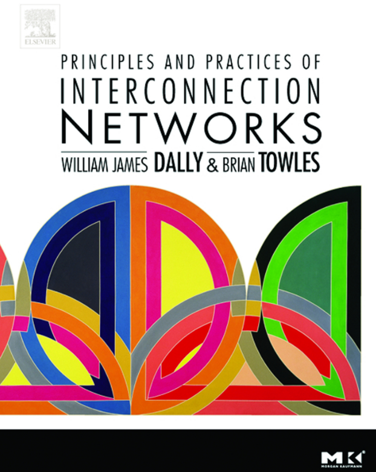
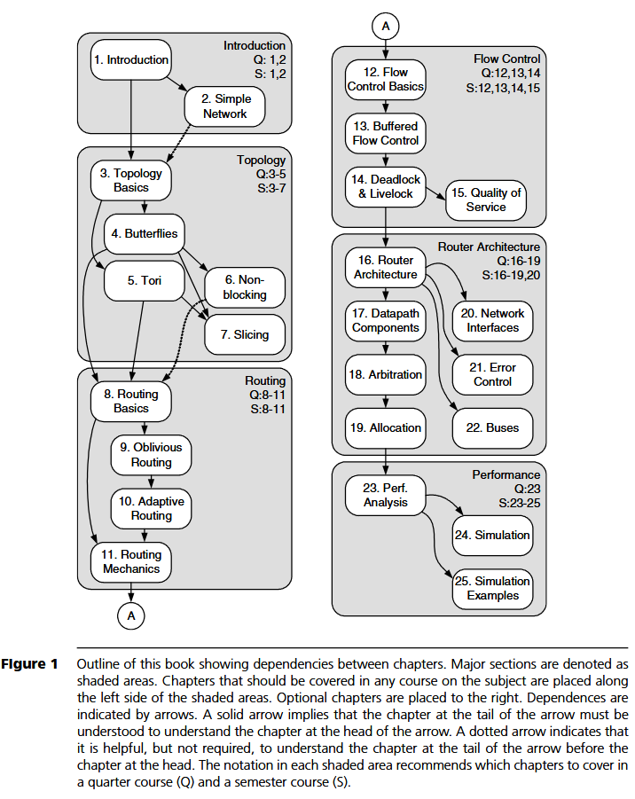

# BookSim 学习笔记（0）——专栏介绍

<p align="center">
    
</p>

> **BookSim Notes**
>
> 从《Principles and Practices of Interconnection Networks》出发，
> 系统学习互连网络（Interconnection Network）理论，并结合 BookSim 源码理解现代 NoC 的设计与实现。

---

# 为什么写这个专栏

近年来，随着 NoC（Network-on-Chip）、Chiplet、AI Accelerator、高性能计算（HPC）等方向的发展，互连网络（Interconnection Network）已经成为计算机体系结构中不可或缺的一部分。

对于很多刚接触这一领域的同学来说，学习过程通常会遇到几个问题：

- 理论知识零散，缺乏系统性的学习路线；
- 阅读论文时，大量涉及 Routing、Flow Control、Virtual Channel 等概念，却不了解其设计初衷；
- 想阅读 BookSim 源码，却发现需要扎实的互连网络基础；
- 能够运行仿真实验，却难以理解实验结果背后的设计原理。

因此，我希望借助阅读 **《Principles and Practices of Interconnection Networks》** 这本经典教材，对互连网络相关知识进行系统梳理，并结合 BookSim 模拟器的实现，将理论知识与工程实践联系起来。

本系列既是一份学习笔记，也是一次完整的源码阅读记录。

---

# 为什么选择这本书

《Principles and Practices of Interconnection Networks》由 William J. Dally 和 Brian Towles 编写，是互连网络领域最具代表性的教材之一。

全书不仅介绍了互连网络设计的基本理论，同时也涵盖了大量经典案例（Case Study）、设计经验以及性能分析方法，其内容几乎覆盖了现代互连网络设计涉及的主要问题，包括：

- 网络拓扑（Topology）
- 路由算法（Routing）
- 流量控制（Flow Control）
- 路由器微架构（Router Architecture）
- 仲裁与资源分配（Arbitration & Allocation）
- 网络接口（Network Interface）
- 性能分析（Performance Analysis）
- 网络仿真（Simulation）

全书共 **25 个章节**，按照知识依赖关系逐步展开，最终形成完整的互连网络知识体系。:contentReference[oaicite:0]{index=0}

---

# 本专栏的目标

整个系列不会逐句翻译原书，而是在尊重原书章节组织的基础上：

- 梳理每一章的核心知识；
- 补充必要的背景知识和推导过程；
- 结合近年来 NoC 与片上互连的发展进行适当扩展；
- 分析这些理论在 BookSim 中的具体实现。

希望最终能够建立如下学习路径：

```text
教材理论
      │
      ▼
理解设计思想
      │
      ▼
BookSim源码实现
      │
      ▼
网络性能分析
      │
      ▼
开展自己的研究工作
```

---

# 本系列内容安排

本系列将严格按照原书章节顺序进行整理，每一篇对应一个 Chapter。



## Part 0：专栏介绍

| 序号 | 文件名               | 内容             |
| ---- | -------------------- | ---------------- |
| 00   | `00_introduction.md` | 专栏介绍（当前） |

---

## Part 1：Introduction

| Chapter   | 文件名                                           |
| --------- | ------------------------------------------------ |
| Chapter 1 | `01_introduction_to_interconnection_networks.md` |
| Chapter 2 | `02_a_simple_interconnection_network.md`         |

介绍互连网络的发展背景、应用场景以及一个简单互连网络的完整设计过程。

---

## Part 2：Topology

| Chapter   | 文件名                        |
| --------- | ----------------------------- |
| Chapter 3 | `03_topology_basics.md`       |
| Chapter 4 | `04_butterfly_networks.md`    |
| Chapter 5 | `05_torus_networks.md`        |
| Chapter 6 | `06_non_blocking_networks.md` |
| Chapter 7 | `07_slicing_and_dicing.md`    |

重点讨论各种经典网络拓扑及其性能分析。

---

## Part 3：Routing

| Chapter    | 文件名                    |
| ---------- | ------------------------- |
| Chapter 8  | `08_routing_basics.md`    |
| Chapter 9  | `09_oblivious_routing.md` |
| Chapter 10 | `10_adaptive_routing.md`  |
| Chapter 11 | `11_routing_mechanics.md` |

介绍路由算法的基本思想及实现方式。

---

## Part 4：Flow Control

| Chapter    | 文件名                        |
| ---------- | ----------------------------- |
| Chapter 12 | `12_flow_control_basics.md`   |
| Chapter 13 | `13_buffered_flow_control.md` |
| Chapter 14 | `14_deadlock_and_livelock.md` |
| Chapter 15 | `15_quality_of_service.md`    |

重点介绍流量控制、虚拟通道、死锁避免及 QoS 等内容。

---

## Part 5：Router Architecture

| Chapter    | 文件名                             |
| ---------- | ---------------------------------- |
| Chapter 16 | `16_router_architecture.md`        |
| Chapter 17 | `17_router_datapath_components.md` |
| Chapter 18 | `18_arbitration.md`                |
| Chapter 19 | `19_allocation.md`                 |
| Chapter 20 | `20_network_interfaces.md`         |
| Chapter 21 | `21_error_control.md`              |
| Chapter 22 | `22_buses.md`                      |

介绍现代路由器的微架构设计及网络接口实现。

---

## Part 6：Performance & Simulation

| Chapter    | 文件名                       |
| ---------- | ---------------------------- |
| Chapter 23 | `23_performance_analysis.md` |
| Chapter 24 | `24_simulation.md`           |
| Chapter 25 | `25_simulation_examples.md`  |

学习如何评价互连网络性能，以及如何利用仿真验证设计方案。

---

# 每篇文章的组织形式

为了保持整个系列风格统一，每一篇文章均采用如下结构：

```text
本章导读

1. 背景介绍
2. 基本概念
3. 核心原理
4. 数学分析（必要时）
5. 经典案例（Case Study）
6. 与现代NoC的联系
7. BookSim中的实现

本章总结

下一章预告
```

其中 **"BookSim中的实现"** 是本系列区别于教材阅读笔记的重要特色，将结合源码分析对应理论在 BookSim 中的实现方式。

---

# 面向读者

本系列适合以下读者：

- 学习 Network-on-Chip（NoC）
- 阅读 BookSim 源码
- 从事互连网络相关科研
- 学习计算机体系结构
- 希望系统理解 Interconnection Network 的设计思想

默认读者具有计算机组成原理或计算机体系结构的基础知识。

---

# 阅读建议

建议按照章节顺序阅读。

虽然每一篇都尽量保持相对独立，但由于后续章节建立在前面章节的基础之上，因此按照原书顺序学习能够获得最佳阅读体验。

对于已经具有一定基础的读者，也可以根据研究方向直接查阅对应章节。

---

# 最后

互连网络是一门兼具理论深度与工程实践价值的研究领域。

本系列希望以《Principles and Practices of Interconnection Networks》为主线，在系统梳理互连网络理论的同时，结合 BookSim 模拟器的实现，逐步建立起从**基础概念**到**源码分析**再到**性能评估**的完整知识体系。

希望这些学习笔记不仅能够帮助自己加深理解，也能够为后来者提供一份系统、易读且便于实践的参考资料。

---

<a href="01_introduction_to_interconnection_networks.md">下一篇：Chapter 1 —— Introduction to Interconnection Networks</a>