# BookSim学习笔记（1）——互连网络导论（Introduction to Interconnection Networks）

> 对应教材 Chapter 1：Introduction to Interconnection Networks

---

# 写在前面

从这一篇开始，我们正式进入《Principles and Practices of Interconnection Networks》的阅读。

很多介绍 NoC（Network-on-Chip）的文章，一开始便会介绍 Mesh、Torus、Virtual Channel、Wormhole Routing 等具体技术。然而，本书并没有这样安排，而是先回答三个最基本的问题：

- 什么是互连网络（Interconnection Network）？
- 为什么现代计算机需要互连网络？
- 一本关于互连网络的教材，应该学习哪些内容？

事实上，这三个问题构成了整本书的逻辑起点。理解了第一章，后续关于 Topology、Routing、Flow Control、Router Architecture 等章节便有了统一的认识框架。

---

# 1 什么是互连网络

在讨论具体技术之前，首先要回答一个根本问题：互连网络究竟是什么？它和我们熟悉的总线、以太网有什么区别？Dally 在开篇给出了精准的定义：**互连网络是一种可编程的共享通信系统，用于在多个终端之间传输数据**。这个定义里有两个关键词：「共享」与「可编程」。

所谓共享，是指所有终端分时复用同一套物理链路与交换资源，而非每个终端对之间都拉专用连线；所谓可编程，是指网络的连接关系不是固定的，可以在不同时刻为不同的终端对建立数据通路。

这里Network承担三件事情：

① 建立连接（Connection）

② 路径选择（Routing）

③ 数据转发（Forwarding）

所以：

> **Network本身就是一个可编程的数据交换系统。**

## Figure 1\.1 Functional view of an interconnection network

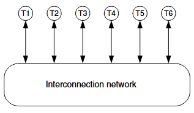

### 图示背景

这是全书的第一张图，也是对互连网络最抽象的功能建模。作者在开篇引入这张图，是为了先剥离所有具体的硬件细节，让读者从功能本质上理解互连网络：它就是一个连接多个终端的黑盒，负责把数据从任意源终端送到任意目的终端。后续所有的拓扑、路由、流控技术，本质上都是在实现这个黑盒的不同方案。

### 图示解析

图中展示了 6 个终端（Terminal，图中标注为 T1\~T6），通过双向通道连接到一个统一的互连网络模块。每个通道两端都有箭头，表示数据可以双向传输：终端既可以向网络发送数据，也可以从网络接收数据。

- 终端是广义的通信端点：它可以是处理器核心、存储器控制器、I/O 接口，也可以是路由器的线卡、整个计算节点，取决于我们讨论的网络尺度。

- 通道是信息传输的物理载体：可以是芯片内的金属连线、板级的差分信号线、机柜间的电缆，也可以是长距光纤。

- 网络本体是共享的交换资源：它内部有大量的交换节点和链路，可以同时建立多条互不冲突的通信路径。

### 原理分析

互连网络的核心价值，来自于**资源共享带来的利用率提升**。我们可以做一个简单的对比：

- 如果采用专用布线，6 个终端两两全互连需要 6×5=30 条单向通道。每个通道大部分时间都是空闲的，资源利用率极低，而且引脚和布线成本随终端数量平方增长，扩展性极差。

- 如果采用总线，所有终端共享一条通道，同一时刻只能有一对终端通信，带宽成为系统瓶颈，无法支持并发传输。

- 而互连网络通过交换节点构建共享的交换矩阵，允许多对终端同时通信，只要它们的路径不冲突。这既解决了专用布线成本高的问题，也解决了总线并发度低的问题。

从更本质的角度看，互连网络是用「时分复用 \+ 空间复用」的方式，把昂贵的通信资源池化，用统计复用的增益换取更低的单位带宽成本。这和云计算里的资源池化思想异曲同工。

### 工程意义

这个抽象模型具有极强的普适性，覆盖了从毫米级到公里级的所有互连场景：

- **片上网络（NoC）**：终端是 CPU 核心、GPU SM、缓存分区、内存控制器、PCIe 控制器，网络是芯片内的金属连线构成的交换网格。

- **Chiplet 互连**：终端是不同的裸片（Die），网络是封装内的硅通孔（TSV）或重布线层（RDL）通道。

- **系统级互连**：终端是服务器节点，网络是 InfiniBand 或 RoCE 交换机构成的胖树网络。

- **电信交换**：终端是光线路卡，网络是交换机内部的交换结构。

无论尺度如何变化，互连网络的核心问题和设计方法论是共通的。这也是为什么本书的理论既能指导芯片设计，也能指导超级计算机和数据中心网络建设。

### 本图小结

这张图是全书最基础的功能模型。读者需要抓住「共享、可编程、并发传输」三个核心特征，建立对互连网络的抽象认知。所有后续的技术细节，都是围绕如何高效、可靠、低成本地实现这个模型展开的。

### ⭐⭐⭐ 干货总结

请记住一句话：

> **Interconnection Network = Shared Communication Infrastructure**

后面整本书都围绕这句话展开。

---

# 2 互连网络的典型应用场景

不存在放之四海而皆准的「最优网络」，所有设计取舍都源于场景需求。Dally 在第一章详细介绍了三类最经典的应用场景：处理器 \- 存储器互连、I/O 互连、分组交换结构。三者的需求差异极大，也催生了不同的技术路线。

## 2\.1 处理器 \- 存储器互连

处理器 \- 存储器互连是并行计算机诞生以来最经典的互连场景，它的核心任务是连接多个处理器和多个存储器，让任意处理器都能访问任意存储单元。

### Figure 1\.2 Processor\-Memory Interconnect Architectures

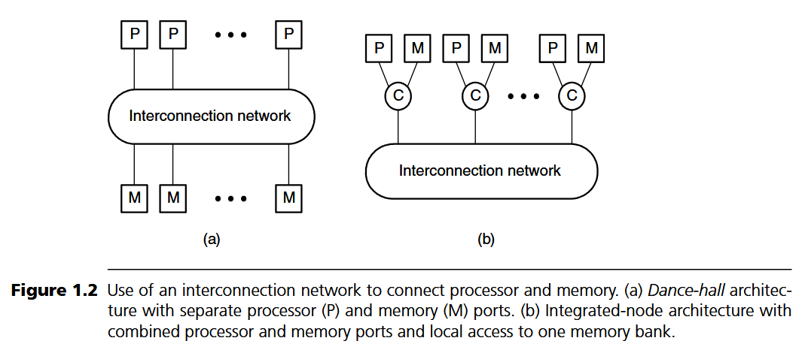

#### 图示背景

作者给出了两种典型的处理器 \- 存储互连架构，代表了两种截然不同的设计哲学。理解这两种架构的取舍，是理解并行计算机互连设计的起点。

#### 图示解析

图 \(a\) 是**舞厅架构（Dance\-hall Architecture）**：处理器集群和存储器集群分别位于网络的两侧，像舞厅里男女分站两边一样。所有处理器访问所有存储器都必须经过互连网络，没有本地内存的概念。
图 \(b\) 是**集成节点架构（Integrated Node Architecture）**：每个节点同时包含处理器和本地存储器，处理器访问本地内存不需要经过网络，只有访问远端节点的存储器时才使用网络。

#### 原理分析

舞厅架构的优点是访存延迟均匀，编程模型简单，属于典型的均匀访存（UMA）模型。但它的缺点也非常明显：所有访存流量都要跨越网络，对网络的二分带宽要求极高，系统规模很难做大。
集成节点架构则利用了**访存的空间局部性**：绝大多数内存访问都会命中本地缓存和本地内存，只有少量跨节点访问需要走网络。这就大幅降低了对网络带宽的压力，让系统可以扩展到成千上万的节点。这也是后来分布式共享内存（DSM）、NUMA 架构成为主流的根本原因。
当然，集成节点架构也带来了访存延迟不一致的问题：访问本地内存快，访问远端内存慢。这就要求操作系统和应用程序做亲和性调度，尽量把数据和计算放在同一个节点上，才能发挥最佳性能。

#### 工程意义

这两种架构的演变至今仍在继续：

- 今天的多核 CPU、GPU，本质上就是缩小版的集成节点架构：每个计算单元有自己的 L1/L2 缓存，通过 NoC 访问共享的 L3 缓存和内存控制器。

- 近年来兴起的内存池化、分解式内存（Disaggregated Memory），则是在向舞厅架构回归：计算资源和内存资源分离，通过高速光互连连接，目标是提升内存资源利用率，降低数据中心的 TCO。
  技术的发展总是螺旋上升的，但底层的设计逻辑从未改变：在局部性和扩展性之间做权衡。

#### 本图小结

两种架构对应两种设计思路：舞厅架构追求均匀延迟与简单编程模型，集成节点架构利用局部性换取扩展性与低成本。理解这一权衡，就能理解并行计算机互连的发展脉络。

### ⭐⭐⭐ 干货总结

Dance Hall：

```
CPU
↓
Network
↓
Memory
```

优点：Memory访问均匀

缺点：Network压力最大。

------

Integrated Node：

```
CPU+Memory
↓
Network
↓
CPU+Memory
```

优点：Locality好。

现代NUMA、NoC、Chiplet几乎都是这种思想。

一句话：

> **尽量让Local Traffic留在本地。**

---

### Figure 1\.3 Packet Formats for Processor\-Memory Interconnect

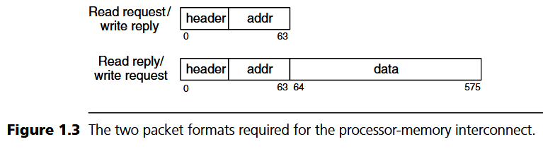

#### 图示背景

讲完架构，就要看流量长什么样。处理器和内存之间的交互消息有固定的格式，这种「双峰」消息长度分布，是处理器 \- 存储互连最显著的流量特征，也直接决定了网络的优化方向。

#### 图示解析

图中展示了两种分组格式：

1. **短分组**：仅包含头部（Header）和地址（Addr）字段，总长度 64 位。对应读请求、写应答这类控制消息，只需要传递地址和命令，不需要携带数据载荷。

2. **长分组**：在头部和地址之外，增加了 512 位的数据字段，总长度 576 位。对应读响应、写请求这类数据消息，需要传输完整的缓存行（Cache Line）。

64 位地址 \+ 512 位数据，正好对应了当时主流计算机的缓存行大小。这种「短控制包 \+ 长数据包」的双峰分布，是处理器 \- 存储流量的标志性特征。

#### 原理分析

双峰消息长度带来了两个不同的优化目标，它们之间往往存在张力：

- 对于短控制消息，\\*\\* 头部延迟（Header Latency）\\*\\* 是核心指标。发出一个读请求后多久能收到第一个字节的响应，直接决定了缓存缺失延迟，进而影响处理器的 IPC。这类消息对延迟极度敏感，对带宽不敏感。

- 对于长数据消息，\\*\\* 带宽（Throughput）\\*\\* 是核心指标。要尽快把整个缓存行传输完毕，减少序列化延迟。这类消息对带宽敏感，延迟的相对影响更小。

这种差异催生了很多关键技术：比如虚通道技术，可以分离控制流和数据流，避免短消息被长消息阻塞；比如优先仲裁机制，给短控制消息更高的优先级。
另外，固定长度的消息也让我们可以做很多硬件优化：比如预分配缓冲、固定流水线深度、简化流控逻辑等。

#### 工程意义

几十年过去了，缓存行大小基本稳定在 64 字节，双峰消息长度的特征也从未改变。

- PCIe 事务层包（TLP）分为短的请求 / 应答包和长的数据包，地址和数据分离传输。

- ARM 的 AMBA AXI 总线，单独拆分地址通道和数据通道，本质上也是在处理同样的流量特征。

- AI 加速器的 NoC 中，权重、激活值、控制信号的长度差异巨大，同样遵循类似的设计思路。

可以说，只要冯・诺依曼架构还是主流，这种地址 \- 数据分离的双峰流量特征就会一直存在，对应的网络优化方法也就一直有效。

#### 本图小结

消息长度分布不是无关紧要的参数，它直接决定了序列化延迟的占比，进而影响拓扑、流控、路由器架构的选型。做网络设计，第一步永远是搞清楚你的流量长什么样。

---

## 2\.2 I/O 互连

第二类典型应用是 I/O 互连，主要用于连接主机适配器和大量外围设备，比如磁盘阵列、网卡等。

### Figure 1\.4 Typical I/O Network

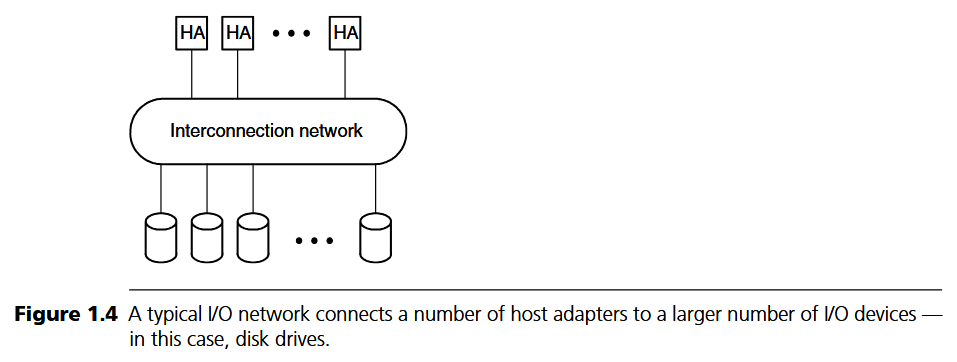

#### 图示背景

这是一个典型的存储 I/O 网络示意图。和处理器 \- 内存互连不同，I/O 场景的两侧终端是不对等的：一侧是少量的高速主机适配器，另一侧是大量的低速 I/O 设备。这种不对称性，决定了 I/O 网络的核心设计思路。

#### 图示解析

图的上方是主机适配器（Host Adapter），连接主机的内存总线，数量少、单端口带宽高；下方是大量的 I/O 设备（比如磁盘），数量多、单设备带宽低；互连网络位于中间，负责任意主机到任意设备的连接。
网络内部通常会做**集中（Concentration）**：把多个低速的设备端口汇聚到少数高速的网络端口上，提升链路利用率。

#### 原理分析

I/O 流量最显著的特征是**峰值带宽与平均带宽的比值极高**。
以机械硬盘为例，峰值连续传输速率可以达到上百 MB/s，但由于寻道延迟、旋转延迟的存在，随机访问的平均带宽可能只有几 MB/s，峰均比可以达到几十倍。如果按照峰值带宽给每个设备配一条独立的高速链路，成本会极高，而且链路绝大多数时间都是空闲的。
因此 I/O 网络的核心设计哲学是**统计复用**：把多个低速端口集中起来，共享高速的网络链路。只要多个设备不同时跑满峰值，整体带宽就足够。用牺牲极端情况下的延迟确定性，换取大幅的成本降低。
另外，I/O 场景对延迟的容忍度很高。磁盘本身的访问延迟就是毫秒级的，网络增加几微秒的延迟完全可以忽略不计。这也给了网络设计很大的优化空间，可以用更复杂的调度、更充分的复用来降低成本。

#### 工程意义

集中与统计复用的思想，至今主导着存储和 I/O 互连领域：

- NVMe over Fabrics（NoF）、SAS 交换机、PCIe 交换网络，本质上都是 I/O 互连网络，核心都是做端口汇聚和统计复用。

- 一个 PCIe 4\.0 x16 的上游端口，可以带几十块 NVMe SSD，就是利用了 SSD 业务的峰均比。

- 云计算里的网络超卖、存储超卖，底层逻辑和 I/O 互连的集中思想完全一致：用业务的统计特性换成本。

#### 本图小结

I/O 互连的关键词是「集中」与「统计复用」。当流量峰均比高、延迟不敏感时，用确定性换成本是非常划算的设计取舍。

---

## 2\.3 分组交换结构

第三类典型应用是分组交换结构（Packet Switching Fabric），也就是路由器、交换机内部的交换矩阵。这是互连网络另一个大的应用领域，和并行计算领域并行发展，相互借鉴。

### Figure 1\.5 Packet Switching Fabric

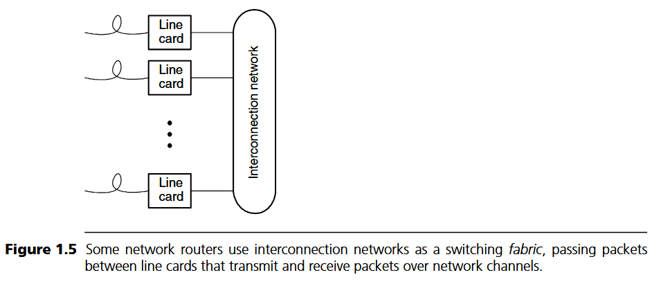

#### 图示背景

这张图展示了交换结构在路由器中的位置。作者引入这个场景，是为了说明另一类极端需求：高负载持续运行、严格的服务质量、非干扰性。这些需求催生了 Clos 网络、调度算法等一大批经典技术。

#### 图示解析

图中两侧是线卡（Line Card），中间是作为交换结构的互连网络。

- 输入线卡负责接收外部链路上的分组，做协议处理、查表、分类、流量管理，然后送入交换结构。

- 交换结构负责把分组从任意输入线卡转发到对应的输出线卡，只做高速的数据交换，不做复杂的协议处理。

- 输出线卡负责排队、调度，把分组发送到外部输出链路上。

交换结构是路由器的「数据平面核心」，它的容量直接决定了整台路由器的交换能力。

#### 原理分析

交换结构场景有三个非常独特的需求，和另外两个场景差异显著：

1. **高负载持续运行**：输入线卡通常以接近线速的速率持续注入流量，网络长期工作在高负载状态。这就要求网络的饱和吞吐量必须足够高，不能在高负载下出现吞吐量崩溃。

2. **非干扰性（Non\-interfering）**：发往不同输出端口的流量之间不能互相影响。比如某个输出端口拥塞了，不能导致其他不相关的输出端口吞吐量下降。这对路由算法和流控机制提出了非常高的要求。

3. **可接受的丢包率**：和处理器 \- 内存互连绝对不能丢包不同，交换结构可以容忍极低概率的丢包，因为上层的 TCP 协议会处理重传。这给设计留下了优化空间。

正是这些需求，催生了 Clos/Beneš网络、输入输出排队、iSLIP 调度算法等经典技术。交换结构领域也是互连网络技术最密集、迭代最快的领域之一。

#### 工程意义

今天我们数据中心里的所有交换机、路由器，核心都是一个分组交换结构。

- 博通、英伟达的高端交换芯片，单片容量可以达到 51\.2Tbps 甚至更高，内部就是用多级 Clos 拓扑实现的交换结构。

- 网络处理器（NPU）内部的模块之间，也广泛使用 NoC 作为交换结构。

- 电信领域的 OTN 交换机、核心路由器，内部的交换矩阵同样遵循这些基本原理。

交换结构领域发展出的很多技术，比如调度算法、QoS 机制，后来也被反哺到了片上网络和高性能计算互连领域，推动了整个学科的发展。

#### 本图小结

交换结构是吞吐量导向的场景，追求高负载下的稳定性、流量隔离与服务质量。它是互连网络技术的重要发源地，很多经典算法都诞生于此。

---

# 3 互连网络设计的五大核心问题

了解了应用场景和需求差异之后，我们需要把互连网络的设计问题拆解成可研究、可优化的具体维度。Dally 把整个领域拆解为五大核心问题：**拓扑（Topology）、路由（Routing）、流控（Flow Control）、路由器架构（Router Architecture）、性能评价（Performance Evaluation）**。

这五个维度不是孤立的，而是层层递进、相互影响的：拓扑是物理基础，路由决定路径选择，流控决定资源的时序分配，路由器架构是硬件实现，性能评价是检验设计好坏的标准。全书的章节安排，就是严格按照这个逻辑展开的。

## 拓扑：网络的骨架

其实Topology真正决定的是四件事情：

① Network Diameter：最远两个节点距离，影响Latency。

② Bisection Bandwidth：网络中间能通过多少数据，影响Throughput。

③ Cost：需要多少Router、多少Wire。

④ Path Diversity：两点之间有多少条路径，决定Adaptive Routing是否有意义。

拓扑是网络中节点和通道的连接方式，也就是物理布线的结构。Mesh、Torus、Butterfly、Fat Tree、Clos，都是不同的拓扑类型。
拓扑决定了网络的根本属性：

- **直径**：最远两个节点之间的跳数，决定了最坏情况下的延迟下限。
- **二分带宽**：把网络切成两半需要切断的通道总带宽，决定了吞吐量的理论上限。
- **节点度**：每个路由器连接的通道数，决定了引脚成本和实现复杂度。
- **路径多样性**：两点之间可选的路径数量，决定了负载均衡能力和容错能力。

拓扑是互连网络设计的第一步，也是最顶层的决策。一旦拓扑定了，整个网络的性能天花板和成本底线就基本确定了。后面的路由、流控做得再好，也不可能突破拓扑给出的理论上限。

## 路由：路径的选择

路由算法决定了一个分组从源到目的地，具体选择哪条路径。拓扑只是给出了所有可能的路径，路由算法负责在这些路径中做选择。
路由算法有不同的类型：

- **确定性路由**：源和目的确定了，路径就唯一确定了，比如 Torus 的维度序路由。优点是实现简单，缺点是负载均衡能力差，面对特定流量模式容易出现瓶颈。

- **Oblivious 路由**：不感知网络状态，通过随机化等方式平均负载，比如 Valiant 路由。优点是无需网络状态信息，最坏情况性能有保障；缺点是平均情况下可能比最优路由多走一些路。

- **自适应路由**：实时感知网络拥塞状态，动态选择更空闲的路径。优点是负载均衡能力强，吞吐量高；缺点是实现复杂，容易出现死锁和活锁问题。

路由算法的好坏，直接决定了拓扑的理论性能能发挥出多少。差的路由算法会让大量通道空闲，少数通道成为瓶颈，浪费宝贵的二分带宽。好的路由算法，则能在各种流量模式下都保持较好的负载均衡。

## 流控：资源的时序管理

如果说路由决定了走哪条路，流控就决定了什么时候上路、什么时候停下来等。流控的核心是管理网络中的缓冲和带宽资源，避免拥塞、死锁和资源浪费。
流控的粒度有粗有细：存储转发以整个分组为单位，虫洞流控以微片（Flit）为单位，虚通道流控以虚通道为单位。粒度越细，资源利用率越高，延迟越低，但实现逻辑也越复杂。
流控还和死锁、活锁问题紧密相关。不合理的路由和流控组合，很容易出现循环等待，导致死锁，整个网络卡住不动。死锁避免是流控设计中最核心也最精妙的部分。
可以说，流控是互连网络里最有技术含量的部分，也是最容易出问题的部分。很多实际系统的性能瓶颈，都出在流控设计上。

## 路由器架构：算法的硬件落地

拓扑、路由、流控都是算法和架构层面的，最终都要落到具体的路由器硬件实现上。路由器架构研究的，就是用什么样的微架构来高效实现这些算法，同时满足时序、面积、功耗的约束。
路由器流水线分几级？缓冲放在输入还是输出？分配器用什么仲裁算法？交叉开关用什么结构？这些都是路由器架构要解决的问题。
路由器的单跳延迟和吞吐率，直接决定了整个网络的零负载延迟和饱和吞吐量。很多时候拓扑选得再好，路由器实现得很差，整体性能也会一塌糊涂。尤其是在片上网络场景下，路由器的面积和功耗占比很高，架构优化的意义非常重大。

## 性能评价：设计好坏的标尺

设计做得好不好，不能凭感觉，必须有科学、量化的评价方法。
性能评价首先要确定指标：延迟、吞吐量、功耗、成本、面积、容错能力，都是核心指标。其次要确定负载：用什么样的流量模式测试？均匀随机、位反转、转置，还是真实业务 trace？不同流量模式下，网络的表现可能天差地别。
评价方法也分很多种：分析建模用排队论、概率方法，快速得到趋势性结论；精确评估用离散事件仿真；最终验证用 FPGA 原型或者实际芯片。
性能评价不是简单跑个分，它需要严谨的实验设计，避免各种测量陷阱，才能得到可信的结论。

---

# 4 流控初步认识：为什么切通流控是现代网络的基础

流控是互连网络最核心的概念之一，也是初学者最容易理解偏差的部分。Dally 在第一章就拿出了存储转发和切通流控的时空对比图，就是为了用最直观的方式，让读者理解不同流控机制的本质差异。

## Figure 1\.10 Store\-and\-Forward vs Cut\-Through Flow Control

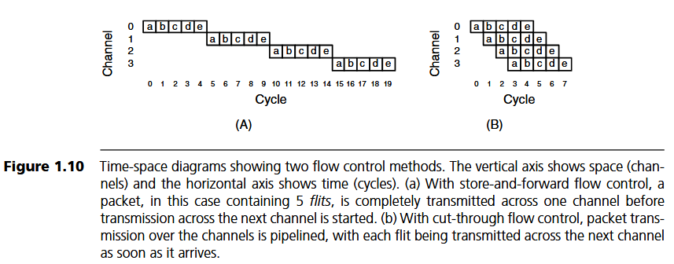

### 图示背景

这是流控部分的经典入门图示。作者用时空图（Space\-Time Diagram）的形式，把抽象的流控过程可视化，让读者一眼就能看出两种流控机制的延迟差异。理解了这张图，就能理解为什么现代网络无一例外都选择了切通式的流控。

### 图示解析

时空图的纵轴代表空间，也就是不同的传输通道（图中有四条通道，对应四跳链路）；横轴代表时间，以时钟周期为单位。图中的每个小方块代表一个**微片（Flit，Flow Control Digit）**，也就是流控调度的最小单位。整个分组被分成了 5 个 flit。

- **左图：存储转发（Store\-and\-Forward）流控**
  每一个节点必须等整个分组的所有 5 个 flit 全部接收完毕、完整存储在本地缓冲区之后，才能开始向下一个节点发送。因此我们可以看到，每个通道上的传输是完全串行的：第一跳跳 5 个周期，第二跳再 5 个周期，以此类推。整个分组走完四跳，需要大约 20 个周期。

- **右图：切通（Cut\-Through）流控**
  不需要等整个包收完，只要分组的头部 flit 到达当前节点，完成路由计算，并且下游通道有可用资源，就可以立即向下游转发。后面的 flit 跟着头部，依次流水线式地向前推进。从图中可以看到，四跳的传输在时间上是重叠的，整个分组走完四跳，只需要大约 8 个周期。

### 原理分析

我们可以用公式更精确地量化两者的延迟差异。假设分组长度为 L 比特，单通道带宽为 b 比特每秒，路径跳数为 H，单跳路由器延迟为 t\_r 秒。
对于存储转发流控，总延迟为：

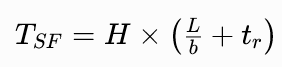

每一跳都要付出完整的序列化延迟加上路由器处理延迟，延迟和跳数呈线性关系。
对于切通流控，总延迟为：

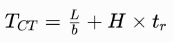

序列化延迟只需要付一次，剩下的跳数都可以流水线进行。当跳数 H 很大的时候，切通的延迟优势是压倒性的。

当然，切通不是没有代价的。存储转发的缓冲是按整个分组分配的，管理简单；而切通需要按 flit 粒度管理缓冲，控制逻辑更复杂。另外，如果路径中间发生拥塞，分组会停在半路上，占用沿途所有通道的缓冲，就像虫子钻过隧道一样 —— 这就是「虫洞流控（Wormhole Flow Control）」名字的由来。这种特性会带来队头阻塞、死锁等一系列问题，后续的虚通道等技术，就是为了解决这些问题而诞生的。

### 工程意义

切通 / 虫洞流控的思想，现在已经渗透到了几乎所有的互连网络领域：

- 超级计算机的定制互连网络，全部采用基于 flit 的虫洞流控 \+ 虚通道。

- 数据中心的 RoCE 网络，本质上也是切通的思想，支持小包快速转发。

- 芯片内的 NoC，几乎清一色采用虫洞流控，因为它对缓冲的需求最小，适合片上实现。

- 甚至 PCIe 总线，也采用了切通的思想，数据包被拆分成物理层符号，流水线传输。

存储转发现在基本只在跳数极少、实现成本要求极低，或者链路错误率很高的场景使用。在绝大多数高性能互连场景，切通 / 虫洞都是绝对的主流。

### 本图小结

这张图是理解现代流控机制的钥匙。读者需要掌握时空图的读法，理解切通流控的流水线本质，记住核心结论：多跳网络中，切通流控把延迟从「跳数 × 包传输时间」降低到了「包传输时间 \+ 跳数 × 单跳延迟」，这是互连网络性能的一次质的飞跃。

---

# 5 路由器架构初步认识：三大核心模块

所有的拓扑、路由、流控算法，最终都要实现在路由器硬件里。路由器是互连网络的基本功能单元，理解了路由器的内部结构，才算真正理解了网络的工作原理。

## Figure 1\.11 Simplified Router Architecture

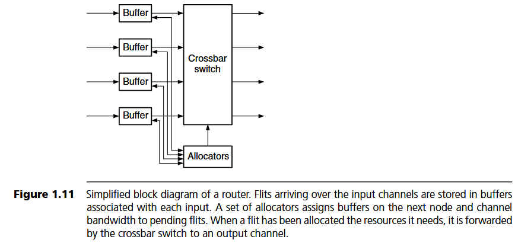

### 图示背景

这是一个最经典的输入缓冲路由器（Input\-Buffered Router）的简化框图。作者在开篇就拿出这个模型，是为了给后续所有路由器架构的讨论建立一个基准。后续所有的优化，比如虚通道、输出缓冲、投机路由、流水线化，都是在这个基础模型上扩展而来的。

### 图示解析

这个简化的路由器主要由三个核心部分组成：输入缓冲、交叉开关、分配器。

1. **输入缓冲（Input Buffer）**
   和每个输入通道对应，flit 从输入通道进来之后，首先进入缓冲区排队，等待分配输出资源。为什么需要缓冲？因为如果输出端口正忙，flit 不能直接通过，就需要找个地方暂时存着，否则就会丢失。缓冲是网络中用来吸收突发流量、解决资源竞争的核心手段。

2. **交叉开关（Crossbar Switch）**
   路由器的数据通路核心。一个 n 输入 n 输出的交叉开关，可以在同一时刻建立多条互不冲突的连接，把任意输入端口连接到任意输出端口。它的作用就是把来自不同输入的 flit，送到正确的输出端口上去。

3. **分配器（Allocators）**
   路由器的控制核心，也是最「聪明」的部分。分配器负责解决资源竞争：当多个输入的 flit 都想去同一个输出端口时，谁先走？分配器会按照某种仲裁规则（比如轮询、固定优先级），把输出端口的使用权授予其中一个输入，其他的继续在输入缓冲里等待。

一个 flit 的完整转发流程是：到达输入端口 → 存入输入缓冲 → 头部 flit 进行路由计算，得到输出端口 → 向分配器请求该输出端口 → 分配器仲裁，授予请求 → flit 通过交叉开关到达输出端口 → 离开路由器，进入下一条链路。

### 原理分析

为什么采用输入缓冲的结构？核心原因是**成本**。
如果把缓冲放在输出端，每个输出端口需要能够同时接收所有输入端口发来的数据，缓冲的带宽要求非常高，实现成本昂贵。而输入缓冲的结构，每个缓冲区只服务一个输入端口，带宽要求低，实现简单。
但输入缓冲路由器有一个天生的缺陷：**队头阻塞（Head\-of\-Line Blocking, HOL）**。如果一个队列的第一个 flit 因为输出端口忙而被阻塞，那么队列后面的 flit 即使想去其他空闲的输出端口，也无法前进，被队头的 flit 挡住了。理论上，均匀随机流量下，输入缓冲路由器的最大吞吐量只能达到约 58% 的线速，剩下的带宽都被队头阻塞浪费了。
解决队头阻塞最经典的方案就是**虚通道（Virtual Channel, VC）**：把一个物理通道拆分成多个虚通道，每个虚通道有自己独立的缓冲区。这样，即使一个虚通道的队头阻塞了，其他虚通道的 flit 还可以绕过它，继续前进。

另外，分配器的设计也是大学问。简单的轮询仲裁器实现容易，但性能一般；复杂的矩阵仲裁器、波前分配器性能好，但硬件开销大、时序紧张。对于大规模的路由器，分配器的延迟往往是整个路由器流水线的瓶颈。

### 工程意义

输入缓冲 \+ 交叉开关 \+ 分配器的模型，是所有现代路由器的鼻祖。

- 博通、英伟达的商用交换芯片，内部本质上都是输入缓冲路由器，加上了复杂的调度器和 QoS 机制。

- ARM 的 CoreLink NoC、Synopsys 的 DesignWare NoC，也都是基于类似的结构。

- BookSim 模拟器中的路由器模型，就是严格按照这个结构实现的。

对于硬件工程师来说，路由器架构设计的核心权衡，就是在面积、功耗、时序的约束下，尽可能提升分配器的效率和缓冲的利用率，让网络的实际吞吐量尽可能接近理论上限。

### 本图小结

这张图建立了路由器的基本功能模型：输入缓冲解决排队问题，交叉开关解决通路问题，分配器解决竞争问题。三者配合，完成分组的转发功能。理解了这个模型，就掌握了路由器架构的入门钥匙。

### ⭐⭐⭐ 干货总结

现代Router可以抽象成：

```
Input Buffer
↓
Allocator
↓
Crossbar
↓
Output
```

BookSim、Noxim、Garnet 几乎都是这个结构。

---

# 6 如何评价一个互连网络：延迟 \- 吞吐量曲线

做工程设计，不能凭感觉说好坏，必须有统一的、量化的评价标准。对于互连网络来说，最核心、最通用的评价框架，就是**延迟 \- 吞吐量曲线（Latency\-Throughput Curve）**。

## Figure 1\.12 Latency vs Offered Traffic Curve

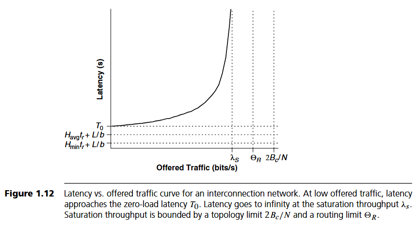

### 图示背景

这张图是互连网络性能评价的「母图」。所有关于性能的讨论，本质上都是在讨论这条曲线的形状和位置。作者在图中标注了三层性能界限，从右到左依次收窄，非常清晰地展示了拓扑、路由、流控三层设计决策是如何一步步影响最终性能的。

### 图示解析

横轴是**注入流量（Offered Traffic）**，表示每个终端注入网络的数据速率，通常归一化到通道带宽，取值从 0 到 1。纵轴是**平均延迟（Latency）**，表示一个分组从源终端注入到目的终端接收完成所经过的总时间。
曲线上有两个关键的特征点：

1. **零负载延迟（Zero\-load Latency, T₀）**：当注入流量趋近于 0 时，网络几乎没有拥塞，分组不需要排队等待，此时的延迟就是零负载延迟。这是网络能达到的最低延迟，由序列化延迟、跳数延迟、链路传播延迟三部分组成。

2. **饱和吞吐量（Saturation Throughput, λ\_s）**：随着注入流量增加，网络中的拥塞越来越严重，延迟急剧上升。当流量增加到某一个临界点之后，延迟趋向于无穷大，网络无法再承载更多的流量，这个临界点的吞吐量就是饱和吞吐量。它代表了网络的最大承载能力。

图中还标注了三层性能上限，从右到左依次收紧：

- **拓扑上限（2Bc/N）**：由网络的二分带宽决定，是理论上能达到的最大吞吐量，假设流量完美均匀分布，所有通道同时满负荷。

- **路由上限（Θ\_R）**：由路由算法的负载均衡能力决定。如果路由算法不能把流量均匀分配到所有通道上，就会出现部分通道拥塞、部分通道空闲的情况，饱和吞吐量会低于拓扑上限。

- **实际饱和点（λ\_s）**：由流控和路由器的实现效率决定。即使路由分配得很均匀，如果流控机制有缺陷，或者路由器的分配器效率不高，会导致通道出现空闲周期，实际吞吐量还会进一步降低。

### 原理分析

这条曲线的形状，本质上是排队论规律的体现。我们可以用最简单的 M/M/1 排队模型来理解：服务强度 ρ 越高，平均排队延迟就越大，公式为：

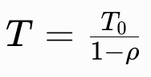

当 ρ 趋近于 1 时，延迟趋近于无穷大。互连网络是一个多队列的排队系统，整体曲线形状和 M/M/1 一致：低负载时延迟平缓增长，接近饱和时延迟呈指数级上升。

三层约束的关系非常重要，它告诉我们做网络优化的正确顺序：先看瓶颈在哪里。

- 如果瓶颈在拓扑，二分带宽不够，那再怎么优化路由和流控也没用，吞吐量上不去。

- 如果拓扑足够好，但路由算法差，负载不均衡，那优化路由算法的收益最大。

- 如果路由已经做得很好了，再去优化流控和路由器微架构，提升资源利用率。

很多初学者容易犯的错误，就是只看零负载延迟，或者只看峰值吞吐量，这都是片面的。一个好的网络设计，应该在低负载时有低延迟，同时在高负载时有高吞吐量。不同的场景有不同的偏好：实时控制系统更看重低负载延迟，大数据吞吐量场景更看重饱和吞吐量。

### 工程意义

延迟 \- 吞吐量曲线是工业界和学术界评价互连网络的金标准。不管是发表论文，还是做产品选型，大家都会拿出这条曲线来对比。
在实际的工程设计中，我们通常不会让网络工作在饱和点附近，因为那里延迟太高，而且不稳定。一般会留一定的余量，比如工作在饱和吞吐量的 70%\~80%，这个区域叫「舒适区」，延迟比较稳定，也有足够的余量应对突发流量。
数据中心的网络设计就是典型的思路：宁可多花一点成本建更胖的网络，也要让工作点落在低延迟区域，保证业务的延迟稳定性。而超级计算机的互连则更追求极致的饱和吞吐量，因为科学计算应用通常持续满负载运行。

另外，这条曲线也是性能仿真的核心输出。我们用 BookSim 跑仿真，最主要的结果就是这条曲线：在不同的注入率下，测量平均延迟，然后画出来。通过分析曲线的形状和饱和点，我们就能定位网络的瓶颈在哪里，进而指导优化方向。

### 本图小结

延迟 \- 吞吐量曲线是互连网络性能的统一评价框架。零负载延迟和饱和吞吐量是两个核心指标，拓扑、路由、流控三层约束层层收紧，共同决定了曲线的位置和形状。学会看这条曲线、用这条曲线分析问题，是每个互连网络从业者的基本功。

### ⭐⭐⭐ 干货总结

所有Network优化，最终都会落到这条曲线上。

优化目标只有三个：

① 更低Zero-load Latency

② 更高Saturation Throughput

③ 更平滑的Latency增长

所以，Topology、Routing、Flow Control、Router

其实都在回答：

> 如何让Figure1.12更漂亮？

这也是整本书真正的主线。

---

# 7 BookSim 中的对应关系

理论学习最终要落地到实践。BookSim 是目前学术界最主流的开源互连网络仿真器，也是很多人入门学习、做研究的工具。这里我们把本章讲到的核心概念和 BookSim 中的模块、参数对应起来，帮助大家完成从理论到实践的过渡。

| 教材概念             | BookSim 对应模块 / 参数               | 说明                                                         |
| -------------------- | ------------------------------------- | ------------------------------------------------------------ |
| 拓扑（Topology）     | `topology/` 目录                      | 实现了 mesh、torus、fly、fat\_tree 等经典拓扑，配置文件中用`topology`参数指定 |
| 路由（Routing）      | `routing/` 目录                       | 实现了 dim\_order、valiant、adaptive 等路由算法，配置文件中用`routing_function`指定 |
| 流控（Flow Control） | `flowcontrol/` 目录                   | 实现了 store\_forward、wormhole、virtual\_channel 三种流控模型 |
| 虚通道（VC）         | `num_vcs` 参数                        | 每个物理通道的虚通道数量                                     |
| 缓冲大小             | `vc_buf_size` 参数                    | 每个虚通道可以容纳的 flit 数量                               |
| 路由器               | `router/` 目录                        | 包含输入单元、虚通道分配器、开关分配器、交叉开关等子模块     |
| 流量模式             | `traffic/` 目录                       | 实现了 uniform、bitrev、transpose、neighbor 等多种流量模式   |
| 注入率               | `injection_rate` 参数                 | 对应横轴的 Offered Traffic                                   |
| 性能指标             | 仿真输出的`avg_latency`、`throughput` | 对应纵轴延迟和实际吞吐量                                     |

建议大家在学习后续章节的时候，每学一个概念，就去 BookSim 里找找对应的代码，看看具体是怎么实现的。理论结合实践，是学习互连网络最快的方式。

---

# 本章总结

本章作为全书的导论，完成了三件事：
第一，定义了互连网络的基本概念与本质特征 —— 可编程的共享通信系统，用统计复用提升通信资源利用率。
第二，介绍了三大典型应用场景及其需求差异：处理器 \- 存储互连追求低延迟，I/O 互连追求低成本高集中比，交换结构追求高吞吐与 QoS。需求决定设计，这是贯穿全书的主线。
第三，拆解了互连网络设计的五大核心问题：拓扑、路由、流控、路由器架构、性能评价，并给出了延迟 \- 吞吐量曲线作为统一的评价框架。

后续的所有章节，都是在这个框架下，对每个具体问题的深入展开。比如接下来的几章会详细讲各种拓扑的性质、设计方法和案例；然后讲路由算法的分类、设计和死锁避免；然后讲流控机制；然后讲路由器的微架构设计；最后讲性能分析方法和仿真技术。

---

## 本章核心结论（Key Takeaways）

**1. 核心定义与适用范围**

互连网络本质是可编程共享数据交换通信基础设施，依靠资源统计复用提升带宽利用率，用以替代传统总线与专用布线；应用场景覆盖处理器 - 存储互连、I/O 互连、交换机交换结构，不局限于片上 NoC，Chiplet、数据中心交换芯片等现代硬件均适用整套设计理论。互连网络的本质不是“连线”，而是**“共享的数据交换系统（Shared Communication Infrastructure）”**

**2. 三大场景差异化设计需求**

①处理器 - 存储互连：延迟高度敏感，流量呈长短包双峰特征，短包优化头部延迟、长包侧重传输带宽；

②I/O 互连：流量峰均比极高，采用集中式架构、靠统计复用降低硬件成本，对延迟容忍度高；

③交换结构：追求高持续吞吐、流量非干扰隔离，具备 QoS 管控能力，允许极低概率丢包。

**3. 完整设计五层主线（学习 BookSim 仿真统一框架）**

标准化完整设计流程：拓扑 (Topology)→路由 (Routing)→流控 (Flow Control)→路由器架构 (Router Architecture)→性能评价 (Performance Analysis)，五大维度层层约束、相互影响，共同决定网络整体性能；

各模块核心职能：拓扑定义节点链路连接方式，路由决策数据包传输路径，流控管控数据包转发时序，路由器架构完成整套功能硬件落地。

**4. 拓扑与路由关键设计指标**

路径多样性是拓扑、路由设计核心考量，同时决定网络负载均衡能力与故障容错上限；网络性能存在三层递进约束：拓扑划定理论吞吐上限，路由决定链路负载均衡水平，流控 + 路由器硬件实现决定实际可达到的资源利用率。

**5. 主流流控机制**

现代高性能互连普遍采用**分组交换（Packet Switching）**，以 Flit（微片）作为调度粒度；切通 / 虫洞流控依靠流水线转发大幅削减多跳传输延迟，是当前主流流控技术。

**6. 路由器硬件基础架构**

经典输入缓冲路由器包含**输入缓冲、交叉开关、分配器**三大核心组件，分配器为控制核心，其仲裁分配效率直接决定路由器吞吐上限。

**7. 统一性能评测标准**

**延迟 - 吞吐量曲线（Figure 1.12）**是互连网络通用性能评价框架，核心指标为**零负载延迟、饱和吞吐量**；所有优化都在追求更低的零负载延迟、更高的饱和吞吐量以及更好的中高负载性能。

---

<a href="02_a_simple_interconnection_network.md">下一篇：Chapter 2 —— A Simple Interconnection Network</a>

