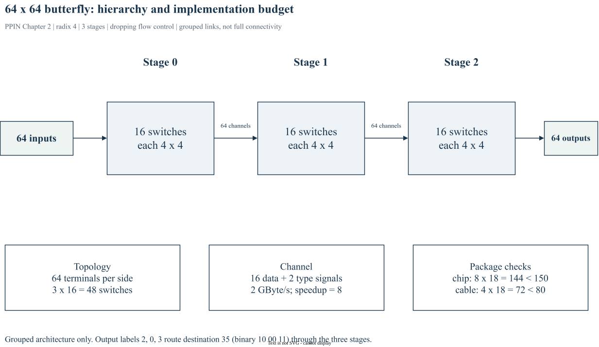

# Chapter 2｜A Simple Interconnection Network

> 原书：William J. Dally、Brian Towles，*Principles and Practices of Interconnection Networks*（Morgan Kaufmann，2004），第 2 章，印刷页 25–44。本地参考 PDF 的页序为印刷页 +27。以下为中文学习整理，保留原书全部目录小节的编号与标题，不是逐句翻译。BookSim2 对照版本固定为 [`28f4329`](https://github.com/booksim/booksim2/tree/28f43299f1706a3160ffac721ca461d74eb6e618)。

[专栏导读](00_Introduction.md) · [原书目录与页码对照](appendix-reading-map.md)

## 2.1 Network Specifications and Constraints

*原书印刷页 25。*

本章的对象是 64 输入、64 输出网络。原书表 2.1 给出每输入峰值与平均带宽 0.25 GByte/s、100 ns 消息延迟目标、4–64 byte 消息、随机流量，并允许丢弃。表 2.2 再限定引脚、板级信号和线缆预算。这些是本案例的设计假设，并非通用 NoC spec。先列需求，再决定架构，避免从某个熟悉的 Mesh 配置反推需求。

## 2.2 Topology

*原书印刷页 27。*

选择 radix-4、三级 butterfly：`log_4(64)=3`，每级 16 个 4×4 switch，共 48 个。内部带宽取 2 GByte/s，相对端点需求为 8 倍 speedup。每 channel 用 16 data signals 加 2 control signals；每芯片 4 入 4 出共 144 signals，满足 150 的上限。板边界 32×18=576，小于 750；每缆 4×18=72，小于 80。拓扑、带宽和封装必须一起算。



*图 2-A：依据原书 §2.1–2.2、表 2.1–2.2 整理的分级示意；非完整 64×64 连线图。每级 16 个 switch，箭头表示连接束。原创建模图，可编辑源文件见图片清单。*

## 2.3 Routing

*原书印刷页 31。*

六位目的地址分成三个两位字段，逐级选择 0–3 输出。原书输入 12 到输出 35 的例子，目的地址 `100011₂` 给出输出序列 2、0、3。每级消费最高两位并移位，使各级可复用相同译码电路。它是 destination-tag routing；地址字段次序必须与级间连线一致。

## 2.4 Flow Control

*原书印刷页 32。*

这是 dropping flow control。每个 phit 为 16 位数据与 2 位类型：H=11、P=10、N=00。header 后的 payload 连续发送，空闲用 null 表示；新 header 遇到已占用输出时，该 packet 被丢弃，由更高层负责重发。这里没有给 packet 配置逐跳 VC 缓冲，也没有使用 credit。不要把它改写成第 13 章的 wormhole 示例。

## 2.5 Router Design

*原书印刷页 33。*

4×4 router 由输入寄存器、输出多路选择器、header 移位逻辑、输出寄存器和每输出一个 allocator 组成。分配状态要跨 payload 保持，并在 header/null 边界按协议更新。输入和输出共 8×18=144 个寄存位；原书的门数估算依赖当时器件，不能直接用来预测现代 NoC 面积。

## 2.6 Performance Analysis

*原书印刷页 36。*

按原书式 (2.2)，在输入独立、均匀选择输出的简化模型下，`p[i+1] = 1 - (1-p[i]/4)^4`。从 p0=0.125 连算三级得到约 0.119、0.114、0.109；未重发时约 12.6% 输入丢失。重发又增加内部 offered load，形成反馈。必须同时区分外部新消息率、含重发的输入率和成功交付率，不能用一个 injection rate 代替三者。

```python
# 原书式 (2.2) 的独立均匀输入近似；无重发，不是 BookSim 运行结果
p = 0.125
for stage in range(3):
    p = 1 - (1 - p / 4) ** 4
    print(stage + 1, p)
```

外部新流量 λ、第一次注入 p0 和级间 p1、p2、p3 的口径必须分开。若加入重发，在稳定状态要求 p3=λ，而 p0 包含失败重试。

## 2.7 Exercises

*原书印刷页 42。*

自拟练习：按 18 signals/channel 重新核对 chip、board 和 cable 三个预算；再把 speedup 从 8 改成 4，列出带宽、丢弃率和延迟需要重新验证的条件。用上述递推式计算无重发时三级输出，检查单位归一化。这里不复刻原书题目与答案。

## BookSim2 源码对照与适用边界

固定版本节选（仅去除行末空白），省略外围上下文：[查看 src/networks/fly.cpp 第 45–58 行](https://github.com/booksim/booksim2/blob/28f43299f1706a3160ffac721ca461d74eb6e618/src/networks/fly.cpp#L45-L58)。

```cpp
void KNFly::_ComputeSize( const Configuration &config )
{
  _k = config.GetInt( "k" );
  _n = config.GetInt( "n" );

  gK = _k; gN = _n;

  _nodes = powi( _k, _n );

  // n stages of k^(n-1) k x k switches
  _size     = _n*powi( _k, _n-1 );

  // n-1 sets of wiring between the stages
  _channels = (_n-1)*_nodes;
```

`KNFly::_ComputeSize` 给出 butterfly 的端点、switch 和级间 channel 数，适合核对本章结构。BookSim2 常规 IQRouter 是有缓冲的性能模型；即使 topology=fly，也不会自动实现本章 H/P/N、丢弃及重发协议。因此这里只对应拓扑，不能宣称重现原书整个设计。

## 来源与继续阅读

- 原书第 2 章，pp. 25–44；各节页码已逐项列出。案例与原书公式均以本地参考书为依据。
- [BookSim2 固定版本源码](https://github.com/booksim/booksim2/tree/28f43299f1706a3160ffac721ca461d74eb6e618)，节选保留[上游许可](/notes/booksim-notes/source-license.txt)。
- [全书章节/源码路线与图片来源](appendix-reading-map.md)。新增图均附 `.drawio` 源文件，插图是结构说明，不是测量波形。

[上一篇](01_introduction_to_interconnection_networks.md) · [下一篇](03_topology_basics.md) · [专栏目录](/booksim-series.html)
