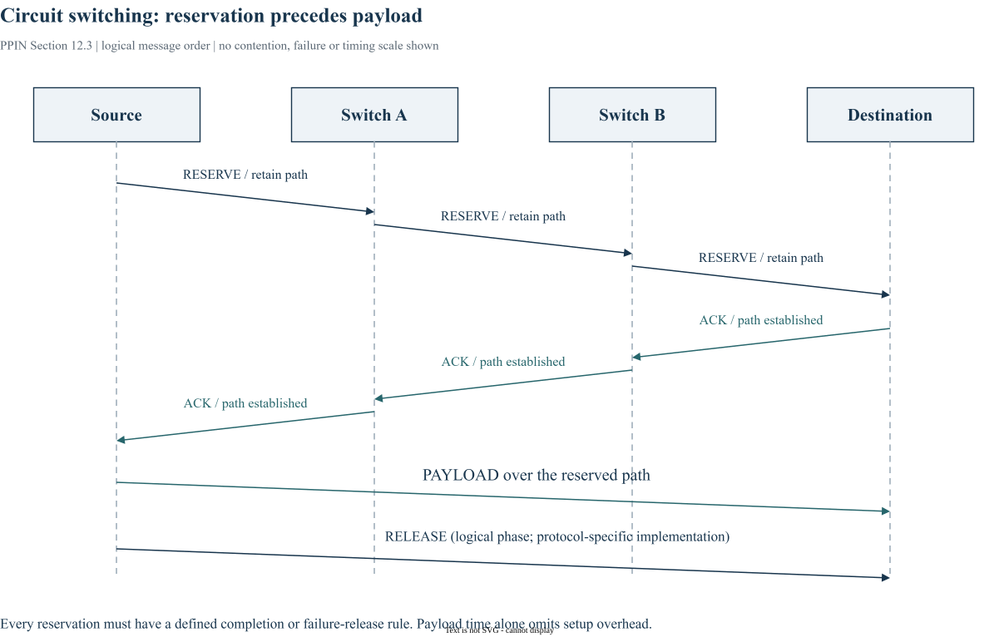

# Chapter 12｜Flow Control Basics

> 原书：William J. Dally、Brian Towles，*Principles and Practices of Interconnection Networks*（Morgan Kaufmann，2004），第 12 章，印刷页 221–232。本地参考 PDF 的页序为印刷页 +27。以下为中文学习整理，保留原书全部目录小节的编号与标题，不是逐句翻译。BookSim2 对照版本固定为 [`28f4329`](https://github.com/booksim/booksim2/tree/28f43299f1706a3160ffac721ca461d74eb6e618)。

[专栏导读](00_Introduction.md) · [原书目录与页码对照](appendix-reading-map.md)

## 12.1 Resources and Allocation Units

*原书印刷页 222。*

流控管理 channel 带宽、连接状态和缓冲等资源。message 是通信语义单位，packet 是路由组织单位，flit 是流控单位，phit 是一次物理传输单位。单位之间可以一对多，不能默认一 flit 恰等于一个物理周期。

## 12.2 Bufferless Flow Control

*原书印刷页 225。*

bufferless flow control 遇到争用时可以丢弃或偏转。丢弃需要检测失败并重发；偏转需要保持目的可达并证明最终前进。标准 butterfly 只有唯一源宿路径，随意换输出会离开可达路径，因此不能把 Torus 的 deflection 直接照搬过去。本节承接第 2 章，而不是提前讨论 credit。

## 12.3 Circuit Switching

*原书印刷页 228。*

circuit switching 先请求并保留路径，再返回确认，随后发送数据并释放。没有 payload 排队缓冲不代表没有控制状态或建立等待。原书简化无 flight-time 模型给出 `T0=3H·tr+L/b` 和 channel busy time `Tb0=2H·tr+L/b`；这依赖所述建立/确认/释放协议，不能套作 wormhole 公式。



*图 12-A：依据原书 §12.3 重新组织的消息时序；纵向表示先后顺序，非按比例时间轴，未画出争用和失败重试。控制阶段不能从端到端成本中删去。*

## 12.4 Bibliographic Notes

*原书印刷页 230。*

本节对应原书 p. 230 的文献脉络。继续查阅时应回到原书该节和书末 Bibliography，区分最初提出的方法、后续实现与本文使用的 BookSim2 版本。本文末尾源码链接是实现对照，不作为原书历史论述的替代依据。

## 12.5 Exercises

*原书印刷页 230。*

自拟练习：为同一个 4×4 switch 分别画出“争用后丢弃”和“先建立电路再发数据”的消息过程，标明请求、确认、数据及释放。说明两种方案分别如何检测失败、如何回收资源，以及哪些成本不能由一次 payload latency 覆盖。

## BookSim2 源码对照与适用边界

固定版本节选（仅去除行末空白），省略外围上下文：[查看 src/channel.hpp 第 90–93 行](https://github.com/booksim/booksim2/blob/28f43299f1706a3160ffac721ca461d74eb6e618/src/channel.hpp#L90-L93)。

```cpp
template<typename T>
void Channel<T>::Send(T * data) {
  _input = data;
}
```

Channel 的 Send 表示向周期模型交付对象，不是在请求一条电路。固定版本的常规 IQRouter/Channel 路径不提供本章电路建立、ACK、独占数据阶段及释放的完整协议。credit 的对照放在第 13 章；如果要研究本章两种流控，应先实现相应状态和测量边界。

## 来源与继续阅读

- 原书第 12 章，pp. 221–232；各节页码已逐项列出。案例与原书公式均以本地参考书为依据。
- [BookSim2 固定版本源码](https://github.com/booksim/booksim2/tree/28f43299f1706a3160ffac721ca461d74eb6e618)，节选保留[上游许可](/notes/booksim-notes/source-license.txt)。
- [全书章节/源码路线与图片来源](appendix-reading-map.md)。新增图均附 `.drawio` 源文件，插图是结构说明，不是测量波形。

[上一篇](11_routing_mechanics.md) · [下一篇](13_buffered_flow_control.md) · [专栏目录](/booksim-series.html)
