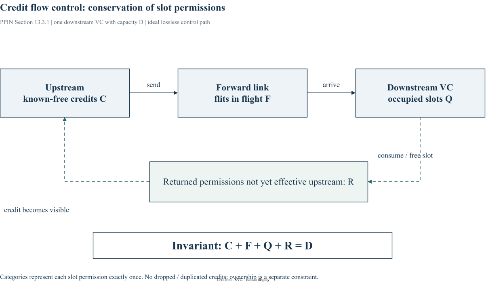

# Chapter 13｜Buffered Flow Control

> 原书：William J. Dally、Brian Towles，*Principles and Practices of Interconnection Networks*（Morgan Kaufmann，2004），第 13 章，印刷页 233–256。本地参考 PDF 的页序为印刷页 +27。以下为中文学习整理，保留原书全部目录小节的编号与标题，不是逐句翻译。BookSim2 对照版本固定为 [`28f4329`](https://github.com/booksim/booksim2/tree/28f43299f1706a3160ffac721ca461d74eb6e618)。

[专栏导读](00_Introduction.md) · [原书目录与页码对照](appendix-reading-map.md)

## 13.1 Packet-Buffer Flow Control

*原书印刷页 234。*

packet-buffer flow control 在节点提供报文级缓冲。store-and-forward 等完整包到达再发送，virtual cut-through 可在下游有足够报文空间时提前转发。比较必须保持包长和缓冲容量的口径一致。

## 13.2 Flit-Buffer Flow Control

*原书印刷页 237。*

flit-buffer 方法以更细粒度缓冲降低存储需求，但 packet 会同时占住多个节点资源。一个受阻 head 如何影响后续 flit，是理解阻塞传播的起点。

### 13.2.1 Wormhole Flow Control

*原书印刷页 237。*

wormhole 把 packet 串在少量逐跳缓冲中，head 被堵时身体可能跨越多跳。低存储成本伴随着 channel 保持、队头阻塞和更复杂依赖。

### 13.2.2 Virtual-Channel Flow Control

*原书印刷页 239。*

VC 在同一物理 channel 上保存多个逻辑队列与状态，让另一个 packet 有机会利用空闲带宽。VC 不增加物理链路的峰值传输率，而且 VC 所有权和槽位容量是两种约束。

## 13.3 Buffer Management and Backpressure

*原书印刷页 245。*

backpressure 表达下游可接受能力，必须覆盖发送在途、下游处理和许可返回的延迟。先画资源守恒，再决定计数器和门限。

### 13.3.1 Credit-Based Flow Control

*原书印刷页 245。*

credit 记录下游可用槽。若 flit 大小 Lf bit、链路 b bit/s、完整 credit 往返 tcrt，则连续满速所需 F 满足 `F≥tcrt·b/Lf`（原书式 13.1，实际取整）。往返包含处理时间，不能只算线长。



*图 13-A：依据原书 §13.3.1 的 credit 原理绘制。四类互斥状态以槽位许可为单位；“返回在途”包括已释放但尚未在上游生效的许可。虚线是返回控制路径。*

若每周期 1 flit、完整往返 6 周期，深度至少 6 才可能无竞争满速；深度 2 的量级上限约为 2/6 flit/cycle。该简化估算还忽略仲裁和 packet 所有权，不是一般网络吞吐预测。

### 13.3.2 On/Off Flow Control

*原书印刷页 247。*

on/off 用停止和恢复门限降低反馈次数。发出 stop 后仍会有在途数据抵达，因此门限必须留出反馈延迟所需的安全容量。

### 13.3.3 Ack/Nack Flow Control

*原书印刷页 249。*

ack/nack 允许先发再确认，失败需要重传或恢复。它与不丢数据的 credit 许可语义不同，需要额外处理重复、在途状态和重发存储。

## 13.4 Flit-Reservation Flow Control

*原书印刷页 251。*

flit-reservation 通过预先安排未来传输机会，协调数据和控制。学习时必须把预约时刻、实际数据到达时刻与缓冲占用分别标出。

### 13.4.1 A Flit-Reservation Router

*原书印刷页 252。*

预约型 router 除数据通路外，还需要表示未来服务时隙的状态。不可把当前空闲直接解释为未来已预约可用。

### 13.4.2 Output Scheduling

*原书印刷页 253。*

output scheduling 避免未来同一输出的冲突，需限定服务时刻和已有预约的优先关系。

### 13.4.3 Input Scheduling

*原书印刷页 255。*

input scheduling 确保计划中的输入数据能按时送达输出；只解决输出冲突不足以保证整个 router 调度可实现。

## 13.5 Bibliographic Notes

*原书印刷页 256。*

本节对应原书 p. 256 的文献脉络。继续查阅时应回到原书该节和书末 Bibliography，区分最初提出的方法、后续实现与本文使用的 BookSim2 版本。本文末尾源码链接是实现对照，不作为原书历史论述的替代依据。

## 13.6 Exercises

*原书印刷页 256。*

自拟练习（不复制原书习题）：固定总槽位，对比2×8和4×4，并使用一个目的端阻塞、另一个目的端可前进的流量。记录每流时延、实际接收速率和阻塞来源；uniform 平均值不足以确认 HOL 传播改善。另一组再单独增加总容量，区分切分与容量效应。

## BookSim2 源码对照与适用边界

固定版本节选（仅去除行末空白），省略外围上下文：[查看 src/buffer_state.cpp 第 599–602 行](https://github.com/booksim/booksim2/blob/28f43299f1706a3160ffac721ca461d74eb6e618/src/buffer_state.cpp#L599-L602)。

```cpp
    if(_wait_for_tail_credit && !_vc_occupancy[vc] && _tail_sent[vc]) {
      assert(_in_use_by[vc] >= 0);
      _in_use_by[vc] = -1;
    }
```

这一分支在发送过 tail 且占用降到零时释放 VC 所有者，体现了等待 tail credit 的策略。阅读时还要看 SendingFlit 中不等待的分支，否则会错误地认为所有配置都采用同一个释放时点。VC availability 与 capacity 在 VA / SA 中分别参与过滤。

## 来源与继续阅读

- 原书第 13 章，pp. 233–256；各节页码已逐项列出。案例与原书公式均以本地参考书为依据。
- [BookSim2 固定版本源码](https://github.com/booksim/booksim2/tree/28f43299f1706a3160ffac721ca461d74eb6e618)，节选保留[上游许可](/notes/booksim-notes/source-license.txt)。
- [全书章节/源码路线与图片来源](appendix-reading-map.md)。新增图均附 `.drawio` 源文件，插图是结构说明，不是测量波形。

[上一篇](12_flow_control_basics.md) · [下一篇](14_deadlock_and_livelock.md) · [专栏目录](/booksim-series.html)
