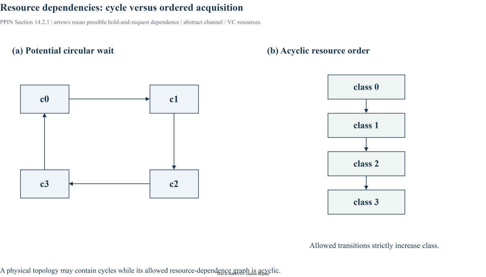

# Chapter 14｜Deadlock and Livelock

> 原书：William J. Dally、Brian Towles，*Principles and Practices of Interconnection Networks*（Morgan Kaufmann，2004），第 14 章，印刷页 257–284。本地参考 PDF 的页序为印刷页 +27。以下为中文学习整理，保留原书全部目录小节的编号与标题，不是逐句翻译。BookSim2 对照版本固定为 [`28f4329`](https://github.com/booksim/booksim2/tree/28f43299f1706a3160ffac721ca461d74eb6e618)。

[专栏导读](00_Introduction.md) · [原书目录与页码对照](appendix-reading-map.md)

## 14.1 Deadlock

*原书印刷页 258。*

死锁是参与者持有资源并等待另一组永不释放的资源。要先定义 agent 和资源粒度，再画依赖；某个 timeout 未触发不等于网络无死锁。

### 14.1.1 Agents and Resources

*原书印刷页 258。*

agent 可以是 packet 或协议事务，resource 可以是 channel、VC、buffer 或协议队列。不同抽象产生不同依赖图。

### 14.1.2 Wait-For and Holds Relations

*原书印刷页 259。*

holds 表达已占有，wait-for 表达等待。等待图中的闭环需要结合不可抢占和保持规则分析，不能只从物理连线有环就下结论。

### 14.1.3 Resource Dependences

*原书印刷页 260。*

resource-dependence 将 packet 可能连续持有和申请的资源连边，适合证明所有合法执行都不会形成环。

### 14.1.4 Some Examples

*原书印刷页 260。*

环形路径加保持等待可能形成循环依赖；即使物理 Mesh 无 wrap，允许任意转弯也可构造依赖环。应画 channel/VC 节点而不是 router 节点。

### 14.1.5 High-Level (Protocol) Deadlock

*原书印刷页 262。*

请求等待响应、响应又等待被请求占满的缓冲，是协议级风险。仅证明数据网络的 channel dependency 无环还不够。

## 14.2 Deadlock Avoidance

*原书印刷页 263。*

avoidance 通过限制可申请资源，预先排除循环等待。每种规则都会改变路径集合、VC 需求或可用带宽，应同时检查性能代价。

### 14.2.1 Resource Classes

*原书印刷页 263。*

给资源分类并规定单调使用顺序，可破除依赖环；分组后还需检查组内依赖和跨类转换。



*图 14-A：原创建模示例，箭头表示持有一个 channel/VC 后允许申请另一个。右图通过删除回边得到严格递增顺序；用于解释证明方法，不表示任意 Torus 仅删除一条物理连接即可完成设计。*

### 14.2.2 Restricted Physical Routes

*原书印刷页 267。*

限制维度次序或部分转弯，可在物理连接仍有环时得到无环的资源依赖。删掉转弯也可能让某些 traffic 的路径选择减少。

### 14.2.3 Hybrid Deadlock Avoidance

*原书印刷页 270。*

混合方案把路由限制与资源分类结合，减少单独使用某种方法的开销；证明需要覆盖两套规则交界。

## 14.3 Adaptive Routing

*原书印刷页 272。*

自适应允许多个候选输出，不能只验证当前选中的一条路径。必须分析全部可能选择及其资源转移。

### 14.3.1 Routing Subfunctions and Extended Dependences

*原书印刷页 272。*

routing subfunction 表示受约束的路由子集；extended dependence 用于描述更一般的申请关系。证明必须与缓冲和转发语义匹配。

### 14.3.2 Duato’s Protocol for Deadlock-Free Adaptive Algorithms

*原书印刷页 276。*

Duato 方法允许自适应部分存在某些依赖，但需要满足定理条件的连通无死锁 escape 子网络，并保证可按规则进入和推进。“预留一个 VC”本身不是充分证明。

## 14.4 Deadlock Recovery

*原书印刷页 277。*

recovery 接受死锁可能发生，再检测和打破它。检测时延、误判、恢复成本和最终前进都要建模。

### 14.4.1 Regressive Recovery

*原书印刷页 278。*

regressive 恢复通过回退或重发释放资源，需要保证重复消息与恢复状态正确。

### 14.4.2 Progressive Recovery

*原书印刷页 278。*

progressive 恢复尝试让部分消息向前推进以解除等待，其备用资源仍需保证可获得。

## 14.5 Livelock

*原书印刷页 279。*

livelock 中消息持续活动却不完成，例如反复偏转。年龄、优先级或限制绕路可帮助前进，但必须说明仲裁和负载假设。

## 14.6 Case Study: Deadlock Avoidance in the Cray T3E

*原书印刷页 279。*

Cray T3E 案例展示如何将死锁避免条件落实到资源组织。阅读时按合法 channel/VC 转移建图，不能以机器长期运行正常替代理论证明。

T3E 把 Duato 型自适应方法与 direction-order 子路由结合。该子路由按 +x、+y、+z、−x、−y、−z 的方向顺序使用资源；Torus 的维内依赖环再由 dateline 和 VC 类别处理。原书还说明节点能容纳最大 packet 的 cut-through 缓冲条件，这影响扩展依赖证明。不能把这些前提删掉后，仅保留“两个 VC 就无死锁”。

## 14.7 Bibliographic Notes

*原书印刷页 281。*

本节对应原书 p. 281 的文献脉络。继续查阅时应回到原书该节和书末 Bibliography，区分最初提出的方法、后续实现与本文使用的 BookSim2 版本。本文末尾源码链接是实现对照，不作为原书历史论述的替代依据。

## 14.8 Exercises

*原书印刷页 282。*

自拟练习（不复制原书习题）：为一个单向环画具体 VC 的等待图，再用两类 VC 和转移限制尝试切断循环。运行时保存 head 所占资源和等待请求的快照；若只因 latency_thres 中止，应先区分性能门槛与真正循环。随机仿真通过不替代对允许转移的论证。

## BookSim2 源码对照与适用边界

固定版本节选（仅去除行末空白），省略外围上下文：[查看 src/booksim_config.cpp 第 197–206 行](https://github.com/booksim/booksim2/blob/28f43299f1706a3160ffac721ca461d74eb6e618/src/booksim_config.cpp#L197-L206)。

```cpp
  // Control assignment of packets to VCs
  _int_map["read_request_begin_vc"] = 0;
  _int_map["read_request_end_vc"] = 5;
  _int_map["write_request_begin_vc"] = 2;
  _int_map["write_request_end_vc"] = 7;
  _int_map["read_reply_begin_vc"] = 8;
  _int_map["read_reply_end_vc"] = 13;
  _int_map["write_reply_begin_vc"] = 10;
  _int_map["write_reply_end_vc"] = 15;

```

默认配置为 read request、write request、read reply 等定义 begin/end VC 区间。部分默认区间相互重叠，并且针对默认 VC 数；改变 num_vcs 或 use_read_write 后必须重新核对，不能把默认值当作任意配置的无死锁保证。该版本也没有像 Constellation 那样在生成前统一验证任意 routing relation 的流程。

## 来源与继续阅读

- 原书第 14 章，pp. 257–284；各节页码已逐项列出。案例与原书公式均以本地参考书为依据。
- [BookSim2 固定版本源码](https://github.com/booksim/booksim2/tree/28f43299f1706a3160ffac721ca461d74eb6e618)，节选保留[上游许可](/notes/booksim-notes/source-license.txt)。
- [全书章节/源码路线与图片来源](appendix-reading-map.md)。新增图均附 `.drawio` 源文件，插图是结构说明，不是测量波形。

[上一篇](13_buffered_flow_control.md) · [下一篇](15_quality_of_service.md) · [专栏目录](/booksim-series.html)
