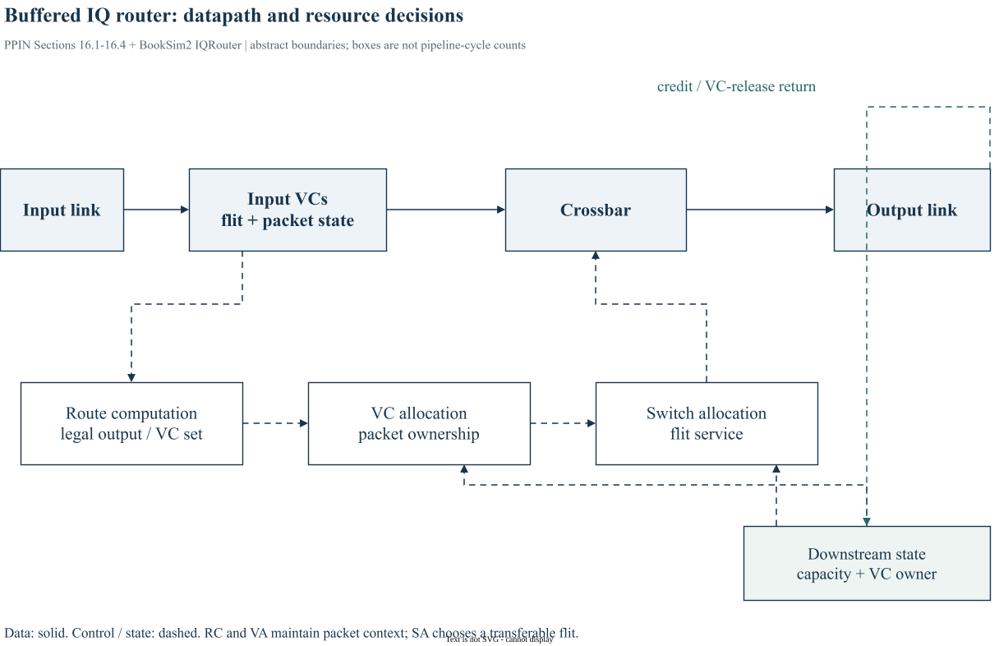

# Chapter 16｜Router Architecture

> 原书：William J. Dally、Brian Towles，*Principles and Practices of Interconnection Networks*（Morgan Kaufmann，2004），第 16 章，印刷页 305–324。本地参考 PDF 的页序为印刷页 +27。以下为中文学习整理，保留原书全部目录小节的编号与标题，不是逐句翻译。BookSim2 对照版本固定为 [`28f4329`](https://github.com/booksim/booksim2/tree/28f43299f1706a3160ffac721ca461d74eb6e618)。

[专栏导读](00_Introduction.md) · [原书目录与页码对照](appendix-reading-map.md)

## 16.1 Basic Router Architecture

*原书印刷页 305。*

基本 router 将数据通路与路由、VC 分配、switch 分配等控制分开。pipeline 是功能和时序的联合设计，不只是把若干方框顺序连接。

### 16.1.1 Block Diagram

*原书印刷页 305。*

输入缓冲保存 flit 与状态，crossbar 搬运获准数据，输出和反馈连接相邻 router。控制选择必须与对应 flit 同步。

### 16.1.2 The Router Pipeline

*原书印刷页 308。*

典型步骤包括接收/写入、RC、VA、SA、ST；具体实现可合并、重叠或旁路。BookSim 的事件安排和 delay 参数一起决定性能，函数调用次数不是流水拍数。



*图 16-A：依据原书 §16.1–16.4 与 BookSim2 IQRouter 职责绘制的抽象架构。实线表示 flit 数据，虚线表示控制或 credit；方框不等于一拍，旁路和推测细节未展开。*

## 16.2 Stalls

*原书印刷页 310。*

stall 可能来自无输出 VC、下游容量不足、输入/输出仲裁失败或 pipeline 占用。检查瓶颈时分别记录阻塞原因，而不是统称 congestion。

## 16.3 Closing the Loop with Credits

*原书印刷页 312。*

credit 把下游缓冲状态反馈到上游。增加流水深度可能增大往返周期，从而需要更多 buffer 才能保持满速；不能独立调 router latency 而忽略反馈环。

## 16.4 Reallocating a Channel

*原书印刷页 313。*

tail 经过后何时允许新 head 占用输出 VC，取决于释放约定。tail 已发送和 tail credit 已返回对应不同边界，必须避免两个 packet 的状态重叠。

## 16.5 Speculation and Lookahead

*原书印刷页 316。*

speculation 提前执行可能失败的分配，失败时需取消；lookahead 提前计算后继路由。二者都可缩短关键路径，但有额外控制、误判或带宽开销。

## 16.6 Flit and Credit Encoding

*原书印刷页 319。*

flit/credit 编码需携带 VC、边界等控制信息，并明确数据与控制同步。BookSim 对象字段不等于物理链路逐位编码，不能据结构体大小估计线宽。

## 16.7 Case Study: The Alpha 21364 Router

*原书印刷页 321。*

Alpha 21364 案例展示 pipeline、缓冲和控制如何组成实际 router。对照其时序和资源组织，理解原书抽象方框如何转化为具体实现。

Alpha 21364 把处理器、一致性硬件、内存控制器和 router 集成到同一芯片。其 router 采用 cut-through，而不是默认把所有 packet 当作普通 wormhole VC 流。原书据此讨论合并 VC/switch allocation 的可能性，并按 phit 跟踪深流水。因此不能把常见五个缩写各设一拍，就声称得到了这颗芯片的模型。

## 16.8 Bibliographic Notes

*原书印刷页 324。*

本节对应原书 p. 324 的文献脉络。继续查阅时应回到原书该节和书末 Bibliography，区分最初提出的方法、后续实现与本文使用的 BookSim2 版本。本文末尾源码链接是实现对照，不作为原书历史论述的替代依据。

## 16.9 Exercises

*原书印刷页 324。*

自拟练习（不复制原书习题）：固定单 flow 和4-flit packet，从 head 的路由队列开始列出每级完成时间。再增加另一个输入竞争同一输出，说明新增等待属于 VA、SA 还是 credit。对 speedup 或 speculation 的比较应同时说明额外存储和模型时序假设。

## BookSim2 源码对照与适用边界

固定版本节选（仅去除行末空白），省略外围上下文：[查看 src/routers/iq_router.cpp 第 226–244 行](https://github.com/booksim/booksim2/blob/28f43299f1706a3160ffac721ca461d74eb6e618/src/routers/iq_router.cpp#L226-L244)。

```cpp
void IQRouter::_InternalStep( )
{
  if(!_active) {
    return;
  }

  _InputQueuing( );
  bool activity = !_proc_credits.empty();

  if(!_route_vcs.empty())
    _RouteEvaluate( );
  if(_vc_allocator) {
    _vc_allocator->Clear();
    if(!_vc_alloc_vcs.empty())
      _VCAllocEvaluate( );
  }
  if(_hold_switch_for_packet) {
    if(!_sw_hold_vcs.empty())
      _SWHoldEvaluate( );
```

先进行 InputQueuing，再按待处理队列启动 RC、VA、SA 和 traversal 的 Evaluate，后半段对应 Update。某队列为空时跳过工作是模拟优化，不代表硬件不存在。读一个 stall 时要找到请求何时被排入、何时被判定可完成、何时真正更新绑定。

## 来源与继续阅读

- 原书第 16 章，pp. 305–324；各节页码已逐项列出。案例与原书公式均以本地参考书为依据。
- [BookSim2 固定版本源码](https://github.com/booksim/booksim2/tree/28f43299f1706a3160ffac721ca461d74eb6e618)，节选保留[上游许可](/notes/booksim-notes/source-license.txt)。
- [全书章节/源码路线与图片来源](appendix-reading-map.md)。新增图均附 `.drawio` 源文件，插图是结构说明，不是测量波形。

[上一篇](15_quality_of_service.md) · [下一篇](17_router_datapath_components.md) · [专栏目录](/booksim-series.html)
