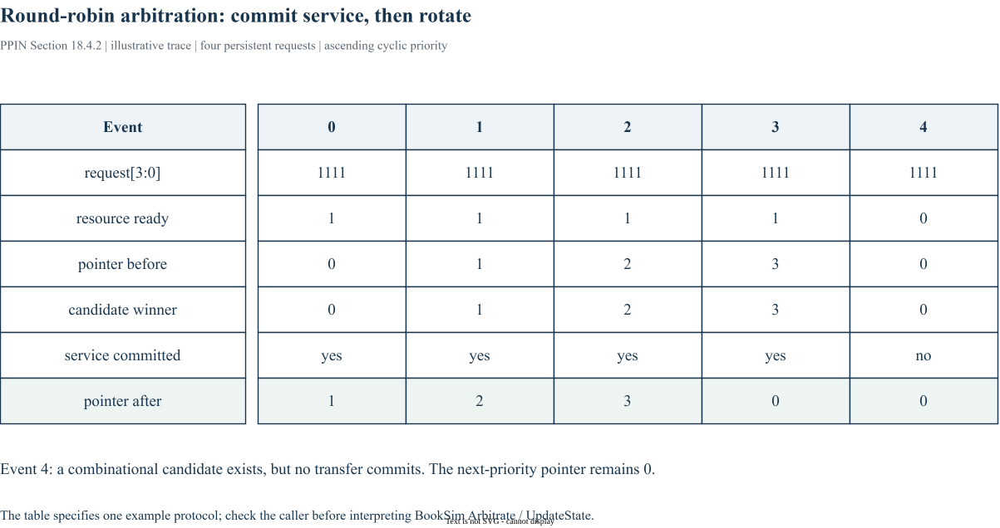

# Chapter 18｜Arbitration

> 原书：William J. Dally、Brian Towles，*Principles and Practices of Interconnection Networks*（Morgan Kaufmann，2004），第 18 章，印刷页 349–362。本地参考 PDF 的页序为印刷页 +27。以下为中文学习整理，保留原书全部目录小节的编号与标题，不是逐句翻译。BookSim2 对照版本固定为 [`28f4329`](https://github.com/booksim/booksim2/tree/28f43299f1706a3160ffac721ca461d74eb6e618)。

[专栏导读](00_Introduction.md) · [原书目录与页码对照](appendix-reading-map.md)

## 18.1 Arbitration Timing

*原书印刷页 349。*

仲裁输入 request 和优先状态，输出至多一个有效 grant。request 的采样、grant 的生效和状态更新必须在时序上对齐；请求胜出未必等于数据已经完成传输。

## 18.2 Fairness

*原书印刷页 351。*

fairness 必须明确持续请求、资源持续可用和服务单位等条件。无饥饿、有限等待以及字节带宽公平是不同属性。

## 18.3 Fixed Priority Arbiter

*原书印刷页 352。*

fixed-priority 可实现为优先编码：`gnt[i] = req[i] & ~OR(req[0..i-1])`（低编号优先）。它能保证 one-hot，却可能让高编号长期饥饿；低延迟与公平性应分开评价。

补充阅读：[SiliconCrafters：Fixed Priority Arbiter](https://www.siliconcrafters.com/post/fixed-priority-arbiter)（2024-03-30）。本文只参考其 prefix-mask 的解释；博客中的教学 RTL 应自行审查组合逻辑和赋值语义，不能当作本专栏已验证的实现。

## 18.4 Variable Priority Iterative Arbiters

*原书印刷页 354。*

可变优先级通过状态改变下一轮顺序，迭代结构则用较简单单元生成选择。更新规则是算法的一部分，不能只读组合选择函数。

### 18.4.1 Oblivious Arbiters

*原书印刷页 354。*

oblivious arbiter 的优先级演进不依赖当前请求的具体拥塞历史，适合规律调度，但不代表任意活跃集合都能得到最理想公平。

### 18.4.2 Round-Robin Arbiter

*原书印刷页 355。*

round-robin 通常在一次有效服务后，把起始优先级移到 winner 的下一位。没有成功服务却更新指针，可能让实际获得带宽的顺序偏离设计意图。



*图 18-A：原创教学轨迹；四个持续请求、资源每拍可用，起始 pointer=0，成功服务后才轮转。最后一列资源不可用，pointer 保持。不是 BookSim 的波形导出。*

补充阅读参考 [SiliconCrafters：Round Robin Arbiter](https://www.siliconcrafters.com/post/round-robin-arbiter)（2024-03-31，更新 2024-05-16）。借鉴的是“旋转优先级与不同 RTL 结构”的讲解角度；本文没有复制其代码和图片。将它与 BookSim 对照时，还应单独检查实际服务与 pointer 更新的关系。

### 18.4.3 Grant-Hold Circuit

*原书印刷页 355。*

grant-hold 在多周期占用或等待接受时保留授予，避免一次事务被中途切换；同时必须定义何时释放以及资源不可用时是否继续 hold。

### 18.4.4 Weighted Round-Robin Arbiter

*原书印刷页 357。*

weighted round-robin 以权重改变服务份额。按 packet 还是 flit 消耗权重，会影响长短报文的字节公平。

## 18.5 Matrix Arbiter

*原书印刷页 358。*

matrix arbiter 为请求者对保存优先关系，可以并行决定胜者。状态规模和更新复杂度增大，需检查优先关系是否一致。

## 18.6 Queuing Arbiter

*原书印刷页 360。*

queuing arbiter 按请求到达次序服务，适合表达先来先服务；同时请求如何排序，以及请求撤销后如何处理，仍需协议规定。

## 18.7 Exercises

*原书印刷页 362。*

自拟练习（不复制原书习题）：用三个同优先级持续请求画出6次服务序列；再插入一次“grant未被接受”，比较更新和不更新指针的差别。最后加入一个更高 priority 的请求，解释轮询为何不一定保证低优先级带宽。

## BookSim2 源码对照与适用边界

固定版本节选（仅去除行末空白），省略外围上下文：[查看 src/arbiters/roundrobin_arb.cpp 第 50–54 行](https://github.com/booksim/booksim2/blob/28f43299f1706a3160ffac721ca461d74eb6e618/src/arbiters/roundrobin_arb.cpp#L50-L54)。

```cpp
void RoundRobinArbiter::UpdateState() {
  // update priority matrix using last grant
  if ( _selected > -1 )
    _pointer = ( _selected + 1 ) % _size ;
}
```

当 selected 有效时，pointer 更新到获胜输入的下一位置。仲裁器将选择和 UpdateState 分开提供，调用者应决定何时提交状态更新；需要继续到 separable allocator 中追调用，而不是假定 Arbitrate 本身已经推进指针。带显式 pri 时还要检查不同优先级如何覆盖轮转顺序。

## 来源与继续阅读

- 原书第 18 章，pp. 349–362；各节页码已逐项列出。案例与原书公式均以本地参考书为依据。
- [BookSim2 固定版本源码](https://github.com/booksim/booksim2/tree/28f43299f1706a3160ffac721ca461d74eb6e618)，节选保留[上游许可](/notes/booksim-notes/source-license.txt)。
- [全书章节/源码路线与图片来源](appendix-reading-map.md)。新增图均附 `.drawio` 源文件，插图是结构说明，不是测量波形。

[上一篇](17_router_datapath_components.md) · [下一篇](19_allocation.md) · [专栏目录](/booksim-series.html)
