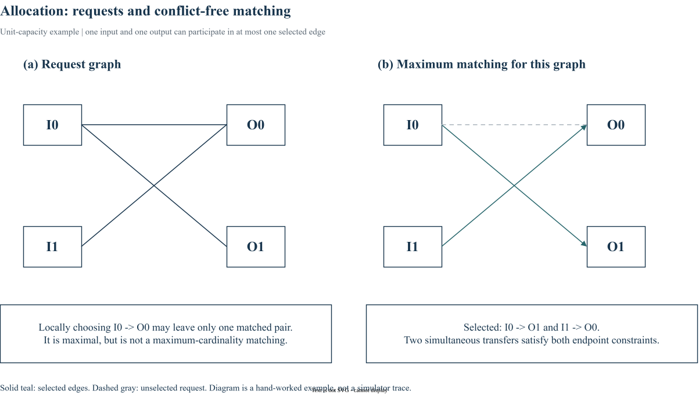

# Chapter 19｜Allocation｜从局部仲裁到二分图匹配

> 以《Principles and Practices of Interconnection Networks》的章节主题为学习顺序；本文为概念整理与固定版本源码解读，不是原书逐句翻译。BookSim2 基线：[`28f4329`](https://github.com/booksim/booksim2/tree/28f43299f1706a3160ffac721ca461d74eb6e618)。

## 1. 多个资源必须同时满足不冲突约束

将输入和输出视为二分图两侧，请求视为边，allocator 选择不冲突的匹配：单 lane 情况下一个输入和一个输出都不能同时匹配两次。多个独立输出仲裁器可能同时选中一个输入，仍需要 accept / 冲突消解。



图中 I0 同时请求 O0/O1，I1 只请求 O0。若局部选择占用 I0→O0，本轮可能只获得一个匹配；选择 I1→O0、I0→O1 则得到两个。局部合理选择未必使总服务量最大。

## 2. Maximal 与 maximum 不同

Maximal matching 表示无法再直接添加一条边；maximum matching 追求最大基数。前者可能更小。实际 router 常选迭代、分离式或其他近似算法，在匹配质量、时延与实现成本之间取舍。

## 3. iSLIP 的迭代不是免费的硬件周期

Grant / accept 通过轮转状态逐步建立匹配。alloc_iters 增大可能改善给定请求图的结果，但模拟器不自动将算法复杂度转换为频率损失；必须独立解释 vc_alloc_delay / sw_alloc_delay 的建模依据。

## 4. BookSim 源码拆解

固定版本节选（仅去除行末空白），省略外围上下文：[查看 src/allocators/islip.cpp 第 56–64 行](https://github.com/booksim/booksim2/blob/28f43299f1706a3160ffac721ca461d74eb6e618/src/allocators/islip.cpp#L56-L64)。

```cpp
  for ( int iter = 0; iter < _iSLIP_iter; ++iter ) {
    // Grant phase

    vector<int> grants(_outputs, -1);

    for ( output = 0; output < _outputs; ++output ) {

      // Skip loop if there are no requests
      // or the output is already matched
```

每轮会跳过已经匹配的输出，再进行 grant 和 accept。VA 的资源通常是输出 VC，SA 的资源通常是交换端口或展开后的 lane；两张请求图的维度和许可约束不同。对照 `Allocator::NewAllocator` 可核对 islip、pim、separable_input_first 等准确配置名。

## 5. 学习练习与实验边界

在图示请求矩阵上手动跑一轮和多轮 grant / accept，记录匹配边和指针。对比不同 allocator 时同时保存输入图、priority 和最终 matching，避免仅凭全网 throughput 猜测某次仲裁为什么失败。

## 源码与阅读导航

- [src/allocators/islip.cpp](https://github.com/booksim/booksim2/blob/28f43299f1706a3160ffac721ca461d74eb6e618/src/allocators/islip.cpp)
- [src/allocators/allocator.cpp](https://github.com/booksim/booksim2/blob/28f43299f1706a3160ffac721ca461d74eb6e618/src/allocators/allocator.cpp)
- [src/routers/iq_router.cpp](https://github.com/booksim/booksim2/blob/28f43299f1706a3160ffac721ca461d74eb6e618/src/routers/iq_router.cpp)

源码节选版权归 Trustees of The Leland Stanford Junior University，保留[上游许可与免责声明](/notes/booksim-notes/source-license.txt)。新增架构图与算例为教学整理；未执行的方案不标作测量结果。

[上一篇](18_arbitration.md) · [专栏导读](00_Introduction.md)

---

[下一篇：Chapter 20 — Network Interfaces｜生成、注入与事务边界](20_network_interfaces.md)
