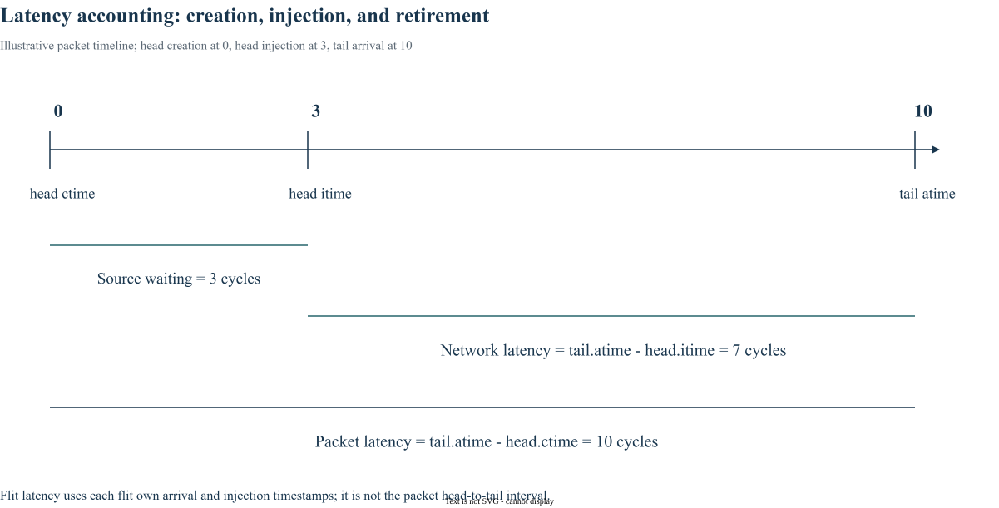

# Chapter 20｜Network Interfaces｜生成、注入与事务边界

> 以《Principles and Practices of Interconnection Networks》的章节主题为学习顺序；本文为概念整理与固定版本源码解读，不是原书逐句翻译。BookSim2 基线：[`28f4329`](https://github.com/booksim/booksim2/tree/28f43299f1706a3160ffac721ca461d74eb6e618)。

## 1. Terminal 不只是另一根物理链路

真实 NI 要把协议事务打包、选择目的、管理注入队列、恢复消息并遵守事务顺序。地址到目标映射、outstanding 数、返回依赖、错误恢复和 coherence 都可能影响流量，不能只用一个随机目的生成器替代全部行为。

## 2. BookSim 的边界在 TrafficManager

该版本通过 TrafficManager 生成 packet / flit，维护源端待注入队列，并在 ejection 时统计、释放对象。read/write request-reply 模式提供抽象事务响应机制，却不是某完整 ISA 或 AXI / TileLink 协议实现。

Flit 的 data 指针也不意味着模型默认检查真实 payload 内容。若用于系统集成，需明确哪些逻辑仍由外部模型负责。

## 3. 三个时间戳定义两种 packet latency

ctime 记录创建时刻，itime 记录实际注入，atime 记录到达。head 的创建到 tail 到达包含源端等待；head 注入到 tail 到达排除了对应的源端等待，但仍包括网络内阻塞。单 flit 的 itime→atime 又是另一种指标。



## 4. BookSim 源码拆解

固定版本节选（仅去除行末空白），省略外围上下文：[查看 src/flit.hpp 第 56–63 行](https://github.com/booksim/booksim2/blob/28f43299f1706a3160ffac721ca461d74eb6e618/src/flit.hpp#L56-L63)。

```cpp
  int  ctime;
  int  itime;
  int  atime;

  int  id;
  int  pid;

  bool record;
```

Flit 同时保存 id、pid、src / dest、head / tail、cl 等字段；TrafficManager::_GeneratePacket 设置创建信息，_Step 在真实发送时设置 itime，接收时写 atime。不同统计对象的起止事件见第23章，不能只把所有输出都叫 network latency。

## 5. 学习练习与实验边界

在教学时间线 ctime=0、head itime=3、tail atime=10 上，算出 packet latency=10、network latency=7、源端等待=3。再追一个 request-reply 事务的目的和返回生成时机，说明其中没有被模型表达的真实系统功能。

## 源码与阅读导航

- [src/flit.hpp](https://github.com/booksim/booksim2/blob/28f43299f1706a3160ffac721ca461d74eb6e618/src/flit.hpp)
- [src/trafficmanager.cpp](https://github.com/booksim/booksim2/blob/28f43299f1706a3160ffac721ca461d74eb6e618/src/trafficmanager.cpp)
- [src/packet_reply_info.hpp](https://github.com/booksim/booksim2/blob/28f43299f1706a3160ffac721ca461d74eb6e618/src/packet_reply_info.hpp)

源码节选版权归 Trustees of The Leland Stanford Junior University，保留[上游许可与免责声明](/notes/booksim-notes/source-license.txt)。新增架构图与算例为教学整理；未执行的方案不标作测量结果。

[上一篇](19_allocation.md) · [专栏导读](00_Introduction.md)

---

[下一篇：Chapter 21 — Error Control｜可靠性机制与模型边界](21_error_control.md)
