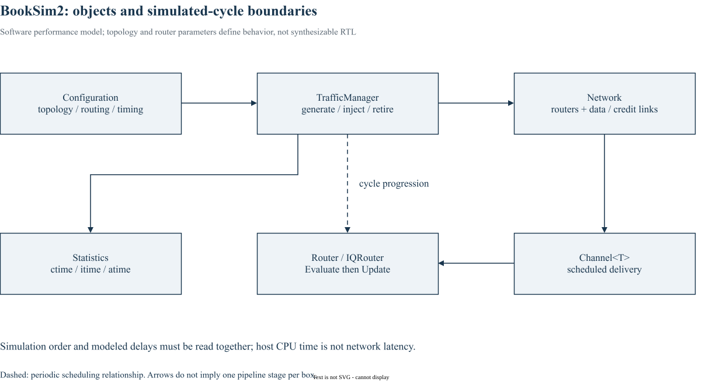

# 实验附录｜BookSim2 最小配置验证

这是本专栏追加的 2×2 Mesh smoke 实验，用于核对构建、配置和统计路径；不是原书第 2 章的 butterfly/dropping 网络，也不是第 25 章曲线的逐值复现。原书组织见[章节与页码对照](appendix-reading-map.md)。



*补充图：依据固定版本源码整理的软件对象关系；箭头不表示每个方框固定占一拍，也不表示 RTL 生成流程。*

## 1. 验证对象与环境

本次在2026-10-22使用干净的上游源码归档，在独立临时目录构建；没有修改 BookSim 源码。源码基线为 [`28f43299f1706a3160ffac721ca461d74eb6e618`](https://github.com/booksim/booksim2/tree/28f43299f1706a3160ffac721ca461d74eb6e618)，构建命令为 `make -C src -j4`。

| 工具 | 实际查询版本 |
| --- | --- |
| GNU C++ | 11.4.0 |
| Flex | 2.6.4 |
| GNU Bison | 3.8.2 |

三个配置只改变注入率，采用2×2 Mesh、DOR、IQRouter、4 VC×4 flit、4-flit packet、uniform、seed=1。warmup_periods=2、sample_period=1000、max_samples=10、sim_count=1，负载单位为flit/node/cycle。

配置下载：[0.02](/notes/booksim-notes/experiments/mesh2x2-flit002.cfg)、[0.10](/notes/booksim-notes/experiments/mesh2x2-flit010.cfg)、[0.20](/notes/booksim-notes/experiments/mesh2x2-flit020.cfg)。它们不是需要其他私有环境文件才能运行的片段。

## 2. 该提交的返回码约定

这个版本有一个容易误判的入口约定：[main.cpp](https://github.com/booksim/booksim2/blob/28f43299f1706a3160ffac721ca461d74eb6e618/src/main.cpp#L185-L186) 将 `Simulate(config)` 的 true 返回值转换为 `-1`，在Unix下表现为退出码255。`TrafficManager::Run` 完成正常流程返回true；报告 Simulation unstable 时则返回false。

因此不能用通常的“非零即失败”包装器直接解释该版本。反过来，255也可能来自其他错误路径，必须同时核对完整日志：正常统计、排空完成和结束标记应存在，不能有错误或 unstable。配置解析失败的返回码也不应被当作成功证明。

可在调用时明确捕获返回码，不修改上游语义：

```bash
set +e
./src/booksim experiments/mesh2x2-flit002.cfg > smoke-002.log 2>&1
rc=$?
set -e
# 针对这个固定提交，至少同时检查以下条件；实际脚本还应保留完整日志
test "$rc" -eq 255
grep -q 'Overall Traffic Statistics' smoke-002.log
grep -q 'Time taken is' smoke-002.log
if grep -q 'Simulation unstable' smoke-002.log; then exit 1; fi
```

这项特殊约定应固定到提交号；不能把所有版本、fork或系统调用的255一概视为仿真成功。

## 3. 实际观察到的最终统计

下表取每次输出最后的 Overall Traffic Statistics，非中途采样打印。latency 单位为cycle，rate单位为flit/node/cycle。

| 配置负载 | Packet latency avg | Network latency avg | Flit latency avg | Injected flit rate avg | Accepted flit rate avg | 总模拟cycle |
| --- | --- | --- | --- | --- | --- | --- |
| 0.02 | 15.0183 | 14.9756 | 11.9576 | 0.0205313 | 0.020625 | 10001 |
| 0.10 | 15.5636 | 15.3985 | 12.2027 | 0.102281 | 0.102500 | 10001 |
| 0.20 | 16.3538 | 15.9962 | 12.5951 | 0.208050 | 0.207850 | 7025 |

三个运行均返回255，包含最终统计与 Time taken 标记，没有 Simulation unstable；外层验证脚本完成并退出0。输出里的“1 samples”来自sim_count=1的overall汇总，不表示只传输一个packet。

实际速率与配置值的微小差异来自随机产生和有限统计窗口。accepted略大于injected也不表示物理链路凭空多发：注入、接收窗口与在途报文的边界需要共同解释。

## 4. 这些结果尚不能证明什么

这是构建、配置与统计路径的smoke验证，不是饱和吞吐扫描、全量回归、多seed区间估计或RTL等价验证。没有进行综合、物理时序、功耗或应用系统仿真。

固定版本 `_SingleSim` 的循环既受max_samples限制，也检查converged计数；离开循环后，若处于running，还会增加converged并进入drain。因此成功结束并不自动证明达到了连续三次稳定采样的判据。前两组运行接近采样上限，应扩展窗口与采样上限后再用于正式性能结论。

BookSim报告的hops也要读事件定义：IQRouter在发送flit时增加hops，最终ejection同样经过router，因此它不宜直接与数学上的“router间链路距离”逐值等同。第3章公式只计算后者。

## 5. 建议的下一步

先增加sample_period与max_samples，再显式扫描多个seed和更多负载点；记录源队列积压、未完成报文与退出原因。拓扑实验固定端口带宽及链路延迟，VC实验固定总容量，allocator实验说明建模delay是否随算法改变。只有完成这些对照后，才讨论性能机制和适用范围。

[回到第25章：仿真实例](25_simulation_examples.md)
