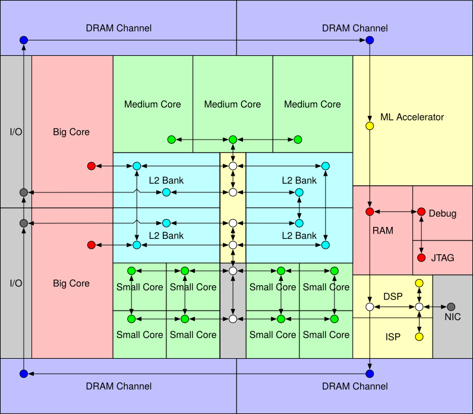

# Constellation NoC 深入学习专栏：从论文、源码到实验

> 本专栏围绕 University of California, Berkeley的 Constellation NoC Generator 展开，目标不是停留在“如何运行 Constellation”，而是从论文、设计抽象、GitHub 工程、Chisel/RTL 实现一直深入到 NoC 性能实验与二次开发，逐步建立对 Constellation 的系统理解，并最终将其作为后续 NoC 研究与实验的基础平台。

---

## 1. 专栏简介

Network-on-Chip（NoC）已经成为现代多核处理器、异构 SoC、AI 加速器以及复杂片上计算系统中重要的互连基础设施。

随着 SoC 中 CPU、GPU、NPU、DSP、加速器、缓存、Scratchpad、DMA、IO 和多级存储系统不断增加，片上通信结构也逐渐从简单的总线和 Crossbar，发展到规则 Mesh、Torus 以及更加复杂的层次化和不规则 NoC。

传统 NoC 设计通常围绕某一种固定拓扑、路由算法和 Router 微架构展开。这种方式对于规则、多核系统较为有效，但面对异构 SoC 中复杂的物理布局和非均匀通信需求时，往往难以充分表达实际设计空间。

Constellation 正是在这一背景下提出的。

论文：

> Jerry Zhao, Animesh Agrawal, Borivoje Nikolic, Krste Asanovic,  
> **“Constellation: An Open-Source SoC-Capable NoC Generator”**,  
> IEEE/ACM International Workshop on Network on Chip Architectures (NoCArc), 2022.

论文提出了一个面向 SoC 集成的、可参数化的 NoC RTL Generator，重点支持高度不规则的 NoC 架构，并通过高度解耦的 specification system 描述大规模的 virtual-channel wormhole-routed NoC design space。



Constellation 同时开源，并集成到 Chipyard SoC generator 中，使 NoC 不再只是一个独立的仿真对象，而能够进入完整的 SoC 生成、验证和评估流程。

---

# 2. 为什么选择 Constellation 作为学习对象？

学习 Constellation 的价值并不只是掌握一个 GitHub 工程。

更重要的是，它提供了一个观察现代 NoC Generator 的完整窗口。

从体系结构角度，可以研究：

- NoC topology
- routing
- virtual channel
- wormhole switching
- flow control
- router microarchitecture
- protocol transport
- traffic evaluation
- deadlock avoidance

从硬件生成角度，可以研究：

- Chisel
- parameterized RTL
- hardware generator
- configuration-driven design
- RTL elaboration
- Verilator simulation

从 SoC 角度，可以研究：

- Chipyard
- RocketChip / Diplomacy
- TileLink
- AXI4
- heterogeneous SoC
- protocol-capable NoC

从科研角度，则可以进一步研究：

- irregular NoC
- topology exploration
- routing exploration
- virtual-channel allocation
- buffer sizing
- flow-control optimization
- router microarchitecture
- latency / throughput trade-off
- NoC design-space exploration

因此，本专栏并不把 Constellation 当作一个孤立的软件项目，而是将其视为：

> **理解现代 NoC Generator、SoC Interconnect 和 NoC Research Workflow 的一个完整实验平台。**

---

# 3. 本专栏的核心学习目标

完成整个专栏后，希望能够形成以下五个层次的能力。

## 3.1 理解论文

能够回答：

- Constellation 为什么被提出？
- 它解决了什么问题？
- 它与传统 Mesh NoC Generator 有什么区别？
- 什么是 irregular NoC？
- 为什么需要高度解耦的 specification system？
- Constellation 的核心设计思想是什么？
- 它为什么适合 heterogeneous SoC？

---

## 3.2 理解 NoC 抽象

能够独立解释：

```text
Topology
    ↓
Channel
    ↓
Virtual Channel
    ↓
Flow
    ↓
Routing
    ↓
Router
    ↓
Protocol
```

以及这些抽象之间的关系。

最终理解：

> 一个 Constellation NoC 并不是由一个 Router 类简单拼接得到，而是由多个相互解耦的 specification 共同定义。

------

## 3.3 理解 GitHub 工程

能够从一个配置出发：

```
TestConfig
    ↓
NoCParams
    ↓
Topology
    ↓
Routing
    ↓
Router
    ↓
Chisel
    ↓
Verilog
```

并能够定位每一步对应的源码。

也就是说，目标不是“知道文件在哪里”，而是能够建立：

> **Concept → Class → Function → Hardware**

之间的映射关系。

------

## 3.4 能够进行实验

能够独立完成：

- 修改 topology
- 修改 VC 数量
- 修改 buffer depth
- 修改 routing
- 修改 traffic pattern
- 运行 RTL simulation
- 获取 throughput
- 获取 latency
- 分析 test result
- 进行 design-space exploration

最终形成完整的：

```
Configuration
      ↓
RTL Generation
      ↓
Simulation
      ↓
Performance Data
      ↓
Analysis
```

实验闭环。

------

## 3.5 能够进行二次开发

最终希望能够从：

> Constellation User

逐步转变为：

> Constellation Developer / NoC Researcher

能够在其基础上实现：

- 自定义 topology
- 自定义 routing
- 自定义 flow
- VC / buffer 参数探索
- Router 优化
- 新的 traffic evaluation
- 面向特定应用的 NoC architecture

最终形成自己的 NoC 研究原型。

------

# 4. 本专栏采用的学习主线

本专栏不按照 GitHub 文件目录简单进行源码逐文件介绍，而采用：

```
论文
  ↓
设计目标
  ↓
体系结构抽象
  ↓
官方文档
  ↓
GitHub 源码
  ↓
Chisel Generator
  ↓
RTL
  ↓
Simulation
  ↓
Performance Evaluation
  ↓
Design Space Exploration
  ↓
二次开发
  ↓
NoC Research
```

这样的学习路线。

核心思想是：

> **先理解“为什么这样设计”，再理解“它是什么”，最后理解“代码如何实现”。**

------

# 5. 论文、文档与源码的三层关系

学习 Constellation 时，建议同时维护三个视角。

## 5.1 Paper：为什么这样设计？

论文主要回答：

> Why?

例如：

- 为什么需要 irregular NoC？
- 为什么需要 decoupled specification？
- 为什么要支持 virtual-channel wormhole routing？
- 为什么需要 SoC integration？
- 为什么需要 evaluation framework？

论文负责建立理论和设计动机。

------

## 5.2 Documentation：怎么使用？

官方文档主要回答：

> How to use?

例如：

- 如何安装？
- 如何生成 NoC？
- 如何运行测试？
- 如何定义 topology？
- 如何配置 routing？
- 如何进行 Chipyard integration？
- 如何运行 evaluation？

官方文档负责建立工程使用方法。

------

## 5.3 GitHub Source：具体怎么实现？

源码则回答：

> How is it implemented?

例如：

```
NoCParams
Topology
RoutingRelation
Flow
Channel
VirtualChannel
Router
Protocol
Test
Evaluation
```

这些抽象最终如何通过 Scala / Chisel 生成 RTL。

因此，本专栏始终遵循：

```
Paper
  ↓
Design Concept
  ↓
Documentation
  ↓
Source Code
  ↓
RTL
```

而不是直接从源码开始。

------

# 6. 当前实验基础

本专栏建立在一个已经完成环境验证的 Constellation fork 基础上。（仓库链接：https://github.com/hujian404/constellation）

当前工程已经能够在远程服务器上完成构建和运行，并完成完整测试。

当前实验环境中已经针对服务器环境进行了必要适配，包括：

- Java / JDK 环境适配
- sbt 环境适配
- Maven dependency 下载环境适配
- Espresso 用户态安装
- Netrace 编译
- Verilator 运行环境适配
- Chipyard integrated mode 适配

这些服务器级 workaround 与 Constellation repository-level modifications 将保持明确区分。

------

# 7. 为什么要区分 Repository 与 Environment？

对于长期维护的实验基础仓库而言，一个非常重要的原则是：

> **项目级修改进入 Git；服务器级 workaround 保留在实验环境文档中。**

可以将整个实验环境理解为两个层次。

```
                    Constellation
                         │
              ┌──────────┴──────────┐
              │                     │
      Repository-level         Host-level
        configuration          environment
              │                     │
              ↓                     ↓
       Build / Test             Java / sbt
       Compatibility            Maven mirror
       Documentation            Verilator
                               Espresso
                               Netrace
```

Repository 中应该保存：

- 可复用的 build compatibility
- 可复用的 test configuration
- 源码修改
- 实验配置
- 实验说明
- reproducibility documentation

而服务器相关内容，例如：

- 本地路径
- SSH
- 网络 workaround
- Maven mirror
- user-space executable
- 临时 wrapper
- 编译生成物

则应保留在环境说明中，而不是污染研究基础仓库。

------

# 8. Constellation 的基本工作模式

当前 Constellation 文档将其使用方式划分为不同模式，其中 Chipyard-Standalone 用于独立 NoC 的生成和评估，而 Chipyard-SoC 则进一步将 Constellation NoC 集成到完整 Chipyard SoC 中。

因此后续学习过程中需要区分：

```
                 Constellation
                       │
          ┌────────────┴────────────┐
          ↓                         ↓
   Chipyard-Standalone       Chipyard-SoC
          │                         │
          ↓                         ↓
     Standalone NoC            Complete SoC
          │                         │
          ↓                         ↓
   RTL / Simulation          SoC Integration
```

前期主要使用 Standalone 模式理解：

- topology
- routing
- router
- flow control
- VC
- traffic

后期再进入：

- TileLink
- AXI4
- Diplomacy
- Chipyard
- RocketChip
- SoC interconnect

------

# 9. 从一个最简单的 TestConfig 开始

Constellation 官方提供了大量测试配置。

例如：

```
TestConfig00
TestConfig01
TestConfig02
...
```

这些配置用于描述不同的 NoC design points。

官方文档指出，`src/main/scala/test/Configs.scala` 中定义了大量示例配置，并通过不同的测试配置覆盖：

- Core NoC
- TileLink transport
- AXI4 transport

等功能。

因此，本专栏不会一开始就分析整个源码树，而会选择一个最简单的配置作为入口。

典型分析路径为：

```
TestConfig00
     ↓
NoC configuration
     ↓
Topology
     ↓
Routing
     ↓
Channel / VC
     ↓
Router
     ↓
Chisel elaboration
     ↓
Verilog
     ↓
ChiselTest / Verilator
```

这样可以从一个具体实例逐渐建立完整的 mental model。

------

# 10. 专栏的五个阶段

整个专栏划分为五个阶段。

------

## Part I：认识 Constellation

目标：

> 建立整体认知。

内容：

```
01 为什么需要 Constellation
02 论文设计目标与核心思想
03 Constellation 整体架构
04 GitHub 工程结构与源码阅读方法
```

这一阶段不追求深入代码，而是回答：

> **Constellation 是什么？为什么值得学习？**

------

# Part II：理解 NoC Generator

目标：

> 理解 Constellation 最核心的 abstraction。

内容：

```
05 NoC Specification
06 Topology
07 Channel / VC / Terminal
08 Flow / Virtual Subnetwork
09 Routing Relation
10 Configuration → RTL
```

这一阶段是整个专栏的核心。

最终需要形成：

```
Topology
   +
Channel
   +
VC
   +
Flow
   +
Routing
   ↓
NoC
```

的完整理解。

------

# Part III：深入 Router 与协议

目标：

> 从 Generator abstraction 进入硬件微架构。

内容：

```
11 Router
12 Wormhole / Credit Flow Control
13 VC / Deadlock
14 VC Allocation / Arbitration / Pipeline
15 TileLink / AXI4
16 Chipyard Integration
```

最终建立：

```
NoC Specification
        ↓
Router Microarchitecture
        ↓
Protocol Transport
        ↓
SoC Interconnect
```

的完整认识。

------

# Part IV：从代码进入实验

目标：

> 学会如何利用 Constellation 做可重复的 NoC 实验。

内容：

```
17 Test Framework
18 Netrace / Traffic Evaluation
19 Performance Evaluation
20 Design Space Exploration
```

这一阶段重点关注：

```
Throughput
Latency
Buffer
VC
Traffic
Routing
Topology
```

之间的关系。

------

# Part V：从学习进入研究

目标：

> 基于 Constellation 开展自己的 NoC research。

内容：

```
21 Custom Topology
22 Custom Routing
23 VC / Buffer / Flow Control
24 Router Optimization
25 From Constellation to NoC Research
```

最终目标：

```
Constellation
     ↓
Baseline
     ↓
Modification
     ↓
Experiment
     ↓
Analysis
     ↓
Research Idea
     ↓
Research Prototype
```

------

# 11. 全部文章目录

## Part I — Understanding Constellation

### 01｜为什么需要 Constellation

核心问题：

- 为什么传统 SoC interconnect 不够？
- 为什么需要 NoC？
- 为什么 Mesh 并不总是合适？
- 什么是 irregular NoC？
- Constellation 的 motivation 是什么？

------

### 02｜论文精读：设计目标与核心思想

核心问题：

- Constellation 解决什么问题？
- 什么是 highly decoupled specification？
- 什么是 virtual-channel wormhole-routed NoC？
- Constellation 的核心 contribution 是什么？
- 为什么它适合 heterogeneous SoC？

------

### 03｜Constellation 整体架构

核心问题：

```
Specification
      ↓
Generator
      ↓
Router / Channel
      ↓
RTL
      ↓
Simulation
      ↓
Evaluation
```

各模块之间是什么关系？

------

### 04｜GitHub 工程结构与源码阅读方法

核心问题：

- 工程目录如何组织？
- Scala / Chisel 代码在哪里？
- TestConfig 在哪里？
- Topology 在哪里？
- Routing 在哪里？
- Router 在哪里？
- Protocol 在哪里？
- Evaluation 在哪里？

目标：

> 建立 Paper ↔ Documentation ↔ Source Code 的映射。

------

# Part II — NoC Generator

### 05｜NoC Specification 与 NoCParams

研究：

- NoCParams
- topology
- channels
- flows
- routing
- configuration

目标：

> 理解 Constellation 如何描述一个 NoC。

------

### 06｜Topology：从 Mesh 到任意有向图

研究：

- Mesh
- Ring
- Torus
- Tree
- Hierarchical topology
- Custom topology
- Directed graph

目标：

> 理解 Constellation 的 topology abstraction。

------

### 07｜Channel、Virtual Channel 与 Terminal

研究：

- physical channel
- terminal
- ingress
- egress
- VC
- buffer depth

目标：

> 理解物理网络资源与逻辑通信资源之间的关系。

------

### 08｜Flow 与 Virtual Subnetwork

研究：

- Flow
- traffic class
- virtual subnetwork
- VC allocation
- flow isolation

目标：

> 理解为什么 topology 与 traffic / flow 可以解耦。

------

### 09｜Routing Relation 与 Routing Table

研究：

- routing relation
- routing path
- routing table
- shortest routing
- escape routing
- deadlock avoidance

目标：

> 理解从 topology 到 routing implementation 的完整过程。

------

### 10｜从 Scala Configuration 到 Verilog RTL

研究：

```
Scala
 ↓
Chisel
 ↓
Elaboration
 ↓
FIRRTL
 ↓
Verilog
 ↓
Verilator
```

目标：

> 真正理解 Constellation Generator 如何产生硬件。

------

# Part III — Router / Flow Control / Protocol

### 11｜Constellation Router 微架构

研究：

- Input
- Output
- Buffer
- Route computation
- VC allocation
- Switch allocation
- Crossbar

目标：

> 从 generator abstraction 进入 Router RTL。

------

### 12｜Wormhole Switching 与 Credit-Based Flow Control

研究：

- packet
- flit
- wormhole
- credit
- backpressure
- buffer occupancy

目标：

> 理解 Constellation 的基本数据传输机制。

------

### 13｜Virtual Channel 与 Deadlock Avoidance

研究：

- VC
- channel dependency
- deadlock
- escape VC
- routing constraints

目标：

> 建立 routing、VC 与 deadlock 三者之间的联系。

------

### 14｜VC Allocation、Arbitration 与 Pipeline

研究：

- VC allocation
- switch allocation
- arbitration
- pipeline
- latency
- throughput

目标：

> 理解 Router 性能与微架构之间的关系。

------

### 15｜TileLink / AXI4 协议支持

研究：

- protocol abstraction
- TileLink
- AXI4
- protocol adapter
- transport network

Constellation 文档将 TileLink / AXI4 支持建立在 Diplomacy 的协议参数与节点映射之上。

目标：

> 理解 Constellation 如何从“独立 NoC”成为“SoC Interconnect”。

------

### 16｜Chipyard / RocketChip 集成

研究：

- Chipyard
- RocketChip
- Diplomacy
- System Bus
- Memory Bus
- Control Bus
- NoC integration

目标：

> 理解 Constellation 在完整 SoC 中的位置。

------

# Part IV — Evaluation

### 17｜Constellation Test Framework

研究：

- TestConfig
- ChiselTest
- functional test
- TileLink test
- AXI4 test
- evaluation test

目标：

> 理解 Constellation 如何验证生成硬件的正确性。

------

### 18｜Netrace 与 Traffic Evaluation

研究：

```
Traffic Matrix
      ↓
Injection
      ↓
Simulation
      ↓
Latency / Throughput
```

目标：

> 理解 Constellation 如何进行网络性能评估。

------

### 19｜NoC 性能评价方法

研究：

- throughput
- average latency
- median latency
- maximum latency
- latency distribution
- saturation

目标：

> 建立规范的 NoC performance evaluation methodology。

------

### 20｜实验设计与 Design Space Exploration

研究：

```
Topology
×
Routing
×
VC
×
Buffer
×
Traffic
```

形成系统化实验矩阵。

目标：

> 从“运行测试”进入“做实验”。

------

# Part V — Research

### 21｜自定义 Topology

第一个二次开发实验：

```
Regular Mesh
      ↓
Mesh + Express Links
      ↓
Irregular NoC
```

研究：

- hop count
- latency
- throughput
- network diameter
- bisection bandwidth

目标：

> 验证 Constellation 的 topology generation 能力。

------

### 22｜自定义 Routing

研究：

- deterministic routing
- adaptive routing
- shortest path
- escape routing
- topology-aware routing

目标：

> 在已有 topology 上研究 routing design space。

------

### 23｜VC、Buffer 与 Flow Control 实验

研究：

```
VC count
VC depth
Buffer depth
Flow
Traffic
```

目标：

> 研究资源配置与 NoC performance / area / latency 之间的关系。

------

### 24｜Router Microarchitecture 优化

研究：

- pipeline
- arbitration
- bypass
- buffer
- allocation
- critical path

目标：

> 从 NoC architecture 进入 Router microarchitecture optimization。

------

### 25｜从 Constellation 到自己的 NoC 研究

最终总结：

```
Constellation
      ↓
Understanding
      ↓
Baseline
      ↓
Experiment
      ↓
Modification
      ↓
Evaluation
      ↓
Research Question
      ↓
Novel NoC Architecture
```

这一篇不再只是学习 Constellation，而是讨论：

> 如何把 Constellation 从一个学习对象变成自己的研究平台。

------

# 12. 专栏最终希望形成的知识体系

完成整个专栏后，希望能够形成如下完整知识图谱：

```
                         Constellation
                               │
              ┌────────────────┼────────────────┐
              │                │                │
          Topology          Routing           Flow
              │                │                │
              └────────────────┼────────────────┘
                               ↓
                        NoC Specification
                               │
                               ↓
                         NoC Generator
                               │
                    ┌──────────┴──────────┐
                    ↓                     ↓
                 Router                Channel
                    │                     │
                    └──────────┬──────────┘
                               ↓
                       Virtual Channels
                               │
                               ↓
                      Wormhole / Flow Control
                               │
                               ↓
                         Protocol Layer
                       ┌───────┴────────┐
                       ↓                ↓
                   TileLink           AXI4
                       │                │
                       └───────┬────────┘
                               ↓
                           Chipyard
                               │
                               ↓
                              SoC
                               │
                               ↓
                         Evaluation
                               │
                 ┌─────────────┼─────────────┐
                 ↓             ↓             ↓
             Throughput      Latency        Area
                 │             │             │
                 └─────────────┼─────────────┘
                               ↓
                    Design Space Exploration
                               │
                               ↓
                         NoC Research
```

------

# 13. 结语

Constellation 的学习不应该停留在：

> “如何运行一个 TestConfig？”

真正值得深入研究的是：

> **如何通过一个高度参数化的硬件生成框架描述、生成、验证和评估复杂 NoC。**

因此，本专栏将始终围绕四条主线展开：

```
论文
 │
 ├── 为什么这样设计？
 │
源码
 │
 ├── 具体如何实现？
 │
RTL
 │
 ├── 最终生成什么硬件？
 │
实验
 │
 └── 设计选择带来了什么影响？
```

最终形成：

> **Paper → Architecture → Source Code → RTL → Experiment → Research**

的完整学习闭环。

------

## 14. 参考资料

### 14.1 核心论文

Jerry Zhao, Animesh Agrawal, Borivoje Nikolic, Krste Asanovic.

> *Constellation: An Open-Source SoC-Capable NoC Generator.*

2022 IEEE/ACM International Workshop on Network on Chip Architectures (NoCArc).

DOI: `10.1109/NoCArc57472.2022.9911299`

该论文是本专栏最核心的理论来源。

------

### 14.2 Constellation 官方文档

官方文档用于学习：

- Installation
- Running
- NoC Configuration
- Routing
- Protocol Support
- Chipyard Integration
- Evaluation

其中官方 Introduction 提供了从简单 NoC 配置、RTL 生成到 simulation 的基本流程。

------

### 14.3 Chipyard

Chipyard 用于理解：

- SoC Generator
- RocketChip
- Diplomacy
- TileLink
- AXI4
- SoC-level NoC integration

------

## 15. 下一篇

下一篇将从一个最基本的问题开始：

> **为什么现代异构 SoC 需要 Constellation？**

将从传统 Bus、Crossbar、规则 Mesh NoC 出发，逐步分析 heterogeneous SoC 的互连需求，并理解 Constellation 所针对的 irregular NoC design space。

---

<a href="01-why-constellation.md">下一篇：Chapter 1 —— Why Constellation?</a>