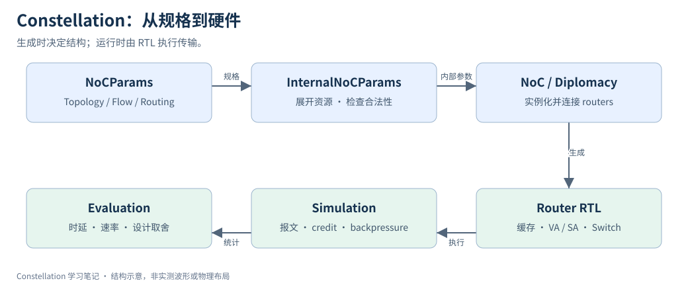

# 03｜Constellation 整体架构

> 更新：2026-10-22。源码基线：[`c1b42cd`](https://github.com/ucb-bar/constellation/tree/c1b42cd0c7c7d6e4fc1ed9bf1f86fbd3b31ac510)。本文按原定章节顺序展开；源码节选、教学示例与实验计划分别标明。运行版本、工具链及本次四项代表性验证见[实验复现附录](appendix-reproduction.md)；教学示意与未执行的扩展实验另行标明。

## 1. 将整体架构拆成两个时间尺度

阅读 Constellation 时，最重要的边界是生成阶段与运行阶段。前者执行 Scala，遍历拓扑和 flow，计算合法资源并建立 Diplomacy 图；后者是生成后的 RTL，在每个时钟周期缓存 flit、分配 VC、仲裁交换并更新 credit。



图中上排属于生成阶段，下排属于运行和实验阶段。箭头表示产物或信息传递，不表示流水线每拍向前走一级。

## 2. 沿着实际构造链阅读

`NoCParams` 是用户规格；`InternalNoCParams.apply` 展开 channel、terminal 和 flow 信息，并运行连通性、虚拟子网前进性及 escape 依赖检查。`NoC` 根据内部参数实例化 router，再通过 channel 节点连接它们。router 的 `LazyModuleImp` 内部建立真正的 Chisel 模块。

以下为固定版本的源码节选，省略外围上下文：[查看 src/main/scala/router/Router.scala 第 131–137 行](https://github.com/ucb-bar/constellation/blob/c1b42cd0c7c7d6e4fc1ed9bf1f86fbd3b31ac510/src/main/scala/router/Router.scala#L131-L137)。

```scala
    val switch = Module(new Switch(routerParams, inParams, outParams, ingressParams, egressParams))
    val switch_allocator = Module(new SwitchAllocator(routerParams, inParams, outParams, ingressParams, egressParams))
    val vc_allocator = Module(routerParams.user.vcAllocator(
      VCAllocatorParams(routerParams, inParams, outParams, ingressParams, egressParams)
    )(p))
    val route_computer = Module(new RouteComputer(routerParams, inParams, outParams, ingressParams, egressParams))

```

这些 `Module(new ...)` 是六类硬件角色：InputUnit 保留报文状态与 flit，OutputUnit 跟踪下游资源，RouteComputer 产生合法候选，VCAllocator 决定报文获得哪个输出 VC，SwitchAllocator 决定交换使用权，Switch 执行数据选择。IngressUnit / EgressUnit 在终端侧做接口适配，因此并非每个端口都是普通 router 间链路。

## 3. Chisel、Diplomacy 和 Scala 各管什么

| 代码形态 | 所属层 | 读法 |
| --- | --- | --- |
| `map`、`filter`、`Seq.tabulate` | Scala | 遍历参数，生成实例或连接 |
| `LazyModule`、node `:=` | Diplomacy | 建立带参数协商的连接图 |
| `Module`、`IO`、`Reg` | Chisel | 电路、端口、寄存器 |
| `when`、`Mux`、Data `:=` | Chisel | 硬件条件与数据赋值 |
| `require` | Scala | 构建时拒绝非法参数 |
| `assert` 接受 `Bool` | Chisel | 运行时硬件断言 |

不要因为两段代码都用了 `:=` 就把它们当同一种连接。应先看左右操作数类型：Diplomacy node 连接会参与参数协商；Chisel Data 连接才是信号赋值。

## 4. 建立一张可追踪的调试地图

构建报 flow 不可达，先查端口映射、边方向和路由 relation；运行时 credit 为零，追 OutputUnit、下游 InputBuffer 与回传链；报文内容错，追 flit 格式、宽度转换、Switch 选择和协议 adapter。定位时先判断错误属于哪一层，避免一开始就在 router 中寻找所有问题。

练习：把 `TestConfig00` 的每个字段连接到图中的对应方框，再解释为什么修改 `flows` 也可能改变生成硬件。完成标准是能从配置走到 `Router.scala` 的模块实例，而不需要先读完所有源码。

## 源码与延伸阅读

以下链接均固定到本章使用的源码版本：

- [src/main/scala/noc/NoC.scala](https://github.com/ucb-bar/constellation/blob/c1b42cd0c7c7d6e4fc1ed9bf1f86fbd3b31ac510/src/main/scala/noc/NoC.scala)
- [src/main/scala/noc/Parameters.scala](https://github.com/ucb-bar/constellation/blob/c1b42cd0c7c7d6e4fc1ed9bf1f86fbd3b31ac510/src/main/scala/noc/Parameters.scala)
- [src/main/scala/router/Router.scala](https://github.com/ucb-bar/constellation/blob/c1b42cd0c7c7d6e4fc1ed9bf1f86fbd3b31ac510/src/main/scala/router/Router.scala)

源码节选版权归 The Regents of the University of California，遵循 [BSD-3-Clause 许可及免责声明](/notes/constellation-notes/source-license.txt)。文字解读与教学图为专栏整理内容。

---

[上一篇](02-paper-design-goals.md) · [专栏导读](00-series-guide.md)

[下一篇：04｜GitHub 工程结构与源码阅读方法](04-github-source-code-guide.md)
