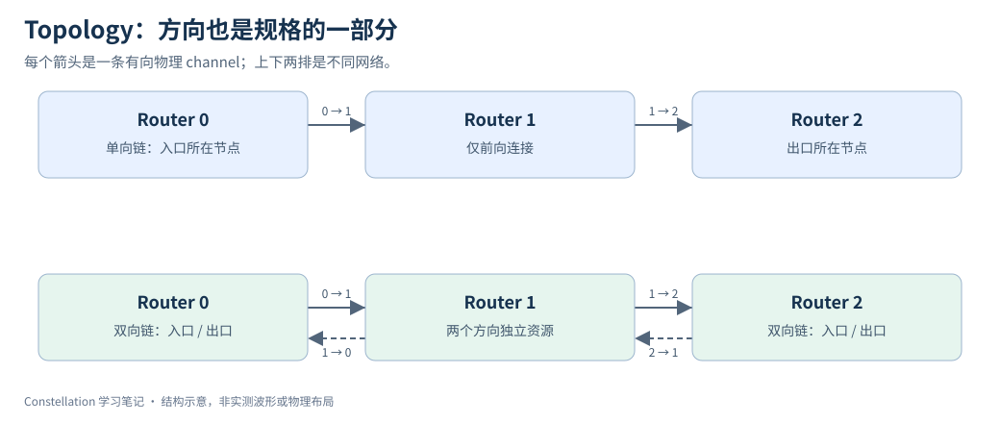
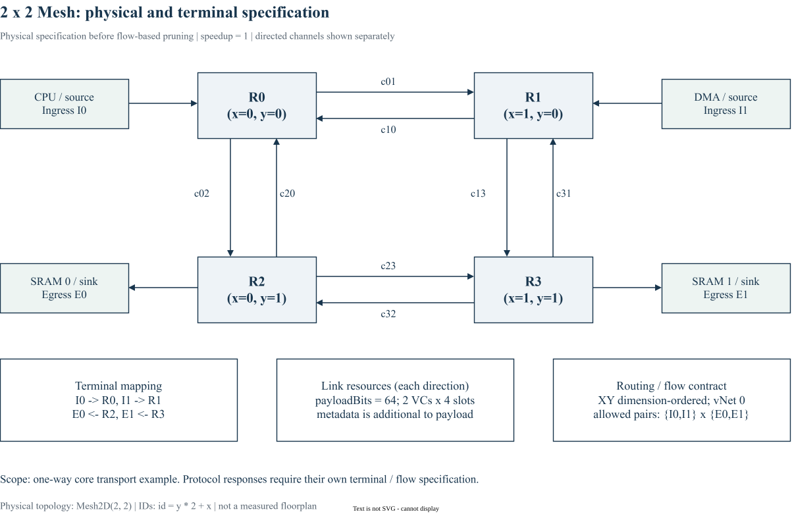

# 06｜Topology：从 Mesh 到任意有向图

> 更新：2026-10-22。源码基线：[`c1b42cd`](https://github.com/ucb-bar/constellation/tree/c1b42cd0c7c7d6e4fc1ed9bf1f86fbd3b31ac510)。本文按原定章节顺序展开；源码节选、教学示例与实验计划分别标明。运行版本、工具链及本次四项代表性验证见[实验复现附录](appendix-reproduction.md)；教学示意与未执行的扩展实验另行标明。

## 1. Topology 是有向图的判定函数

`PhysicalTopology` 提供 `nNodes`、`topo(src,dst): Boolean` 和可视化 plotter。`topo` 的返回值决定两个节点间是否有有向物理 channel；并不包含路由策略、VC 深度或流量概率。



上排单向链只允许从 0 到 2；下排双向链的每对相邻 router 有两个方向独立的 channel。图中的 terminal 挂在 router 上，不增加物理 router 编号。

以下为固定版本的源码节选，省略外围上下文：[查看 src/main/scala/topology/Topologies.scala 第 28–32 行](https://github.com/ucb-bar/constellation/blob/c1b42cd0c7c7d6e4fc1ed9bf1f86fbd3b31ac510/src/main/scala/topology/Topologies.scala#L28-L32)。

```scala
case class UnidirectionalLine(n: Int, skips: Seq[(Int, Int)] = Nil) extends PhysicalTopology {
  val nNodes = n
  def topo(src: Int, dest: Int) = dest - src == 1 || ((dest > src) && skips.contains((src, dest)))
  val plotter = new LinePlotter(this)
}
```

`dest-src==1` 是普通的 Scala 比较，在生成时求出边。`skips.contains((src,dest))` 允许额外前向捷径，但 `dest > src` 仍然禁止后退。对 `UnidirectionalLine(3, Seq((0,2)))`，边集合是 `{0→1, 1→2, 0→2}`；不能由此推导出 2→0 可达。

## 2. Mesh 的编号和边界

固定版本 `Mesh2D` 使用 `x=id%nX`、`y=id/nX`，并检查同一行或列上的相邻坐标。不能简单写 `abs(src-dst)==1`：一行末端与下一行起点编号相邻，却不是水平邻居。

对 2×2 Mesh，节点按行编号为 `0,1 / 2,3`，无向邻居对为 `(0,1),(0,2),(1,3),(2,3)`，因此物理有向边有 8 条。画图时建议在每个 router 上标节点号，另用端口表记录 terminal ID。

## 3. 不同拓扑带来的真实成本

| 拓扑修改 | 可能收益 | 必须补查 |
| --- | --- | --- |
| Mesh 加捷径 | 某些 flow 少跳 | 长线流水、端口增加、路由是否选用 |
| Ring 加回绕边 | 获得环形连接 | channel 依赖环与 dateline / VC 规则 |
| 分层子网 | 匹配模块簇 | 层间瓶颈、全局编号偏移 |
| 高连接度节点 | 降低平均距离 | Crossbar、仲裁与布线成本 |

拓扑上的环与资源依赖环不是同一个图；有环的物理网络可以通过路由规则避免死锁。反过来，拓扑连通也不能保证指定 relation 允许全部 flow 到达目标。

## 4. Scala 用法与练习

`case class` 让拓扑成为可组合的参数对象；`trait` 规定统一接口；`Seq[(Int,Int)]` 保存边对；`contains` 在生成阶段查询边。这里无需使用 `UInt` 或 Chisel `when`，因为硬件是否存在在 elaboration 时已经决定。

练习：枚举 3 节点单向链、带 0→2 捷径的链、双向链的全部有向边，手算 0→2 与 2→0 是否可达，再对照生成器的连通性报错。第 21 章用 `CustomTopology` 将手画图转为显式边集合。

## 5. 工程规格图：先定义节点、方向与资源



图中的 8 个箭头分别表示独立有向 channel，`payloadBits=64` 不包含 flit 元数据。每条候选 channel 配置 2 个 VC、每 VC 4 个槽；I0/I1 是 terminal 序号，R0/R1 是物理节点。图示采用单向业务：两个 source 发往两个 sink，没有把它画成已经完成请求 / 响应协议的 SoC。

这是 **flow 裁剪前的物理规格**，不是 Eval03 的网络或真实 floorplan。在图中给定的端点与 XY 路由下，某些反向边不会被任何 flow 使用，生成器可能将其过滤。由此可见，画出 Mesh 并不保证最终所有方向都有实际硬件。读图后应再核对 `possibleFlows` 与生成日志。

[下载可编辑 draw.io 图源](/notes/constellation-notes/pic/06-topology/mesh-engineering-spec.drawio)

## 源码与延伸阅读

以下链接均固定到本章使用的源码版本：

- [src/main/scala/topology/Topologies.scala](https://github.com/ucb-bar/constellation/blob/c1b42cd0c7c7d6e4fc1ed9bf1f86fbd3b31ac510/src/main/scala/topology/Topologies.scala)
- [src/main/scala/noc/NoC.scala](https://github.com/ucb-bar/constellation/blob/c1b42cd0c7c7d6e4fc1ed9bf1f86fbd3b31ac510/src/main/scala/noc/NoC.scala)

源码节选版权归 The Regents of the University of California，遵循 [BSD-3-Clause 许可及免责声明](/notes/constellation-notes/source-license.txt)。文字解读与教学图为专栏整理内容。

---

[上一篇](05-noc-specification.md) · [专栏导读](00-series-guide.md)

[下一篇：07｜Channel、Virtual Channel 与 Terminal](07-channel-virtual-channel-terminal.md)
