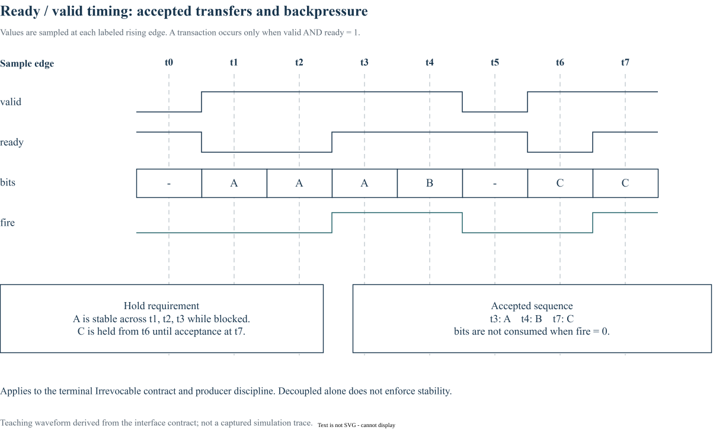

# 07｜Channel、Virtual Channel 与 Terminal

> 更新：2026-10-22。源码基线：[`c1b42cd`](https://github.com/ucb-bar/constellation/tree/c1b42cd0c7c7d6e4fc1ed9bf1f86fbd3b31ac510)。本文按原定章节顺序展开；源码节选、教学示例与实验计划分别标明。运行版本、工具链及本次四项代表性验证见[实验复现附录](appendix-reproduction.md)；教学示意与未执行的扩展实验另行标明。

## 1. 物理 channel、VC 和 terminal 各是什么

物理 channel 是 router 间一个方向的传输资源；VC 是共享该物理链路的逻辑缓冲与报文上下文；terminal 是数据进出 NoC 的接口。多个 VC 不意味着同一条普通链路每拍传多个 flit，链路并行度还要看 `srcSpeedup`、`destSpeedup` 等设置。

`UserVirtualChannelParams(bufferSize)` 的 bufferSize 是 flit 槽数量。W 位 payload、V 个 VC、每 VC 深度 D 的粗略 payload 存储量为 `V×D×W bit`，但真实面积还包含 head/tail 等元数据、控制、实现队列以及存储映射。

## 2. 接口本身说明流控机制

以下为固定版本的源码节选，省略外围上下文：[查看 src/main/scala/channel/Channel.scala 第 11–16 行](https://github.com/ucb-bar/constellation/blob/c1b42cd0c7c7d6e4fc1ed9bf1f86fbd3b31ac510/src/main/scala/channel/Channel.scala#L11-L16)。

```scala
class Channel(val cParam: ChannelParams)(implicit val p: Parameters) extends Bundle {
  val nVirtualChannels = cParam.nVirtualChannels
  val flit = Vec(cParam.srcSpeedup, Valid(new Flit(cParam.payloadBits)))
  val credit_return = Input(UInt(cParam.nVirtualChannels.W))
  val vc_free = Input(UInt(cParam.nVirtualChannels.W))
}
```

router 间的 `flit` 是 `Valid`，没有 ready 字段；发送许可由下游 credit 预先约束。`credit_return` 和 `vc_free` 是反向输入位图，每一位对应一个 VC：前者返还存储槽，后者释放报文级 VC 所有权。两者不能合并为一个“空闲”信号。

terminal 的 `IngressChannel` / `EgressChannel` 则使用 `Irrevocable`。它沿用 ready/valid 接口，并约定在 valid 已经拉高而接收方尚未 ready 时保持数据稳定。读旧版源码时，应结合 [Chisel 接口文档](https://www.chisel-lang.org/docs/explanations/interfaces-and-connections) 理解 Bundle、Flipped 和连接方向。

## 3. 参数如何变为不同大小的电路

`Vec(n, type)` 生成等类型的硬件向量；各输出端口 VC 数不相同时，源码用 `MixedVec(allOutParams.map(...))` 表达不同大小的成员。外层 Scala `map` 在生成时计算每个成员的类型，内层 `Vec` 才是硬件集合。

对 `UserChannelParams`，还应继续看 `unifiedBuffer`、`useOutputQueues`、channelGen 和 crossingType。`unifiedBuffer` 不等于所有 VC 可以无限动态借用任意槽：InputBuffer 中有按 VC 计算的边界与指针，需要按具体实现理解。

## 4. 三类缓存参数不要混淆

| 参数 / 模块 | 主要作用 | 需要复查 |
| --- | --- | --- |
| VC bufferSize | 接收端可容纳的 flit 数 | credit 初始化与计数位宽 |
| InputBuffer 实现选项 | 队列 / 存储组织 | 读写与出队时序 |
| `ChannelBuffer(depth)` | channel 路径寄存与回传延迟 | forward / return 各自延迟 |

尤其不能看到 `ChannelBuffer(2)` 就解释为“每个 VC 增加两个槽”。该文件的前向 `Pipe` 和反向 `ShiftRegister(..., depth)` 应分别阅读。改链路延迟后，深度是否能覆盖 credit 周期也需要重新评估。

练习：在两节点基线上列出三种接口的方向和字段，画出 flit 向右、credit_return 与 vc_free 向左的箭头。然后尝试解释“有空槽但 VC 已被别的报文占用”为什么不能直接发一个新 head。

## 5. Ready / valid 时序：数据保持与接收事件



图中虚线标出采样边沿。A 在 t1、t2 被阻塞，直到 t3 的 valid 和 ready 同时为 1 才被接收；B 在 t4 接收，C 从 t6 保持到 t7。消费者只在 fire 时计数，不能把 valid 保持的多个周期当成重复发送。

数据保持来自 terminal 的 `Irrevocable` 契约及生产端实现，generic `Decoupled` 类型本身并不替所有设计强制这个约束。router 间的 `Valid` + credit 链路也不应套用这张图里的 ready。该图是接口规范的教学时序，不是本次测试抓取的波形。

[下载可编辑 draw.io 图源](/notes/constellation-notes/pic/07-interfaces/ready-valid-timing.drawio)

## 源码与延伸阅读

以下链接均固定到本章使用的源码版本：

- [src/main/scala/channel/Channel.scala](https://github.com/ucb-bar/constellation/blob/c1b42cd0c7c7d6e4fc1ed9bf1f86fbd3b31ac510/src/main/scala/channel/Channel.scala)
- [src/main/scala/channel/Parameters.scala](https://github.com/ucb-bar/constellation/blob/c1b42cd0c7c7d6e4fc1ed9bf1f86fbd3b31ac510/src/main/scala/channel/Parameters.scala)
- [src/main/scala/channel/Buffer.scala](https://github.com/ucb-bar/constellation/blob/c1b42cd0c7c7d6e4fc1ed9bf1f86fbd3b31ac510/src/main/scala/channel/Buffer.scala)
- [src/main/scala/router/InputUnit.scala](https://github.com/ucb-bar/constellation/blob/c1b42cd0c7c7d6e4fc1ed9bf1f86fbd3b31ac510/src/main/scala/router/InputUnit.scala)

源码节选版权归 The Regents of the University of California，遵循 [BSD-3-Clause 许可及免责声明](/notes/constellation-notes/source-license.txt)。文字解读与教学图为专栏整理内容。

---

[上一篇](06-topology.md) · [专栏导读](00-series-guide.md)

[下一篇：08｜Flow 与 Virtual Subnetwork](08-flow-virtual-subnetwork.md)
