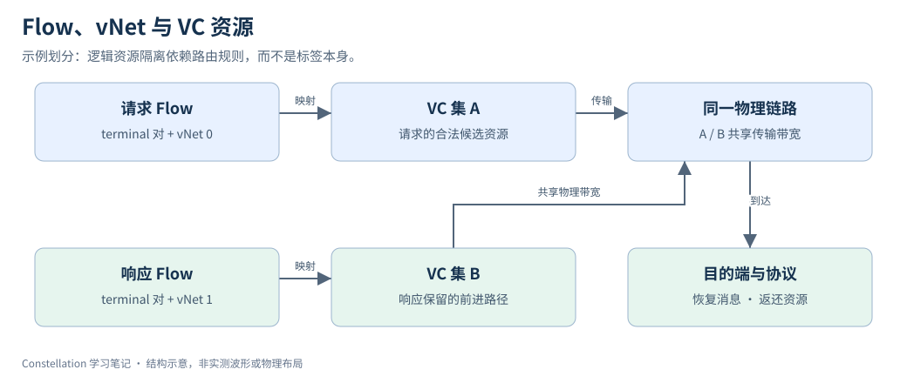

# 08｜Flow 与 Virtual Subnetwork

> 更新：2026-10-22。源码基线：[`c1b42cd`](https://github.com/ucb-bar/constellation/tree/c1b42cd0c7c7d6e4fc1ed9bf1f86fbd3b31ac510)。本文按原定章节顺序展开；源码节选、教学示例与实验计划分别标明。运行版本、工具链及本次四项代表性验证见[实验复现附录](appendix-reproduction.md)；教学示意与未执行的扩展实验另行标明。

## 1. Flow 描述允许的通信，而非流量分布

`FlowParams(ingressId,egressId,vNetId,fifo)` 描述一个被网络支持的源宿关系。它没有注入概率，因而“配置了一个 flow”不等于“每拍会发包”。具体负载属于测试或评估 harness。

一个重要约束是固定版本对每个 ingress–egress 对最多允许一条 flow。若协议需要多个消息类别，通常由协议层展开 terminal 与虚拟子网，不能简单向同一 terminal 对重复追加不同 vNet 的 FlowParams。



图示表达一种教学资源划分：两类消息共享物理链路，但使用独立的逻辑资源。实际 VC 映射由 routing relation 决定，`vNetId` 与 `vc` 不需要数值相等。

## 2. vNetBlocking 的方向必须按契约读

以下为固定版本的源码节选，省略外围上下文：[查看 src/main/scala/noc/Parameters.scala 第 23–27 行](https://github.com/ucb-bar/constellation/blob/c1b42cd0c7c7d6e4fc1ed9bf1f86fbd3b31ac510/src/main/scala/noc/Parameters.scala#L23-L27)。

```scala
  // Flow specification
  // (blocker, blockee) => bool
  // If true, then blocker must be able to proceed when blockee is blocked
  vNetBlocking: (Int, Int) => Boolean = (_, _) => true,
  flows: Seq[FlowParams] = Nil,
```

`vNetBlocking(x,y)==true` 的意义是：当 y 的报文阻塞时，x 仍必须能够前进。它是一项需要资源与路由满足的约束，并不是允许 x 随意占用 y 的所有资源。固定版本的检查会枚举相关子网组合，封锁被阻塞类别可占的 VC，再检查当前子网的连通性。

例如请求流量可能因响应缓冲不足而停住，响应路径仍需能够释放事务。把请求和响应无条件混在同一组 VC 里，可能形成协议层互等，即使单独看 router 的路径是无环的。

## 3. fifo 约束不是一个重排序器

`fifo=true` 表达流的顺序需求。参数检查中，FIFO flow 在某个当前位置如果能走向多个不同的下一物理节点，会触发拒绝。它约束可用路径，不是在出口增加一个万能重排模块，也不代表整个系统所有事务全局有序。

这里 `Boolean` 是 Scala 类型；`(Int,Int)=>Boolean` 是在生成时调用的策略函数。协议消息在运行时携带的是 bundle 中的硬件字段，不能把 Scala 函数当作每拍执行的软件任务。

## 4. 声明最少但完整的 flow 集

只声明实际允许的通信可帮助生成器裁剪资源；漏掉合法通信则会让运行时请求落到没有覆盖的路由输入。应从协议端点矩阵出发定义 flow，然后将测试流量限制在这些 flow 内。

练习：写一张请求 / 响应依赖表，明确哪一类在另一类停住时仍要前进，再为每类画出可用 VC 集。若两个类别仍共享所有 VC，说明仅增加 vNet 标签没有实现期望的隔离。第 13、15 章继续把路由死锁和协议死锁分别展开。

## 源码与延伸阅读

以下链接均固定到本章使用的源码版本：

- [src/main/scala/noc/Parameters.scala](https://github.com/ucb-bar/constellation/blob/c1b42cd0c7c7d6e4fc1ed9bf1f86fbd3b31ac510/src/main/scala/noc/Parameters.scala)
- [src/main/scala/channel/Parameters.scala](https://github.com/ucb-bar/constellation/blob/c1b42cd0c7c7d6e4fc1ed9bf1f86fbd3b31ac510/src/main/scala/channel/Parameters.scala)
- [docs/source/Configuration/FlowSpec.rst](https://github.com/ucb-bar/constellation/blob/c1b42cd0c7c7d6e4fc1ed9bf1f86fbd3b31ac510/docs/source/Configuration/FlowSpec.rst)

源码节选版权归 The Regents of the University of California，遵循 [BSD-3-Clause 许可及免责声明](/notes/constellation-notes/source-license.txt)。文字解读与教学图为专栏整理内容。

---

[上一篇](07-channel-virtual-channel-terminal.md) · [专栏导读](00-series-guide.md)

[下一篇：09｜Routing Relation 与 Routing Table](09-routing-relation.md)
