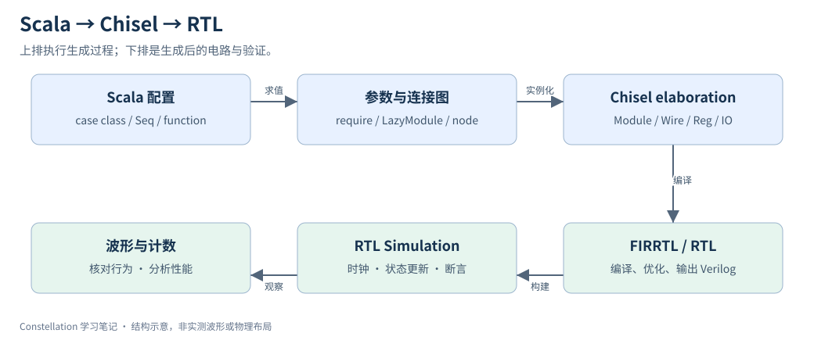

# 10｜从 Scala Configuration 到 Verilog RTL

> 更新：2026-10-22。源码基线：[`c1b42cd`](https://github.com/ucb-bar/constellation/tree/c1b42cd0c7c7d6e4fc1ed9bf1f86fbd3b31ac510)。本文按原定章节顺序展开；源码节选、教学示例与实验计划分别标明。运行版本、工具链及本次四项代表性验证见[实验复现附录](appendix-reproduction.md)；教学示意与未执行的扩展实验另行标明。

## 1. 生成阶段计算结构，运行阶段更新状态



`NoCParams` 及其函数先由 Scala 求值；Diplomacy 建立节点连接并协商参数；Chisel elaboration 建立电路表示；编译后端再输出 RTL；模拟器执行生成后的电路。图中 FIRRTL 表示该历史工程使用的硬件中间表示链路，具体工具版本取决于 standalone 或父 Chipyard 构建。

## 2. 一段代码同时包含两种“选择”

以下为固定版本的源码节选，省略外围上下文：[查看 src/main/scala/router/Router.scala 第 175–179 行](https://github.com/ucb-bar/constellation/blob/c1b42cd0c7c7d6e4fc1ed9bf1f86fbd3b31ac510/src/main/scala/router/Router.scala#L175-L179)。

```scala
    switch.io.sel := (if (routerParams.user.combineSAST) {
      switch_allocator.io.switch_sel
    } else {
      RegNext(switch_allocator.io.switch_sel)
    })
```

外层 `if (routerParams.user.combineSAST)` 的条件是 Scala Boolean，因此 elaboration 时二选一生成硬件。若为 false，`RegNext` 为选择信号插入一拍寄存；若为 true，就直接连接组合选择信号。它不是运行时可写的模式控制位。

对照看 Chisel `when(io.enq.valid)`：条件是硬件 Bool，会生成控制数据路径的逻辑。判断一段条件属于哪一层，先看类型，而不是只看它长得像 if。

| 语法 | 实际含义 | 易错点 |
| --- | --- | --- |
| `val n = 3` | Scala 常量 | 不是 3 位寄存器 |
| `3.U(4.W)` | 4 位 UInt 常量 3 | 数值与位宽分开 |
| `Wire(...)` | 组合信号 | 需完整驱动 |
| `RegInit(0.U(...))` | 有初值的寄存器 | 更新在时钟沿发生 |
| `RegNext(x)` | x 延迟一拍 | 需检查复位与有效位语义 |
| `Seq.fill(n)(Module(...))` | 生成 n 个模块实例 | 不等于运行 n 次 |
| `:=` / `<>` | Chisel 数据连接 | 先确认是否为 Diplomacy node |

## 3. 最短可复现 RTL 路径

固定版本文档给出的 Chipyard-Standalone 例子是：

```bash
# 在已准备好兼容 Chipyard 和 VCS 环境的 Linux 中运行
cd chipyard/sims/vcs
make SUB_PROJECT=constellation BINARY=none CONFIG=TestConfig00 run-binary-debug
```

生成物位于该 simulator 工作目录的 `generated-src` 下，文档示例目录为 `constellation.test.TestHarness.TestConfig00`。本命令依赖 VCS；切换到 Verilator 时应以所用 Chipyard 提交的 Makefile 和 fork 环境说明为准，不能把模拟器替换当成已验证事实。当前 `NocTests.scala` 还提供 chiseltest 测试入口，见第 17 章。

## 4. 看 RTL 时要寻找什么

先核对输入输出端口、router 数量和 channel 方向，再找 VC 状态、credit 计数和 pipeline register。编译优化可能展平模块、裁剪未用位或改名，因此不能要求每个 Scala 类都原样保留为一个 Verilog module。

练习：只改变 `combineSAST`，比较生成 RTL 中相应寄存器及波形时序；再改变 VC 数，检查位宽与实例规模。保存参数、日志和生成物路径。本轮已在实验 fork 的 Chipyard 集成环境完成增量编译及四项 Verilator / chiseltest smoke 验证；这里的 VCS 命令和 pipeline 对比方案并未执行，具体证据见实验复现附录。

## 源码与延伸阅读

以下链接均固定到本章使用的源码版本：

- [src/main/scala/router/Router.scala](https://github.com/ucb-bar/constellation/blob/c1b42cd0c7c7d6e4fc1ed9bf1f86fbd3b31ac510/src/main/scala/router/Router.scala)
- [src/main/scala/noc/NoC.scala](https://github.com/ucb-bar/constellation/blob/c1b42cd0c7c7d6e4fc1ed9bf1f86fbd3b31ac510/src/main/scala/noc/NoC.scala)
- [docs/source/Introduction/SimpleTests.rst](https://github.com/ucb-bar/constellation/blob/c1b42cd0c7c7d6e4fc1ed9bf1f86fbd3b31ac510/docs/source/Introduction/SimpleTests.rst)
- [build.sbt](https://github.com/ucb-bar/constellation/blob/c1b42cd0c7c7d6e4fc1ed9bf1f86fbd3b31ac510/build.sbt)

源码节选版权归 The Regents of the University of California，遵循 [BSD-3-Clause 许可及免责声明](/notes/constellation-notes/source-license.txt)。文字解读与教学图为专栏整理内容。

---

[上一篇](09-routing-relation.md) · [专栏导读](00-series-guide.md)

[下一篇：11｜Constellation Router 微架构](11-router-microarchitecture.md)
