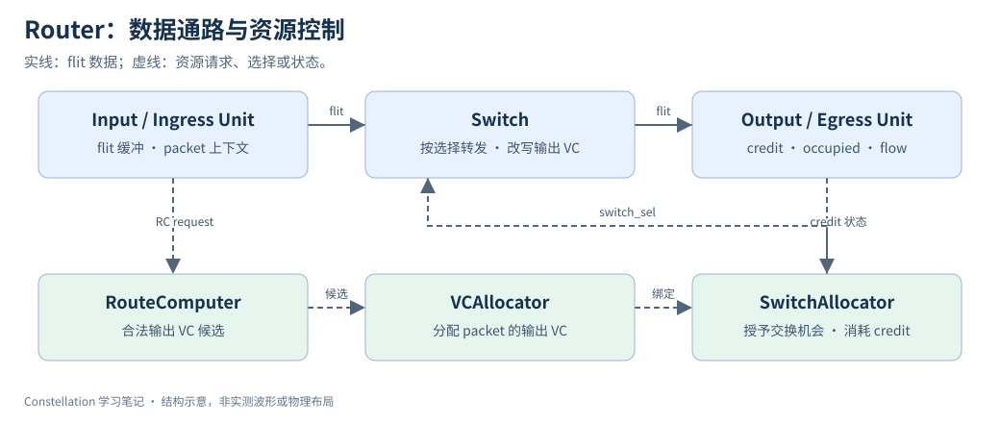
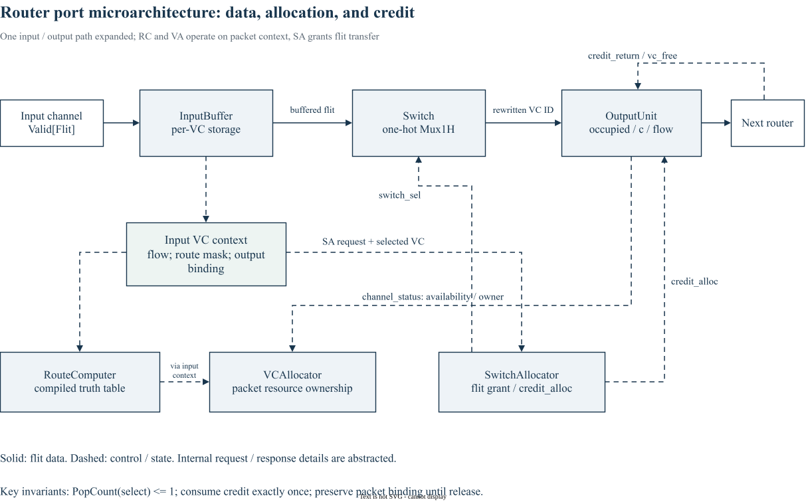

# 11｜Constellation Router 微架构

> 更新：2026-10-22。源码基线：[`c1b42cd`](https://github.com/ucb-bar/constellation/tree/c1b42cd0c7c7d6e4fc1ed9bf1f86fbd3b31ac510)。本文按原定章节顺序展开；源码节选、教学示例与实验计划分别标明。运行版本、工具链及本次四项代表性验证见[实验复现附录](appendix-reproduction.md)；教学示意与未执行的扩展实验另行标明。

## 1. Router 的控制流与数据流一起读



图中实线表示 flit 数据，虚线表示资源请求或状态。它是帮助阅读的结构图，不承诺所有报文固定经历相同拍数；终端、流水线合并和 speedup 都可能改变细节。

数据从 InputUnit 的缓冲进入 Switch，再到 OutputUnit。控制方向则是输入上下文发起路由、VC 分配和交换请求，输出资源状态返回仲裁模块。IngressUnit / EgressUnit 处理终端适配，应与普通 InputUnit / OutputUnit 区分。

## 2. 真正保存哪些状态

InputUnit 保存输入 VC 的报文上下文、输出选择和 flit；OutputUnit 保存下游每个输出 VC 的占用、flow 以及剩余 credit。head 建立路由和资源绑定，后续 flit 沿绑定发送，tail 触发释放流程。这里的“释放”必须进一步区分存储槽返还和 VC 所有权释放。

`RouteComputer` 产生合法候选，VCAllocator 结合 channel_status 决定分配，SwitchAllocator 决定数据通路使用，Switch 通过选择器输出 flit。不要把“RC 成功”“VA 成功”“SA 成功”都称为“路由完成”：它们解决不同冲突。

## 3. Chisel 如何写一个不规则 crossbar

以下为固定版本的源码节选，省略外围上下文：[查看 src/main/scala/router/Switch.scala 第 46–51 行](https://github.com/ucb-bar/constellation/blob/c1b42cd0c7c7d6e4fc1ed9bf1f86fbd3b31ac510/src/main/scala/router/Switch.scala#L46-L51)。

```scala
      val sel_flat = io.sel(i)(j).asUInt
      assert(PopCount(sel_flat) <= 1.U)
      io.out(i)(j).valid := Mux1H(sel_flat, in_flat.map(_.valid)) && sel_flat =/= 0.U
      io.out(i)(j).bits  := Mux1H(sel_flat, in_flat.map(_.bits.flit))
      io.out(i)(j).bits.virt_channel_id := Mux1H(sel_flat, in_flat.map(_.bits.out_virt_channel))
    }
```

`for` 在 elaboration 时为每个输出 lane 展开一组逻辑。`Mux1H` 根据 one-hot 选择数据；`PopCount(sel_flat)<=1.U` 是运行时断言，约束选择最多一个输入。valid 在没有选择时显式为 false；bits 在 valid=false 时不应被消费者当成有效数据。

`virt_channel_id` 被替换成分配到的输出 VC 编号，说明 VC 编号是逐跳资源标识，不要求从源到宿保持同一数字。`MixedVec` 则允许不同端口具有不同 VC 数或 speedup。

## 4. 从一个 flit 开始排查

| 现象 | 先观察 | 下一步 |
| --- | --- | --- |
| head 长时间停留 | RC mask、VA req / fire | 合法候选与 VC 所有权 |
| 已有输出 VC 仍不能发送 | credit_available、SA req | 下游 credit 与交换竞争 |
| 发出但 payload 错 | switch_sel 与输入数据相位 | SA/ST 寄存是否对齐 |
| tail 后无法发新包 | vc_free、occupied | 所有权释放链 |

练习：在两个输入争一个输出的情况下画出 head/body/tail 的时间线，逐拍标 RC、VA、SA 的请求与 fire。先记录不带竞争的基线，再加竞争，不要一开始就使用复杂 Mesh。

## 5. 按工程接口拆开的 router 通路



这张图展开一个输入和一个输出的职责，不限定 router 总端口数。实线是 flit 数据；虚线是请求、选择或资源状态，线条相交但没有连接点的地方不表示信号相连。RC 候选和 VA 绑定通过输入上下文衔接；图中省略了完整 req / resp 往返。

需要同时核对三类契约：Switch 的 one-hot 选择、OutputUnit 的 credit 消耗、packet 的输出 VC 绑定。图中的 control 箭头并不代表阶段一定各占一拍，实际拍数仍由流水线选项、仲裁与终端实现决定。

[下载可编辑 draw.io 图源](/notes/constellation-notes/pic/11-router/router-engineering-spec.drawio)

## 源码与延伸阅读

以下链接均固定到本章使用的源码版本：

- [src/main/scala/router/Router.scala](https://github.com/ucb-bar/constellation/blob/c1b42cd0c7c7d6e4fc1ed9bf1f86fbd3b31ac510/src/main/scala/router/Router.scala)
- [src/main/scala/router/InputUnit.scala](https://github.com/ucb-bar/constellation/blob/c1b42cd0c7c7d6e4fc1ed9bf1f86fbd3b31ac510/src/main/scala/router/InputUnit.scala)
- [src/main/scala/router/OutputUnit.scala](https://github.com/ucb-bar/constellation/blob/c1b42cd0c7c7d6e4fc1ed9bf1f86fbd3b31ac510/src/main/scala/router/OutputUnit.scala)
- [src/main/scala/router/Switch.scala](https://github.com/ucb-bar/constellation/blob/c1b42cd0c7c7d6e4fc1ed9bf1f86fbd3b31ac510/src/main/scala/router/Switch.scala)

源码节选版权归 The Regents of the University of California，遵循 [BSD-3-Clause 许可及免责声明](/notes/constellation-notes/source-license.txt)。文字解读与教学图为专栏整理内容。

---

[上一篇](10-configuration-to-rtl.md) · [专栏导读](00-series-guide.md)

[下一篇：12｜Wormhole Switching 与 Credit-Based Flow Control](12-wormhole-credit-flow-control.md)
