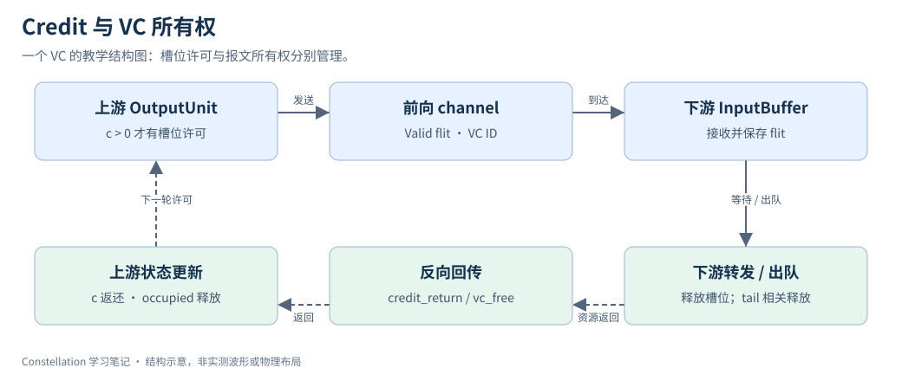
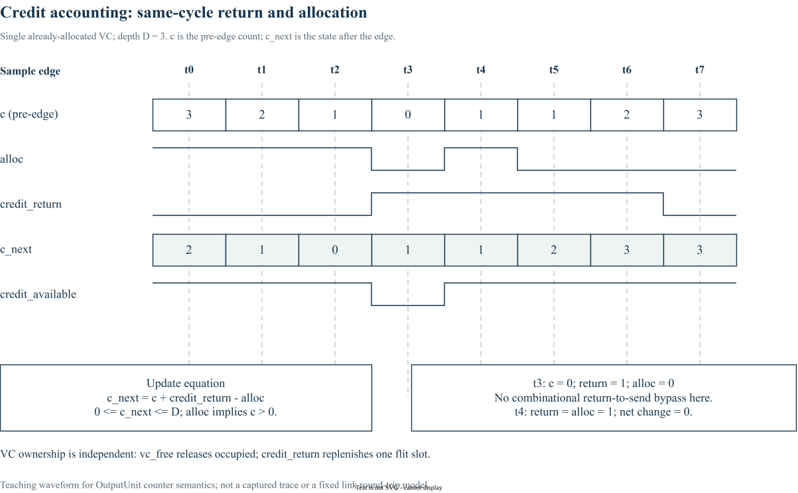

# 12｜Wormhole Switching 与 Credit-Based Flow Control

> 更新：2026-10-22。源码基线：[`c1b42cd`](https://github.com/ucb-bar/constellation/tree/c1b42cd0c7c7d6e4fc1ed9bf1f86fbd3b31ac510)。本文按原定章节顺序展开；源码节选、教学示例与实验计划分别标明。运行版本、工具链及本次四项代表性验证见[实验复现附录](appendix-reproduction.md)；教学示意与未执行的扩展实验另行标明。

## 1. Wormhole 让报文跨越多个 router

一个 packet 被拆成 head、body、tail flit；head 建立逐跳资源绑定，后面的 flit 通过已经获得的路径前进。中间 router 无需缓存完整报文才继续转发，但一个报文可能同时占用沿途多个 VC，因此下游阻塞会向上游传播。

同一个 flit 可以同时是 head 与 tail，表示单 flit packet。不能写出假定两者互斥的控制逻辑。



箭头上标注的 credit_return 返还一个 flit 槽；vc_free 释放报文级资源。它们都反向传播，但用途不同。图示只画一个 VC，实际接口是按 VC 的位图。

## 2. 源码中的 credit 守恒

以下为固定版本的源码节选，省略外围上下文：[查看 src/main/scala/router/OutputUnit.scala 第 93–98 行](https://github.com/ucb-bar/constellation/blob/c1b42cd0c7c7d6e4fc1ed9bf1f86fbd3b31ac510/src/main/scala/router/OutputUnit.scala#L93-L98)。

```scala
    val free = io.out.credit_return(i)
    val alloc = io.credit_alloc(i).alloc
    if (cParam.virtualChannelParams(i).traversable) {
      s.c := s.c +& free - alloc
    }
  }
```

对可遍历 VC，`free` 是本拍 credit 返回位，`alloc` 是本拍消耗位。简化状态方程为 `c_next=c+free-alloc`；两者同时为 1 时净变化为 0。复位代码将 c 初始化为该 VC 的 bufferSize。`+&` 产生带进位的加法中间结果，但最终寄存器位宽仍有限，不能借此自动防止非法下溢。

对深度 3 的教学 VC，若忽略其他延迟，连续三次分配使 c 从 3 降为 0；没有返回时应停止继续申请发送。之后返回一个 credit 才允许下一次消耗。这只是方程示例，具体可发送拍还取决于实现中的寄存与仲裁。

## 3. 有空槽与有 VC 是两个条件

`OutputUnit` 分别维护 `occupied` 与 `c`。某个 VC 可能仍属于旧 packet，即使它已经空出部分存储槽；新 head 不能仅因 c>0 就夺走该 VC。反过来，VC 空闲但 credit 尚未回足，也必须按发送条件行动。

修改 credit 逻辑应确保：只有真实发送或预留事件消耗槽位；同一个出队不重复返回 credit；reset 后两端容量认识一致；tail 与 vc_free 对齐。发送侧 `Valid` 接口没有 ready 来临时挽救错误发送。

## 4. Buffer 深度与往返时延

在单链路、每拍最多一个 flit、无竞争的简化模型中，若一次槽位许可从消耗到重新可用要 R 拍，D 个槽能支持的速率量级受 `min(1,D/R)` 限制。R 必须包含前向、出队和返回相关延迟；该式是 sizing 直觉，不是 Constellation 的性能预测公式。

加入 ChannelBuffer 时应分别核对 forward Pipe、credit_return ShiftRegister 与 vc_free ShiftRegister，不能只增加延迟参数却默认保持满速。练习：对深度 1、2、4 和固定返回延迟画逐拍 credit 表，检查同拍 free / alloc、tail 阻塞、复位、持续 backpressure 四种边界。

## 5. 逐拍计数：返回与消耗同时发生



每列的 c 是边沿之前的寄存器状态，c_next 是该边沿更新后的结果。例如 t3 时 c=0，虽然本拍返回一个 credit，当前实现的 `credit_available` 仍由旧 c 决定，不能在同一拍据此发出新 flit；更新后 c=1，下一拍可再次消耗。t4 的 return 和 alloc 同为 1，净变化为零。

这张图只分析一个已分配输出 VC 的 counter，不把它当成任意新 head 的准入许可。`occupied` 与 `vc_free` 仍需单独检查。返回位采用人为构造的合法事件序列，用于解释方程，不代表固定链路延迟或本次仿真的捕获波形。

[下载可编辑 draw.io 图源](/notes/constellation-notes/pic/12-flow-control/credit-accounting-timing.drawio)

## 源码与延伸阅读

以下链接均固定到本章使用的源码版本：

- [src/main/scala/router/OutputUnit.scala](https://github.com/ucb-bar/constellation/blob/c1b42cd0c7c7d6e4fc1ed9bf1f86fbd3b31ac510/src/main/scala/router/OutputUnit.scala)
- [src/main/scala/channel/Channel.scala](https://github.com/ucb-bar/constellation/blob/c1b42cd0c7c7d6e4fc1ed9bf1f86fbd3b31ac510/src/main/scala/channel/Channel.scala)
- [src/main/scala/channel/Buffer.scala](https://github.com/ucb-bar/constellation/blob/c1b42cd0c7c7d6e4fc1ed9bf1f86fbd3b31ac510/src/main/scala/channel/Buffer.scala)
- [src/main/scala/channel/Flit.scala](https://github.com/ucb-bar/constellation/blob/c1b42cd0c7c7d6e4fc1ed9bf1f86fbd3b31ac510/src/main/scala/channel/Flit.scala)

源码节选版权归 The Regents of the University of California，遵循 [BSD-3-Clause 许可及免责声明](/notes/constellation-notes/source-license.txt)。文字解读与教学图为专栏整理内容。

---

[上一篇](11-router-microarchitecture.md) · [专栏导读](00-series-guide.md)

[下一篇：13｜Virtual Channel 与 Deadlock Avoidance](13-virtual-channel-deadlock.md)
