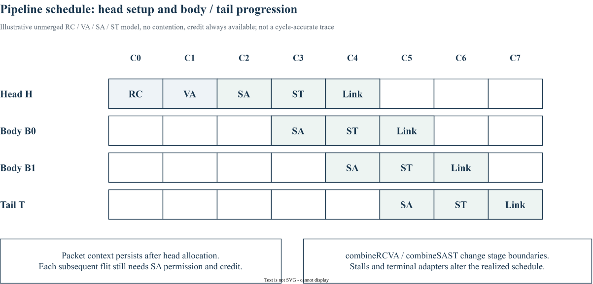

# 14｜VC Allocation、Arbitration 与 Pipeline

> 更新：2026-10-22。源码基线：[`c1b42cd`](https://github.com/ucb-bar/constellation/tree/c1b42cd0c7c7d6e4fc1ed9bf1f86fbd3b31ac510)。本文按原定章节顺序展开；源码节选、教学示例与实验计划分别标明。运行版本、工具链及本次四项代表性验证见[实验复现附录](appendix-reproduction.md)；教学示意与未执行的扩展实验另行标明。

## 1. VA 分配报文资源，SA 分配交换机会

VA（VC allocation）回答“该 packet 占用哪个输出 VC”；SA（switch allocation）回答“当前 flit 何时能通过交换结构”。已经完成 VA 的 packet，仍可能因没有 credit 或交换竞争停住。释放输出 VC 也需要沿 tail / vc_free 链完成。

在 `VCAllocator.scala` 中，req 携带 flow、输入 VC 与候选集合，channel_status 提供输出占用状态，out_allocs 建立输出侧绑定；`SwitchAllocator.scala` 则依据请求产生 credit_alloc 和 switch_sel。结合波形时以 `fire=valid&&ready` 为事务完成事件，不能只看 valid 脉冲。

## 2. 三个微架构开关的准确含义

以下为固定版本的源码节选，省略外围上下文：[查看 src/main/scala/router/Router.scala 第 17–23 行](https://github.com/ucb-bar/constellation/blob/c1b42cd0c7c7d6e4fc1ed9bf1f86fbd3b31ac510/src/main/scala/router/Router.scala#L17-L23)。

```scala
  // Combines SA and ST stages (removes pipeline register)
  combineSAST: Boolean = false,
  // Combines RC and VA stages (removes pipeline register)
  combineRCVA: Boolean = false,
  // Adds combinational path from SA to VA
  coupleSAVA: Boolean = false,
  vcAllocator: VCAllocatorParams => Parameters => VCAllocator = (vP) => (p) => new RotatingSingleVCAllocator(vP)(p)
```

| 参数 | 固定版本注释与连接体现的行为 | 实验时重点观察 |
| --- | --- | --- |
| combineRCVA | 合并 RC 和 VA，移除相应流水寄存 | RC→VA 组合路径 |
| combineSAST | 合并 SA 和 ST | 选择与 flit 数据对齐 |
| coupleSAVA | 加入 SA→VA 组合路径 | 分配耦合、关键路径 |

不要把 `coupleSAVA` 翻译成“简单合并 SA 和 VA 两拍”。它的源码契约是增加组合耦合。三个设置改变控制时序，只有在考虑频率和面积后才能判断收益。

## 3. Chisel 的握手与寄存

`Decoupled(new Req)` 定义 bits、valid、ready；`Flipped` 翻转端口方向。`RegNext` 可以保存选择结果，但如果数据或有效位没有同样对齐，会把上一拍选择用到下一拍数据。修改 pipeline 时应把 valid、payload、VC ID、tail 和 credit 消耗事件画在同一条时间线上。

SwitchArbiter 还保存锁定信息，并在输出 fire 后依据 tail 更新。它不是每拍无记忆地给所有 flit 轮询，所以仲裁公平性分析必须考虑 packet 长度、锁定和阻塞情况。

## 4. 一次可解释的对照实验

以基线为 A，只修改一个开关为 B。先测单 packet 空载逐跳时延，再用两个输入抢一个输出观察仲裁，最后扫描负载。将延迟分为 cycles 与实际时间：若 A 为 5 cycles@1 GHz，B 为 4 cycles@0.7 GHz，则时间分别为 5 ns 与约 5.71 ns。此处是教学算例，未代表该工程实测。

验收至少包括：选择 one-hot、每个 flit 只消耗一次 credit、tail 释放完整、阻塞后恢复、reset 后第一包正确。不能仅用低负载平均延迟下降来批准 pipeline 修改。

## 5. 规范级流水线示意



图中假设 RC / VA / SA / ST 不合并、无竞争且始终有 credit。head 先建立资源绑定，body / tail 不重复执行相同的路由与 VC 获取过程，但每个 flit 仍需获得交换机会。最后一列 Link 只是示意链路传输，不能用图中格数直接推算该实现的实际端到端时延。

真实 InputUnit、IngressUnit 的缓存和握手可能插入额外等待；`combineRCVA`、`combineSAST` 或 `coupleSAVA` 也会改变控制路径。应将这张示意图作为阅读波形前的事件表，再用实际 trace 校正每个阶段的边界。

[下载可编辑 draw.io 图源](/notes/constellation-notes/pic/14-pipeline/packet-pipeline-schedule.drawio)

## 源码与延伸阅读

以下链接均固定到本章使用的源码版本：

- [src/main/scala/router/Router.scala](https://github.com/ucb-bar/constellation/blob/c1b42cd0c7c7d6e4fc1ed9bf1f86fbd3b31ac510/src/main/scala/router/Router.scala)
- [src/main/scala/router/SwitchAllocator.scala](https://github.com/ucb-bar/constellation/blob/c1b42cd0c7c7d6e4fc1ed9bf1f86fbd3b31ac510/src/main/scala/router/SwitchAllocator.scala)
- [src/main/scala/router/vcalloc/VCAllocator.scala](https://github.com/ucb-bar/constellation/blob/c1b42cd0c7c7d6e4fc1ed9bf1f86fbd3b31ac510/src/main/scala/router/vcalloc/VCAllocator.scala)
- [src/main/scala/router/InputUnit.scala](https://github.com/ucb-bar/constellation/blob/c1b42cd0c7c7d6e4fc1ed9bf1f86fbd3b31ac510/src/main/scala/router/InputUnit.scala)

源码节选版权归 The Regents of the University of California，遵循 [BSD-3-Clause 许可及免责声明](/notes/constellation-notes/source-license.txt)。文字解读与教学图为专栏整理内容。

---

[上一篇](13-virtual-channel-deadlock.md) · [专栏导读](00-series-guide.md)

[下一篇：15｜TileLink / AXI4 协议支持](15-tilelink-axi4-protocol.md)
