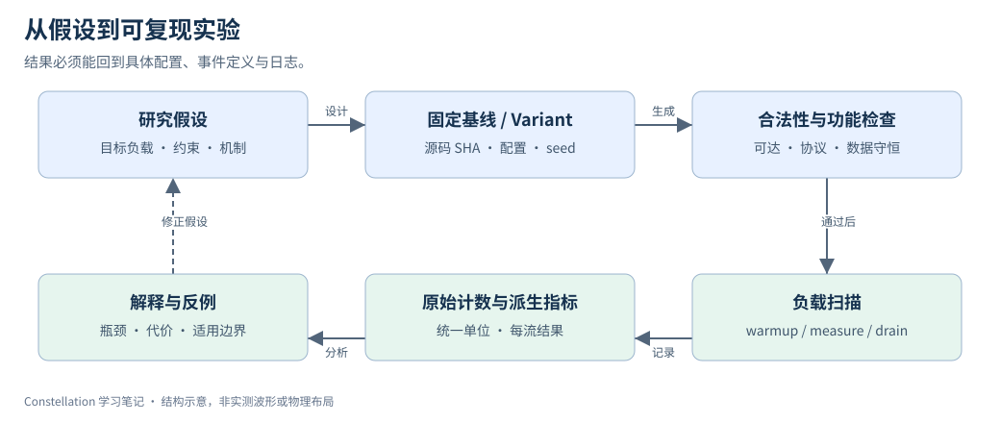

# 20｜实验设计与 Design Space Exploration

> 更新：2026-10-22。源码基线：[`c1b42cd`](https://github.com/ucb-bar/constellation/tree/c1b42cd0c7c7d6e4fc1ed9bf1f86fbd3b31ac510)。本文按原定章节顺序展开；源码节选、教学示例与实验计划分别标明。运行版本、工具链及本次四项代表性验证见[实验复现附录](appendix-reproduction.md)；教学示意与未执行的扩展实验另行标明。

## 1. 先固定比较约束

设计空间包括 topology、routing、VC 数、每 VC 深度、payload 宽度、buffer 实现和 router pipeline。把这些参数同时变化会很难解释结果。先明确比较目标：同容量、同面积、同频率、还是同协议吞吐要求。相同节点数不代表相同资源成本。



每个 variant 都从固定基线出发，依次通过结构检查、功能检查、测量与解释。图中的回边表示根据证据修改假设，不表示自动重复直到出现期望结论。

## 2. 先单因素，再研究交互

第一轮建议固定 2×2 Mesh、端点映射、routing、payload 和 packet 长度，只改变一个资源参数。第二轮才组合 VC 与 pipeline，分析交互。每个负载点单独保存配置、SHA、日志、采样窗口和终止状态。

| variant | VC × depth | 逻辑容量 / 输入物理端口 | 比较目的 |
| --- | --- | --- | --- |
| A | 2×8 | 16 slots | 基线 |
| B | 4×4 | 16 slots | 同容量下改变 VC 分割 |
| C | 4×8 | 32 slots | 增加总容量的另一组比较 |

表中是实验计划，不是实测结果。A 与 B 仍可能有不同控制面积与仲裁延迟；C 不能直接用于证明“VC 本身”的收益。

## 3. Chisel 参数扫描不等于每次都重编一切

以下为固定版本的源码节选，省略外围上下文：[查看 src/main/scala/test/TrafficEvalHarness.scala 第 87–92 行](https://github.com/ucb-bar/constellation/blob/c1b42cd0c7c7d6e4fc1ed9bf1f86fbd3b31ac510/src/main/scala/test/TrafficEvalHarness.scala#L87-L92)。

```scala
  def toConfigStr = s"""# Default generated trafficeval config
warmup                  $warmupCycles
measurement             $measurementCycles
drain                   $drainTimeoutCycles
flits_per_packet        $flitsPerPacket
required_throughput     $requiredThroughput
```

`NoCEvalParams.toConfigStr` 将运行时流量配置导出为文本。改变注入率、warmup 或 measurement 往往可重用相同生成电路；改变 topology、VC 数、buffer 深度和 pipeline 则改变 RTL，应重新 elaboration、构建并验证。要把设计参数与运行参数分开编号，以免日志混用不同 binary。

固定版本 C++ 随机引擎构造时使用固定 seed `0xdeadbeef`。多次运行相同二进制并不自动得到独立随机样本；如需多 seed 统计，应显式扩展或使用已核实的 fork 参数，保存 seed，不能声称上游配置文件已有 seed 开关。

## 4. 用 Pareto 取舍代替单一排行榜

若某方案在带宽、时延、面积三者上都不差且至少一项更好，才构成相应约束下的支配关系。若减少 cycles 却降低频率，则需要报告 ns 和 bit/s。没有综合 / 布局结果时，容量和模块数只能作为结构规模估算，不能称为面积或功耗实测。

练习：为 A/B/C 写清“固定什么、改变什么、预测什么、什么结果会推翻预测”。将失败配置保留在结果表中，附合法性或超时原因，避免只展示最好的点。

## 源码与延伸阅读

以下链接均固定到本章使用的源码版本：

- [src/main/scala/test/TrafficEvalHarness.scala](https://github.com/ucb-bar/constellation/blob/c1b42cd0c7c7d6e4fc1ed9bf1f86fbd3b31ac510/src/main/scala/test/TrafficEvalHarness.scala)
- [src/main/resources/csrc/TrafficEval.cpp](https://github.com/ucb-bar/constellation/blob/c1b42cd0c7c7d6e4fc1ed9bf1f86fbd3b31ac510/src/main/resources/csrc/TrafficEval.cpp)
- [src/main/scala/router/Router.scala](https://github.com/ucb-bar/constellation/blob/c1b42cd0c7c7d6e4fc1ed9bf1f86fbd3b31ac510/src/main/scala/router/Router.scala)

源码节选版权归 The Regents of the University of California，遵循 [BSD-3-Clause 许可及免责声明](/notes/constellation-notes/source-license.txt)。文字解读与教学图为专栏整理内容。

---

[上一篇](19-noc-performance-evaluation.md) · [专栏导读](00-series-guide.md)

[下一篇：21｜自定义 Topology](21-custom-topology.md)
