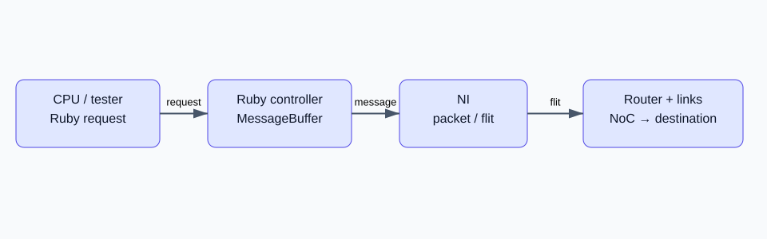

# 导读：从一条消息开始理解 Garnet

[专栏导读](00-reading-map.md) · 源码基线 `ec031fa4e9` · 更新：2026-10-23

Garnet 是 gem5 Ruby 内存系统里的详细互连模型。学习目标是解释“一条请求为什么在这里等待”，并能把等待定位到 NI、VC、仲裁、链路或目的端。先跑通网络独立测试，再读路由器代码，最后回到论文讨论系统反馈。

本系列固定 fork 提交 `ec031fa4e97945c426244566fd6196c7cb2b8e7c`，对应 gem5 **26.0.0.0**；源码目录为 `src/mem/ruby/network/garnet/`，启动日志打印 Garnet 3.0。资料中 Garnet、Garnet 2.0、Garnet 3.0 的名字不能代替版本号。服务器上已有专用构建，本系列在 2026-10-23 重新运行七组实验。

## 推荐阅读顺序

| 章节 | 要回答的问题 | 阅读后动手做什么 |
|---|---|---|
| 01 环境与实验 | 如何确认自己跑的是同一个模型？ | 保存 build-info、config.ini、stats.txt |
| 02 消息与网络接口 | packet、flit、vnet、VC 是什么关系？ | 算出 72 字节消息需要多少 flit |
| 03 路由器 | 为什么同一个输出不能同时服务所有输入？ | 沿 wakeup 跟踪一个 head flit |
| 04 路由与流控 | 有空 buffer 为什么仍可能发不出去？ | 区分 credit 和 VC 空闲信号 |
| 05 实测分析 | 延迟上升发生在哪里？ | 对照七组结果改变一个参数 |
| 06 原论文 | 网络优化为什么不等于程序等比例加速？ | 将网络指标与应用指标分开解释 |

图为本系列自行绘制，箭头描述消息/数据方向；credit 沿独立反向通道返回。可编辑图源见 [system.drawio](/notes/garnet-notes/pic/system.drawio)。standalone 测试使用 tester 和简化协议控制器替代真实 CPU/cache 工作负载；图中的完整层次用于说明真实 Ruby 系统的位置，不能把 standalone 的结果解释为应用性能。

## 资料与使用边界

代码分析以固定提交为准。官方文档用于概念说明，旧教程中的 `garnet2.0` 参数和目录需要重新核对。本系列借鉴本站 BookSim、Constellation 专栏的“概念—源码—实验—练习”组织方式；文字与示意图为学习整理，论文、源码及外部教程权利归原作者。

- Agarwal, Krishna, Peh, Jha，*GARNET: A Detailed On-Chip Network Model inside a Full-System Simulator*，ISPASS 2009，pp. 33–42，[DOI](https://doi.org/10.1109/ISPASS.2009.4919636)。本地阅读依据为 `ref/` 中用户提供的 PDF，不另行复制论文插图。
- [gem5 官方 Garnet 文档](https://www.gem5.org/documentation/general_docs/ruby/garnet-2/)：适合理解组件与术语；示例版本较旧。
- [官方 Synthetic Traffic 文档](https://www.gem5.org/documentation/general_docs/debugging_and_testing/directed_testers/garnet_synthetic_traffic/)：理解注入器，时间语义仍须检查当前代码。
- [Tushar Krishna 的 Garnet 教学入口](https://tusharkrishna.ece.gatech.edu/teaching/garnet_gt/)：原作者团队的实验教程，可作为延伸阅读，本文命令以固定版本实测为准。

[下一篇：环境与第一次实验：确认版本、时钟和输出](01-build-and-run.md)
