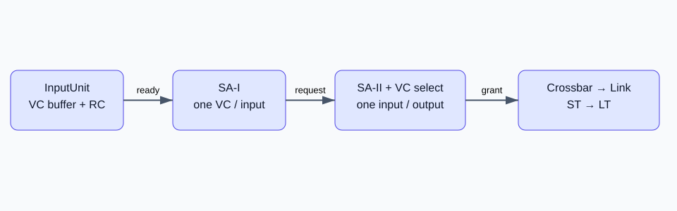

# 路由器源码：从输入缓冲到交换分配

[专栏导读](00-reading-map.md) · 源码基线 `ec031fa4e9` · 更新：2026-10-23



图中是逻辑步骤，不是五个独立时钟阶段。[可编辑 draw.io 图源](/notes/garnet-notes/pic/router.drawio)。

## wakeup 的执行顺序

`Router::wakeup()` 依次唤醒输入单元、输出单元，再执行 switch allocator 和 crossbar。输出单元先消费返回 credit，使后面的仲裁能使用更新后的可用资源信息。gem5 是事件驱动模拟器；对象按时间戳唤醒，不是每个对象都必须在每一拍执行。

`InputUnit::wakeup()` 消费到达的 flit。HEAD/HEAD_TAIL 要求输入 VC 为 IDLE，将其设为 ACTIVE，执行 `route_compute()`，把输出端口保存在 VC 中。BODY/TAIL 沿用包头的路由结果。所有 flit 进入输入 VC 队列。

```cpp
Cycles pipe_stages = m_router->get_pipe_stages();
if (pipe_stages == 1) {
    t_flit->advance_stage(SA_, curTick());
} else {
    Cycles wait_time = pipe_stages - Cycles(1);
    t_flit->advance_stage(SA_, m_router->clockEdge(wait_time));
    m_router->schedule_wakeup(Cycles(wait_time));
}
```

`--router-latency=4` 使 flit 在 buffer 多等 3 个 router 周期才有资格参与 SA。它没有自动创建四个可以独立配置的真实 RTL stage；仲裁竞争仍可能继续增加延迟。

## 两级可分离仲裁

`SwitchAllocator::wakeup()` 调用 `arbitrate_inports()` 和 `arbitrate_outports()`。第一级每输入端口从符合条件的 VC 中选择一个候选，向所需输出提出请求。第二级每输出端口从请求它的输入中选择一个胜者。这样同时满足每输入、每输出至多一次 crossbar 传输的约束，但局部选择不保证全局最大匹配。

HEAD 的输出 VC 在第二级胜出后经 `vc_allocate()` 分配；当前实现没有一个单独的 VCAllocator stage。HEAD 发出后，本包后续 flit 继承已绑定的 outvc。胜出的 flit 从输入队列移出、扣减下游 credit、交给 crossbar，并向上游返回本地槽位 credit。

默认轮询仲裁也受到 ordered vnet 约束：同一输入、同一有序 vnet 内，更早到达且争同一输出的包可能阻挡后来的包。看到有 credit 却没发出时，应检查 SA 就绪时间、输出 VC 可用性、顺序条件和两级仲裁结果。

## 一个简化时间线

假设单周期 router、无竞争、无跨时钟桥接：flit 到达输入后可在此次 router wakeup 参与 SA 和 ST，后续由链路事件送至下一 router。链路延迟要另外计入；credit 还要沿反向链路传播。因此不能把“单周期 router”当作“端到端一周期”。具体 tick 用 RubyNetwork debug trace 核对，别从函数数量推导周期数。

## 对照源码

- [Router::wakeup](https://github.com/hujian404/gem5/blob/ec031fa4e97945c426244566fd6196c7cb2b8e7c/src/mem/ruby/network/garnet/Router.cc)
- [InputUnit::wakeup](https://github.com/hujian404/gem5/blob/ec031fa4e97945c426244566fd6196c7cb2b8e7c/src/mem/ruby/network/garnet/InputUnit.cc)
- [两级交换仲裁](https://github.com/hujian404/gem5/blob/ec031fa4e97945c426244566fd6196c7cb2b8e7c/src/mem/ruby/network/garnet/SwitchAllocator.cc)

[下一篇：XY 路由与 credit：路径和前进条件](04-routing-credit.md)
