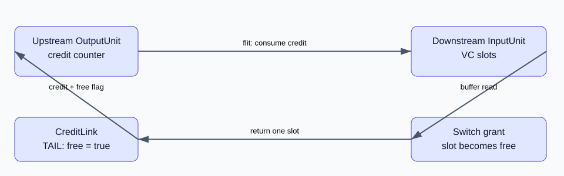

# XY 路由与 credit：路径和前进条件

[专栏导读](00-reading-map.md) · 源码基线 `ec031fa4e9` · 更新：2026-10-23

## 拓扑和算法是两层配置

`configs/topologies/Mesh_XY.py` 创建 router、外部链接和内部链接，并配置方向和权重。`RoutingUnit::outportCompute()` 则按 `routing_algorithm` 选择表路由、坐标 XY 或 custom。目标已在本 router 时，仍用路由表寻找确切本地 NI 端口，因为一个 router 可以连多个 NI。

坐标 XY 用 `x=id%num_cols`、`y=id/num_cols`。只要 X 尚有距离就先走 East/West，X 相同后才走 North/South。例如 4×4 mesh 从 R0 到 R10：`0→1→2→6→10`，4 条内部链路。此源码把 y 增大方向称为 North，画图时应声明坐标，不能由屏幕朝向猜端口名。

维序路由限制通道依赖，有助于避免 mesh 路由层死锁；这不等于任意协议、buffer 分配、跨网络依赖都无死锁。更改 custom 算法前应写出依赖关系，而不是仅检查路径能到达。

## credit 和空闲 VC 信号分别解决什么问题

[可编辑图源](/notes/garnet-notes/pic/credit.drawio)。credit 表示下游 buffer 可用槽位，free signal 表示包对 VC 的占用已经结束。两者不能混为一谈。

1. 上游 `OutputUnit` 记录下游输入 VC 的空闲状态及剩余槽位。
2. 发送一个 flit 就消费一个 credit；没有 credit 不能继续写下游。
3. 下游 flit 赢得交换并离开输入 buffer，`InputUnit::increment_credit()` 才把槽位归还上游。
4. 普通 flit 返回 `free_signal=false`；TAIL/HEAD_TAIL 返回 `true`。上游收到后才能将对应 outvc 重新视为 IDLE，供下一个包分配。

`SwitchAllocator::send_allowed()` 对尚未绑定 outvc 的包头检查 `has_free_vc(vnet)`；空闲 VC 至少有一个槽位，无需另外检查 credit。已经有 outvc 的 flit 检查 `has_credit(outvc)`，随后还有 ordered vnet 的顺序检查。满足这些条件只获得请求资格，仍可能输掉仲裁。

## 为什么增加 VC 不一定提高带宽

更多 VC 可以缓解部分队头阻塞，但共享物理输出仍只能按链路能力发送。若路径、交换带宽或目的端成为瓶颈，VC 数增加不会使吞吐按比例增长。credit 往返时延较长而 buffer 很浅时，即使没有别的竞争者也可能出现流水气泡；需要分清资源容量、资源占用和传播延迟。

v26 的 `--per-vnet-links` 为不同 vnet 建立独立内部链接。4×4 mesh 的有向邻接数为 `2×(4×3+4×3)=48`，三个 vnet 对应 144 个内部 link 对象。这增加了网络资源，实验比较必须同时报告链路数量，不能据此宣称同面积性能提升。

## 对照源码

- [Mesh_XY 拓扑](https://github.com/hujian404/gem5/blob/ec031fa4e97945c426244566fd6196c7cb2b8e7c/configs/topologies/Mesh_XY.py)
- [坐标 XY 与 vnet 端口](https://github.com/hujian404/gem5/blob/ec031fa4e97945c426244566fd6196c7cb2b8e7c/src/mem/ruby/network/garnet/RoutingUnit.cc)
- [credit 接收](https://github.com/hujian404/gem5/blob/ec031fa4e97945c426244566fd6196c7cb2b8e7c/src/mem/ruby/network/garnet/OutputUnit.cc)
- [send_allowed](https://github.com/hujian404/gem5/blob/ec031fa4e97945c426244566fd6196c7cb2b8e7c/src/mem/ruby/network/garnet/SwitchAllocator.cc)

[下一篇：七组实测：负载、流水和链路资源](05-results.md)
