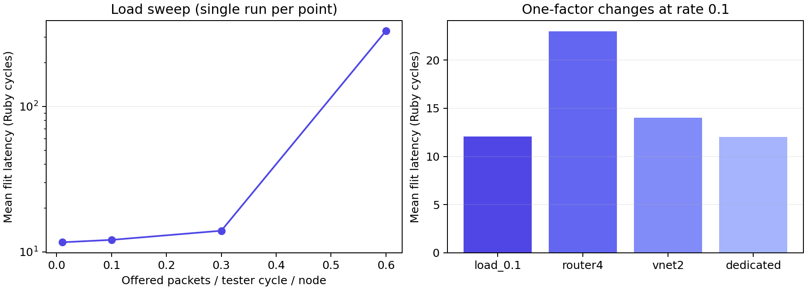

# 七组实测：负载、流水和链路资源

[专栏导读](00-reading-map.md) · 实验日期：2026-10-23

## 配置与复现

七组实验均在现有 Linux 服务器重新运行，使用 gem5 26.0.0.0 专用 Garnet_standalone 构建，源码提交 `ec031fa4e97945c426244566fd6196c7cb2b8e7c`。公共配置为 16 tester、16 directory、4×4 Mesh_XY、显式坐标 XY、128 bit 链路、默认每 vnet 4 VC、控制/数据 VC 深度 1/4。默认随机 vnet，除 vnet2 对照外不固定消息类型。

每组停止阈值 50,000,000 tick，实测 50 微秒、50,000 tester 周期、100,000 Ruby 周期。只使用配置默认随机种子的一次运行，无预热窗口、无独立测量窗口、无最终 drain。结果用于学习机制和复现基线，不能作为稳态饱和吞吐的最终结论。

下载 [运行脚本](/notes/garnet-notes/scripts/run_experiments.py)，在固定提交的 gem5 根目录执行：

```bash
python3 /path/to/run_experiments.py ../results/my-new-campaign
```

输出目录必须尚不存在，避免覆盖结果。脚本按七组配置逐个运行，检查结束原因与有限的统计值；保留每组命令、实际时钟和内部链接数，计算二进制 SHA-256。

- [原始证据包：七组 stats.txt / config.ini / config.json / stdout.log](/notes/garnet-notes/results/blog-20261023-01.tar.gz)
- [机器可读汇总与 build-info](/notes/garnet-notes/results/summary.json)

证据包保留宿主绝对路径与 gem5 原始命令；复现时替换为自己的目录。build-info 表示编译时的选项，与 preset 的声明应分别查看，不能仅从二进制目录名推断构建特性。

## 结果

所有延迟原始单位为 tick，除以实际 Ruby 周期 500 tick 后得到下表。network 和 queueing 的逐 flit 平均之和是 total；packet latency 在尾 flit 完成时统计，与逐 flit 平均不能互换。

| 实验 | 注入率 | 内部 links | 注入 / 接收 flit | network / queueing / total（Ruby 周期） |
|---|---:|---:|---:|---:|
| load_0.01 | 0.01 | 48 | 19073 / 19072 | 9.626 / 2.000 / 11.626 |
| load_0.1 | 0.1 | 48 | 186588 / 186580 | 10.078 / 2.000 / 12.078 |
| load_0.3 | 0.3 | 48 | 557877 / 557805 | 11.950 / 2.012 / 13.962 |
| load_0.6 | 0.6 | 48 | 1110135 / 1109713 | 35.419 / 295.130 / 330.550 |
| router4 | 0.1 | 48 | 186588 / 186556 | 20.965 / 2.000 / 22.965 |
| vnet2 | 0.1 | 48 | 399785 / 399738 | 12.029 / 2.009 / 14.038 |
| dedicated | 0.1 | 144 | 186588 / 186580 | 10.015 / 2.000 / 12.015 |



图由保存的 summary.json 生成；[绘图及表格生成脚本](/notes/garnet-notes/scripts/render_results.py)。左图采用对数纵轴，没有误差条，因为每个点仅运行一次。

## 如何解释

负载 0.01→0.1→0.3 时延迟逐步上升；0.6 时等待明显放大，需要结合 queueing、network 和注入/接收差值观察。这里只能说出现明显拥塞迹象，不能由四个点确定饱和拐点。平均延迟仅覆盖已收到的 flit；仍在排队或在途的 flit 没有进入接收端延迟平均。

router4 仅增加 `--router-latency=4`。相比 0.1 基线，增加的是每个经过 router 的就绪等待，实际端到端差值还受争用与路径分布影响，不能简单乘一个固定平均跳数就宣称完全解释结果。

vnet2 仅增加 `--inj-vnet=2`，同样 packet 生成概率下全部为五 flit 数据包，相比混合 vnet 增加链路压力。随机数调用路径也可能改变后续目的序列，不能假定两组逐包目的地严格配对。

dedicated 仅增加 `--per-vnet-links`，内部链接由 48 变为 144。低负载下延迟改善很小不奇怪：基线本就没有很强的资源竞争。它消耗更多物理链接资源，不能作为同成本性能结论。

## 指标回到代码

固定提交的 `NetworkInterface::incrementStats()` 使用以下定义：

```cpp
network_delay = dequeue_time - enqueue_time - cyclesToTicks(Cycles(1));
queueing_delay = src_delay + (curTick() - dequeue_time);
```

这里 enqueue/dequeue 是 flit 在 NI 相关时间戳；network delay 包含网络内排队和序列化等，不是纯链路传播延迟。queueing 包含源端消息等待与目的端交付等待。看见 queueing=2 Ruby 周期不意味着每个 router 都等待 2 周期。

注入数减接收数不等于丢包：测试到阈值直接停止，仍可能有 flit 在途。这个差值也未包含所有尚未成功注入网络的 offered 请求，不能把它当作完整系统 backlog。

练习：从某组 config.ini 找到时钟和路由器 latency，再手算一个统计值的单位换算。然后固定单 flit vnet、多个 seed、更长窗口重复注入率扫描，检验曲线是否收敛。该扩展属于后续实验，本文没有声称已经完成。

[统计实现源码](https://github.com/hujian404/gem5/blob/ec031fa4e97945c426244566fd6196c7cb2b8e7c/src/mem/ruby/network/garnet/NetworkInterface.cc)

[下一篇：重读 GARNET 原论文](06-paper-and-next-steps.md)
